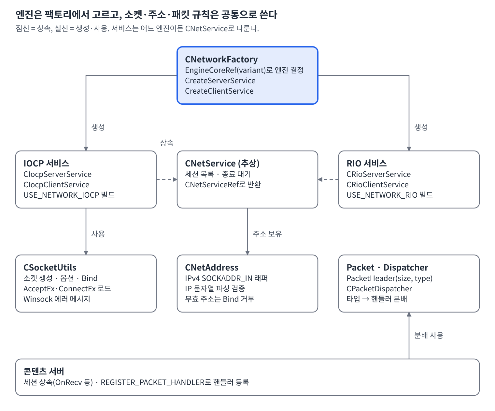
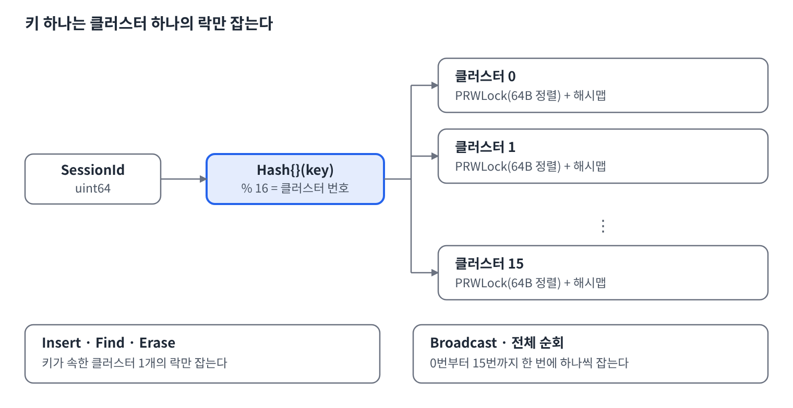
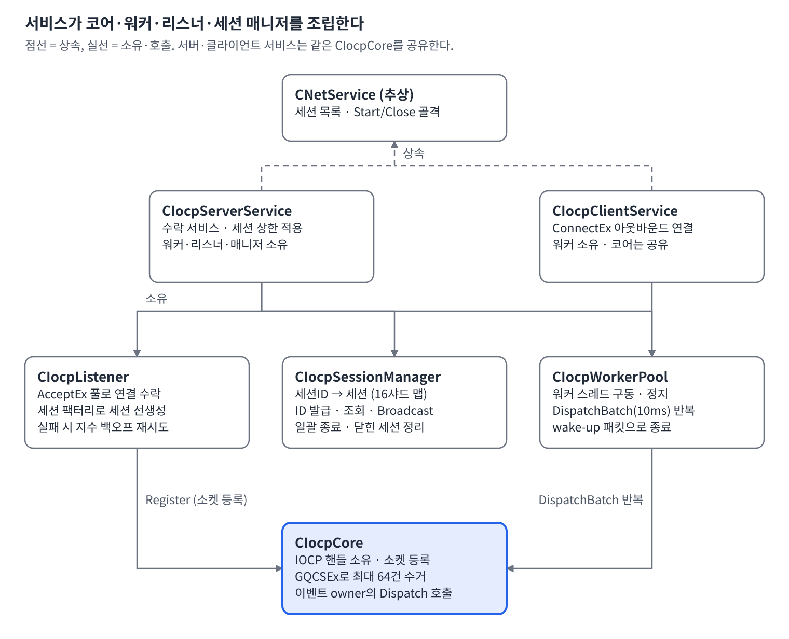
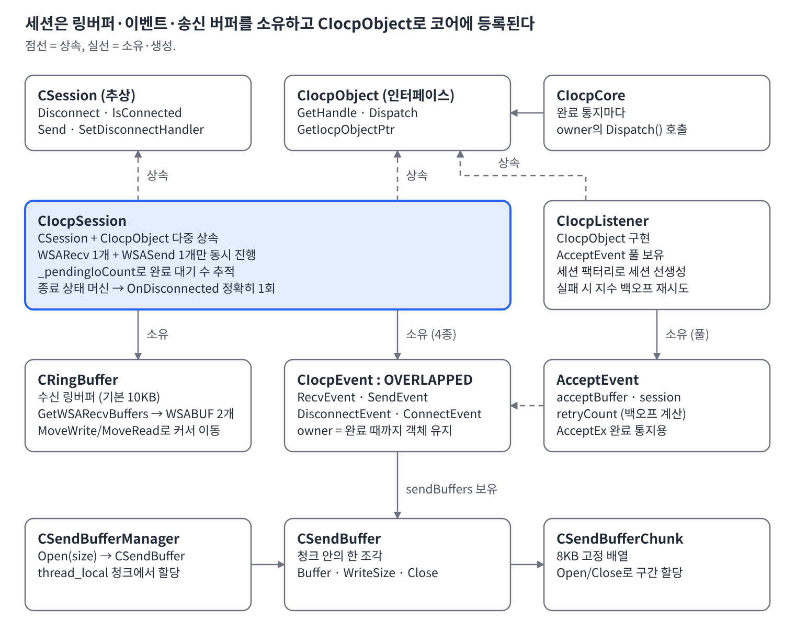
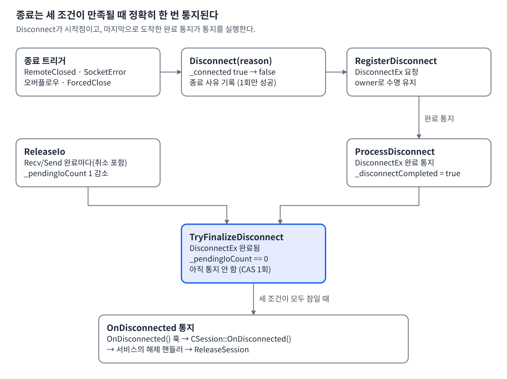

# IOCP 네트워크 계층 기술 가이드

Oct 13, 2026 · @성준

## 개요

UtilCore의 IOCP 계층은 Windows 완료 포트(IOCP) 위에서 서버·클라이언트 TCP 세션을 비동기로 처리하는 `Iocp` 네임스페이스 라이브러리이며, `CIocpCore`(완료 큐) · `CIocpListener`(수락) · `CIocpSession`(송수신·종료) · `CIocpWorkerPool`(워커)이 네 축을 이룬다.

**설계 목표**

- **세션당 I/O 1+1**: 세션마다 WSARecv 1개와 WSASend 1개만 동시에 걸어 순서와 버퍼 소유권을 단순하게 유지한다.
- **수명 안전**: 모든 OVERLAPPED(`CIocpEvent`)가 `owner` shared\_ptr로 객체를 붙잡아, 소켓이 닫혀도 완료 통지가 도착할 때까지 해제되지 않는다.
- **syscall 절감**: `GetQueuedCompletionStatusEx`로 한 번에 최대 64개(`kBatchSize`) 완료를 수거한다.
- **복사 최소화**: 수신은 링버퍼에 직접 WSARecv(WSABUF 2개), 송신은 8KB 청크의 Scatter-Gather로 보낸다.
- **락 경합 분산**: 세션 맵을 16개 클러스터(`kSessionClusterCnt`)로 나눠 샤딩한다.
- **안전한 종료**: `_pendingIoCount`가 0이 되고 DisconnectEx 완료가 처리된 뒤에야 `OnDisconnected`를 단 한 번 통지한다.

## 공통 네트워크 기반 클래스

`Network` 폴더 바로 아래의 파일들은 IOCP와 RIO 두 엔진이 함께 쓰는 공통 계층이다. IOCP 세션·리스너는 `CSocketUtils`로 소켓을 만들고, 서비스는 `CNetAddress`를 들고 있으며, `CNetworkFactory`가 엔진에 맞는 서비스를 만든다. 패킷 규칙(`Packet.h`, `CPacketDispatcher`)은 엔진과 무관하다. `CNetService`·`CSession`·`CRingBuffer`는 뒤의 ‘클래스별 상세’에서 설명한다.



*그림 1. 엔진 선택과 공통 기반 클래스 · 팩토리·소켓·주소·패킷* ([SVG](md_images/01/01-engine-common-base.svg))

### 헤더 파일 구성 (NetworkCommon.h, NetworkRedefineDataType.h)

| 파일 | 역할 |
| --- | --- |
| `NetworkCommon.h` | 네트워크 모듈의 대표 include. `ws2_32`·`mswsock` 라이브러리를 링크하고, 공통 헤더(`NetAddress`, `SocketUtils`, `RingBuffer`, `Session`, `NetService`, `Packet`, `PacketDispatcher`)를 포함한다. 이어 `USE_NETWORK_IOCP`가 정의되면 `IOCP/` 헤더 9개, `USE_NETWORK_RIO`가 정의되면 `RIO/` 헤더를 포함하고, 마지막에 `NetworkFactory.h`를 포함한다. |
| `NetworkRedefineDataType.h` | `CSession`, `CNetService`, `CIocpCore`, `CIocpSession`, `CSendBuffer`, `CRioSession`, `CHttpClient` 등 네트워크 클래스의 `shared_ptr` 별칭(`CIocpCoreRef` 형태)을 `USING_SHARED_PTR`로 선언한다. 전방 선언만 있어 헤더 간 순환 참조를 피한다. |

### 파일별 설명 (공통 기반)

`Network/` 바로 아래 파일 16개(.h 10개, .cpp 6개)의 역할이다. 구분 열은 파일이 맡은 영역이고, 구현 함수는 `.cpp`에 정의된 멤버 함수 이름이다.

| 파일 | 구분 | 선언 | 역할과 구현 내용 |
| --- | --- | --- | --- |
| `NetAddress.h/.cpp` | 주소 | `CNetAddress` | `SOCKADDR_IN`을 감싼 IP/포트 값 타입. `.cpp`에는 생성자 2개와 `GetIpAddress`가 있고, 잘못된 주소는 `IsValid()`가 false로 알린다. |
| `SocketUtils.h/.cpp` | 소켓 유틸 | `CSocketUtils`, `ListenAddressMode`, `_WINSOCK_ERRORCODE_INFO` | 정적 메서드만 가진 소켓 도구함. `Init`/`Clear`(WSAStartup과 확장 함수 로드), 소켓 생성 4종(TCP·UDP·RIO TCP·RIO UDP), 옵션 설정(`SetReuseAddress`·`SetLinger`·`SetNoDelay`·`SetKeepAlive`·버퍼 크기 등), `Bind`/`Listen`/`Connect`/`Accept`/`Close`/`CloseGraceful`, `AcceptEx`·`ConnectEx`·`DisconnectEx` 래퍼, 주소 변환, 영문·한글 WinSock 에러 메시지(`ReportError`)를 구현한다. |
| `NetService.h/.cpp` | 서비스 | `NetServiceType`, `CNetService` | 서비스 공통 기반. 세션 컨테이너(`CVector<CSessionRef>`)를 관리하는 `CreateSession`·`AddSession`·`ReleaseSession`·`GetSession`·`GetSessionsSnapshot`·`GetCurrentSessionCount`와, 종료용 `Close`·`CloseSessions`·`WaitForSessionsEmpty`를 구현한다. `Start`는 파생 클래스가 구현한다. |
| `Session.h` | 세션 | `SessionFactory`, `DisconnectHandler`, `CSession` | 엔진과 무관한 세션 인터페이스. `.cpp` 없이 헤더만 있다. `Disconnect`·`IsConnected`·`GetSocket`·`Send`가 순수 가상 함수다. |
| `RingBuffer.h/.cpp` | 버퍼 | `CRingBuffer` | `BaseAllocator`를 상속한 링버퍼. `Enqueue`·`Dequeue`·`Peek`와 IOCP용(`GetWSARecvBuffers`·`GetWSASendBuffers`), RIO용(`GetRioRecvBuffers`·`GetRioSendBuffers`) 버퍼 조각 계산을 구현하고, 복사 대신 이동 생성자·대입 연산자를 제공한다. |
| `Packet.h` | 패킷 | `PacketHeader` | `size`·`type` 각 `uint16`인 패킷 헤더. 헤더만 있는 파일이다. |
| `PacketDispatcher.h/.cpp` | 패킷 | `PacketHandler`, `EPacketDispatchResult`, `CPacketDispatcher`, `PacketRegistrar`, `REGISTER_PACKET_HANDLER` | 패킷 타입별 핸들러 테이블. `.cpp`에는 `GetTable`(함수 내부 정적 테이블)·`Register`·`Dispatch`가 있고, 매크로가 정적 객체 `PacketRegistrar`로 핸들러를 자동 등록한다. |
| `NetworkFactory.h/.cpp` | 엔진 팩토리 | `ENetworkEngineType`, `EngineCoreRef`, `CNetworkFactory` | 엔진 종류에 맞는 서비스를 만든다. `.cpp`에는 `CreateServerService`와 `CreateClientService` 두 함수뿐이며, `std::visit`로 IOCP·RIO를 분기한다. |
| `NetworkCommon.h` | 헤더 구성 | (선언 없음) | 대표 include. `ws2_32`·`mswsock` 링크, 공통 헤더, `USE_NETWORK_IOCP`/`USE_NETWORK_RIO`에 따른 엔진 헤더 포함을 한다. |
| `NetworkRedefineDataType.h` | 헤더 구성 | `USING_SHARED_PTR` 선언들 | 네트워크 클래스의 `shared_ptr` 별칭(`...Ref`) 모음. 전방 선언만 두어 헤더 순환을 피한다. |

### CNetAddress — IPv4 주소 (NetAddress.h/.cpp)

`SOCKADDR_IN`을 감싼 IP/포트 변환 래퍼다. IP 문자열이 잘못되면 주소는 0.0.0.0으로 남고 `IsValid()`가 false가 되어, `CSocketUtils::Bind`·`Connect`가 이 주소를 거부한다(서버가 의도치 않게 모든 인터페이스에 열리는 것을 막는다).

| 멤버 | 설명 |
| --- | --- |
| `_sockAddr` (`SOCKADDR_IN`) | IP·포트·패밀리 정보 |
| `_valid` (`bool`) | IP 문자열 파싱 성공 여부 |
| `CNetAddress(const SOCKADDR_IN&)` | 암시적 변환을 쓰는 호출부가 있어 `explicit`이 아니다. |
| `CNetAddress(ip, port)` | 문자열 IP와 포트로 생성 |
| `IsValid()` | 사용 가능한 주소인지 |
| `GetSockAddr()` (const / non-const) | 내부 `SOCKADDR_IN` 참조 |
| `GetIpAddress()` / `GetPort()` | IP 문자열 / 포트(호스트 바이트 순서) |
| `TryIp2Address(ip, out)` (static) | 문자열 → `IN_ADDR`. 실패 시 false |
| `Ip2Address(ip)` (static) | 실패 시 0.0.0.0을 반환하고 에러 로그를 남긴다. 성공 여부가 필요하면 `TryIp2Address`를 쓴다. |

### CSocketUtils — 소켓 유틸리티 (SocketUtils.h/.cpp)

소켓 생성·옵션·Bind/Listen/Close와 `AcceptEx`·`ConnectEx`·`DisconnectEx` 확장 함수 래핑을 모은 static 클래스다. RIO 소켓을 만드는 것까지만 담당하고, RIO 함수 테이블은 `CRioCore`가 로드한다. 확장 함수 포인터는 `Init()`에서 단일 스레드로 한 번만 로드한다는 전제라, 서버 시작 시 다른 스레드가 뜨기 전에 호출해야 한다.

| 멤버 변수 (static) | 설명 |
| --- | --- |
| `_acceptEx`, `_getAcceptExSockAddrs`, `_connectEx`, `_disconnectEx` | `Init()`이 로드한 확장 함수 포인터. 로드되기 전에 `AcceptEx`를 부르면 `ASSERT_CRASH`. |
| `_errTableEn`, `_errTableKr` | Winsock 에러 코드 → 설명 문자열(영문·한글) 테이블 |
| `kAcceptExAddrLen` | `sizeof(sockaddr_in) + 16`. AcceptEx 주소 버퍼 크기 상수 |

| 분류 | 함수 | 설명 |
| --- | --- | --- |
| 초기화 | `Init()` | `WSAStartup(2.2)` → 임시 overlapped 소켓으로 AcceptEx·GetAcceptExSockaddrs·ConnectEx·DisconnectEx 포인터 바인딩 → 임시 소켓 닫기. 중간에 실패하면 `WSACleanup` 후 false |
|  | `Clear()` | `WSACleanup` |
| 소켓 생성 | `CreateSocket` / `CreateUdpSocket` | IPv4, `WSA_FLAG_OVERLAPPED` 소켓(IOCP용) |
|  | `CreateRioSocket` / `CreateRioUdpSocket` | `WSA_FLAG_REGISTERED_IO`를 추가한 RIO용 소켓 |
| 옵션 | `SetReuseAddress` · `SetExclusiveAddrUse` · `ApplyListenAddressMode` | Listen 소켓 주소 바인딩 방식. `ListenAddressMode`는 `ReuseAddress`(기본) · `ExclusiveAddrUse` · `None` |
|  | `SetLinger` · `SetNoDelay` · `SetRecvBufferSize` · `SetSendBufferSize` | 일반 소켓 옵션 |
|  | `SetKeepAlive(enable, idleMs, intervalMs)` | `SO_KEEPALIVE`를 켜고, `idleMs`가 0이 아니면 `SIO_KEEPALIVE_VALS`로 주기를 설정 |
|  | `SetUpdateAcceptContext` · `SetUpdateConnectContext` | AcceptEx·ConnectEx 완료 후 소켓 컨텍스트 갱신 |
|  | `GetSocketError` | `SO_ERROR` 조회 |
| 연결·종료 | `Connect` · `Bind` · `Listen` | 무효한 `CNetAddress`는 거부 |
|  | `Close` | 유효한 소켓이면 `closesocket`. 세션 소멸자가 쓴다. |
|  | `CloseGraceful(socket, how)` | `shutdown` 후 `closesocket`. 이미 끊긴 경우(`WSAENOTCONN`)는 정상으로 보고, `INVALID_SOCKET`이면 아무것도 하지 않고 true |
| IOCP 확장 | `AcceptEx` · `GetAcceptExSockaddrs` · `ConnectEx` · `DisconnectEx` | 로드된 포인터를 호출하는 래퍼 |
| RIO용 accept | `SetNonBlocking` · `Accept` | blocking-accept 모델용 |
| 주소 | `IPToAddr` · `AddrToIP` · `IPv4ToIPv6` · `GetSockAddrIn` · `FreeSockAddrIn` · `GetPeerAddress` · `GetLocalAddress` | IP 변환, 호스트 조회(`FreeSockAddrIn`으로 해제), 상대·로컬 주소 조회 |
| 에러 | `GetErrMsgToWinsockErrCodeEn/Kr` · `ReportError` | 에러 코드를 설명 문자열로 변환하고 로그로 남김 |

### CNetworkFactory — 엔진 선택 팩토리 (NetworkFactory.h/.cpp)

멤버 변수가 없는 static 팩토리다. 엔진 종류를 따로 받지 않고 `EngineCoreRef = variant<CIocpCoreRef, CRioCoreRef>`에 담긴 코어의 종류로 `std::visit`에서 분기하므로, 종류와 코어가 어긋난 조합이 생길 수 없다. `ENetworkEngineType`(IOCP, RIO)는 클라이언트·테스트 코드가 엔진을 고를 때 쓰는 열거형이다.

| 함수 | 설명 |
| --- | --- |
| `CreateServerService(engineCore, address, factory, maxSessionCount = 1, workerThreadCount = 0)` | IOCP 코어면 `CIocpServerService`, RIO 코어면 `CRioServerService`를 만들어 `CNetServiceRef`로 반환 |
| `CreateClientService(...)` | 같은 방식으로 클라이언트 서비스 생성 |

담긴 코어가 null이거나 해당 엔진이 빌드 구성(`USE_NETWORK_IOCP`/`USE_NETWORK_RIO`)에서 꺼져 있으면 `nullptr`을 반환한다. 엔진이 추가되면 `static_assert`로 분기 누락을 컴파일 타임에 잡는다.

**워커 스레드 수(`workerThreadCount`) 정책** — 0이면 엔진이 정한다.

| 대상 | 0(자동)일 때 | 권장 |
| --- | --- | --- |
| IOCP 서버 | `hardware_concurrency()` (조회 실패 시 2) | 부하 테스트·코어 분할 등 필요할 때만 직접 지정 |
| RIO 서버 | `max(1, hardware_concurrency() / 2)` | 같음 |
| 클라이언트 | 서버용 자동값이 그대로 적용되어 많아진다 | 세션이 적은 클라이언트는 1(많아도 2)을 직접 지정. 부하생성기를 여러 인스턴스 띄울 때는 인스턴스당 고정 소수값을 명시 |

### Packet · CPacketDispatcher — 패킷 분배 (Packet.h, PacketDispatcher.h/.cpp)

특정 세션·프로토콜을 전혀 모르는 범용 분배기다. 모든 패킷이 `PacketHeader`(`size`, `type` 각 `uint16`, 1바이트 정렬)로 시작하고 `size`가 헤더를 포함한 전체 크기라는 규칙 하나만 지키면 Chat·Game·Login 등 어떤 서버든 같은 등록 테이블을 공유한다.

| 요소 | 설명 |
| --- | --- |
| `PacketHandler` | `void(*)(void* context, const PacketHeader*)`. `context`는 처리할 세션 등이며 실제 타입은 모른다. 각 서버가 타입 안전한 얇은 어댑터를 둔다. |
| `EPacketDispatchResult` | `Handled`, `UnknownType`(미등록 타입), `SizeViolation`(크기가 헤더·최소 크기보다 작거나 버퍼를 넘음) |
| `GetTable()` (private static) | `unordered_map<uint16, Entry{minSize, handler}>`. 함수 내 static으로 두어 정적 초기화 순서 문제를 피한다. |
| `Register(type, minSize, handler)` | 핸들러가 null이거나 `minSize`가 헤더보다 작거나 같은 타입을 두 번 등록하면 `ASSERT_CRASH` |
| `Dispatch(context, header, bufferSize)` | 헤더·`size`·`bufferSize`를 검사(위반 시 `SizeViolation`) → 타입 조회(없으면 `UnknownType`) → 타입별 `minSize` 검사 → 핸들러 호출. 한 번에 패킷 하나만 처리하므로 호출하는 쪽이 버퍼를 패킷 단위로 자른다. |
| `PacketRegistrar` / `REGISTER_PACKET_HANDLER(Type, Struct, Func)` | 파일 스코프 static 객체의 생성자가 프로그램 시작 시 `Register`를 호출한다. `minSize`는 `sizeof(Struct)`, 변수명에 `__LINE__`을 섞어 이름 충돌을 피한다. |

등록은 정적 초기화 단계에서만 일어나고 이후에는 테이블이 읽기 전용이라는 전제로 `Register`·`Dispatch` 어느 쪽도 락을 쓰지 않는다. `REGISTER_PACKET_HANDLER`로 자체 등록하는 .cpp가 정적 라이브러리(.lib/.a)로 링크되면 아무도 그 심볼을 참조하지 않아 링커가 오브젝트를 버릴 수 있으므로 `/WHOLEARCHIVE`(MSVC) 또는 `--whole-archive`(GCC/Clang)로 강제 포함해야 한다. .exe에 직접 컴파일해 넣는 구성이면 해당하지 않는다.

## 공용 유틸 클래스

IOCP 계층은 `Network/` 밖의 UtilCore 공용 클래스 10여 개를 쓴다. 세션 맵(`CClusterSpinUnorderedMap`), 종료 처리 가드(`CScopeExit`), 설정값 보호(`CSyncValue`), 세션 reap 타이머(`CDelayedTaskQueue`), 워커 스레드(`CThreadManager`), 메모리 할당(`xnew`·`CObjectPool` 등)이 그것이다. 아래 표는 어느 클래스가 어디서 쓰이는지 정리한 것이고, 절마다 자세히 설명한다.

| 클래스 | 파일 | 쓰이는 곳 | 역할 |
| --- | --- | --- | --- |
| `CClusterSpinUnorderedMap` | `Containers/Map/ClusterSpinUnorderedMap.h/.inl` | `CIocpSessionManager::_sessions` | 클러스터(샤드)별 읽기/쓰기 락을 가진 해시맵 |
| `PRWLock` | `Thread/PlatformLock.h` | 위 맵의 클러스터 락 | 읽기/쓰기 락 (Windows는 SRWLock, 그 외는 스핀락) |
| `CScopeExit` | `Util/ScopeExit.h` | `CIocpSession::ProcessRecv`·`ProcessSend` | 스코프를 벗어날 때 함수를 1회 실행하는 가드 |
| `CSyncValue` | `Thread/SyncValue.h` | `CIocpServerService`·`CIocpClientService`의 `_socketOptions`, `CIocpClientService::_remoteAddress` | 뮤텍스로 보호되는 값 하나 |
| `CDelayedTaskQueue` | `Containers/Queue/DelayedTaskQueue.h` | `CIocpServerService::_sessionReapQueue` | 지정 시간 뒤에 실행할 작업 예약 큐 |
| `CThreadManager` | `Thread/ThreadManager.h/.cpp` | `CIocpWorkerPool::_threadManager` | 스레드 생성·TLS 초기화·join |
| `xnew`/`xdelete`, `MakeShared`, `StlAllocator`, `BaseAllocator` | `Memory/Allocator.h` | `AcceptEvent` 할당, `CIocpListener` 생성, `CVector` 할당자, `CRingBuffer` 상속 | 풀 기반 할당 유틸 |
| `CObjectPool` | `Memory/ObjectPool.h` | `CSendBuffer`, `CSendBufferChunk` | 타입 전용 메모리 풀 |
| `CVector` 등 | `Memory/Containers.h` | `_sendQueue`, `wsaBufs`, `CNetService::_sessions` 등 | `StlAllocator`를 쓰는 STL 래퍼 |
| `LThreadId` 등 | `BaseTLS.h` | `CThreadManager`가 채움 | 스레드 로컬 스레드 ID |

### CClusterSpinUnorderedMap

키를 해시해 N개 클러스터 중 하나를 고르고, 클러스터마다 해시맵과 읽기/쓰기 락을 하나씩 가진 맵이다. 서로 다른 클러스터에 접근하는 스레드는 락이 달라 서로 기다리지 않는다. IOCP에서는 `CIocpSessionManager`가 `CClusterSpinUnorderedMap<uint64, CIocpSessionRef, 16>`(`SessionMap`)로 세션을 SessionId에 맞춰 보관한다. 세션 수십만 개가 동시에 등록·조회·삭제될 때 단일 락 하나로 직렬화되는 것을 피하기 위한 구조다.



*그림 2. 세션 맵 구조 · 16개 클러스터, 클러스터별 락* ([SVG](md_images/01/02-session-map-cluster.svg))

서로 다른 SessionId가 다른 클러스터에 떨어지면 락이 겹치지 않아 동시에 진행된다. 전체 순회만 클러스터를 번호 순서로 차례로 잡는다.

**템플릿 파라미터**

| 파라미터 | 기본값 | 의미 |
| --- | --- | --- |
| `T1` | — | 키 타입. `Hash`(기본 `std::hash`)와 `==`가 정의되어 있어야 한다. 세션 매니저는 `uint64`(SessionId). |
| `T2` | — | 값 타입. `FindObject(key)`가 값을 반환하므로 기본 생성이 가능해야 한다. 세션 매니저는 `CIocpSessionRef`(`shared_ptr`). |
| `nClusterCnt` | — | 클러스터 수. 0보다 커야 하며(`static_assert`) 컴파일 타임 상수다. 세션 매니저는 `Iocp::kSessionClusterCnt` = 16. |
| `bInnerLock` | `true` | `true`면 `InsertObject`·`FindObject`·`EraseObject`·`getSize`·`ClearObjectMap`이 스스로 락을 잡는다. `false`면 이 내부 락이 `if constexpr`로 컴파일 타임에 제거되고 호출자가 락을 관리해야 한다. |
| `Hash` | `std::hash<T1>` | 키 해시 함수. |

**멤버 변수**

| 변수 | 타입 | 설명 |
| --- | --- | --- |
| `m_ObjectMaps[nClusterCnt]` | `CUnorderedMap<T1, T2, Hash>` | 클러스터별 해시맵. `CUnorderedMap`은 `StlAllocator`를 써서 노드가 UtilCore 메모리 풀에서 할당된다. |
| `m_ObjectLocks[nClusterCnt]` | `PaddedLock` (`alignas(64)` + `PRWLock`) | 클러스터별 읽기/쓰기 락. 64바이트 캐시 라인 단위로 패딩해 이웃한 클러스터 락이 한 캐시 라인을 나눠 쓰지 않게(false sharing 방지) 한다. |

클러스터는 `getClusterIdx(key) = Hash{}(key) % nClusterCnt`로 정한다. 복사·이동은 락 상태가 깨지므로 모두 `delete`되어 있다.

**내부 락을 잡는 함수** (`bInnerLock=true`일 때)

| 함수 | 락 | 동작 |
| --- | --- | --- |
| `InsertObject(key, object)` (`const T1&` / `T1&&`) | 쓰기 | `try_emplace`로 삽입한다. 키가 이미 있으면 기존 값을 덮어쓰지 않고 false를 반환한다. `[[nodiscard]]`. |
| `FindObject(key)` | 읽기 | 값의 복사본을 반환한다. 없으면 `T2{}`(`shared_ptr`이면 `nullptr`)를 반환한다. |
| `FindObject(key, object)` | 읽기 | 찾으면 `object`에 복사하고 true를 반환한다. `[[nodiscard]]`. |
| `EraseObject(key)` | 쓰기 | 제거한 값을 `std::optional<T2>`로 꺼내 두고 락을 푸는 뒤에 소멸시킨다. 마지막 `shared_ptr` 해제로 세션 소멸자가 실행되어도 락 밖이라 교착하지 않는다. `[[nodiscard]]`. |
| `getSize()` | 읽기 | 클러스터를 차례로 읽기 락을 잡고 크기를 합산한다. 전체의 일관된 스냅샷은 아니다. |
| `ClearObjectMap()` | 쓰기 | 클러스터마다 락 안에서 임시 맵과 `swap`하고, 요소 소멸은 락을 푸는 뒤에 한다. 이 호출이 진행되는 동안 다른 스레드가 이미 비운 클러스터에 삽입할 수 있다. |

**락 없이 내부 맵을 내어주는 함수와 외부 제어용 락** (`bInnerLock` 설정과 무관하게 항상 동작)

| 함수 | 설명 |
| --- | --- |
| `GetClusterCnt()` | 클러스터 수(`nClusterCnt`)를 반환한다. |
| `GetClusterMapByIdx(idx)` | 인덱스(0 \~ N-1)로 그 클러스터의 내부 맵 참조를 반환한다. 전체 순회에 쓴다. 락을 잡지 않는다. |
| `GetObjectMap(key)` | 키가 속한 클러스터의 내부 맵 참조를 반환한다. 락을 잡지 않는다. |
| `ReadLock`·`ReadUnlock`·`WriteLock`·`WriteUnlock` (`key`) | 키가 속한 클러스터의 락을 직접 잡고 푸는다. |
| `ReadLockByIdx`·`ReadUnlockByIdx`·`WriteLockByIdx`·`WriteUnlockByIdx` (`idx`) | 클러스터 인덱스로 락을 직접 잡고 푸는다. |
| `ReadLockGuard`·`WriteLockGuard` (`owner, key`) | 위 키 기반 락을 예외 안전하게 감싼 RAII 가드. |
| `ReadLockGuardByIdx`·`WriteLockGuardByIdx` (`owner, idx`) | 인덱스 기반 RAII 가드. 세션 매니저가 전체 순회에 쓴다. |

`InnerReadGuard`·`InnerWriteGuard`(`protected`)는 클래스 내부 함수가 쓰는 가드다. `bInnerLock=false`면 잠금·해제가 모두 no-op이라 비용이 없다. 이 가드 덕분에 `try_emplace`·해시·비교에서 예외가 나도 락이 반드시 풀린다.

**`CIocpSessionManager`가 쓰는 방식**

| 함수 | 맵 호출 | 설명 |
| --- | --- | --- |
| `AddSession` | `InsertObject` | `sessionId`가 0이거나 세션이 null이면 false. 중복 ID도 false. |
| `RemoveSession` | `EraseObject` | 결과는 무시한다. |
| `FindSession` | `FindObject(key)` | 없으면 nullptr. |
| `GetSessionCount` | `getSize` | 전체 세션 수. |
| `Broadcast` | `ReadLockGuardByIdx` + `GetClusterMapByIdx` | 클러스터 0부터 15까지 차례로 읽기 락을 잡고 연결된 세션을 `CVector`에 모은 뒤, 락을 모두 푸른 상태에서 전송한다. |
| `BeginCloseAllSessions` | `ReadLockGuardByIdx` + `GetClusterMapByIdx` | 같은 방식으로 세션을 모은 뒤 락 밖에서 `Disconnect`를 호출한다. |
| `AreAllSessionsClosed` | `ReadLockGuardByIdx` | 연결 중인 세션이 하나라도 있으면 false. |
| `RemoveClosedSessions` | `WriteLockGuardByIdx` + `GetClusterMapByIdx` | 종료 사유가 기록된 세션을 클러스터별로 지우되, 제거한 참조는 `CVector`에 모아 두었다가 함수가 끝난 뒤에 놓는다. |

**규칙과 주의점**

- 이름에 ‘Spin’이 있지만 `PRWLock`은 Windows에서 네이티브 SRWLock이다. 스핀락은 그 외 플랫폼에서만 쓴다(락 계층 절 참고).
- 락을 잡은 채 세션 참조를 놓으면 마지막 참조일 때 세션 소멸자(소켓 닫기, 버퍼 해제)가 락 구간에서 실행된다. 그래서 `EraseObject`는 소멸을 락 밖으로 미루고, `RemoveClosedSessions`는 `removedSessions`에 모았다가 놓는다.
- 여러 클러스터의 락을 동시에 잡아야 하면 클러스터 인덱스 오름차순으로 잡아야 교착을 피한다. 세션 매니저는 한 번에 클러스터 하나씩만 잡는다.
- `getSize`·`ClearObjectMap`·전체 순회는 클러스터 단위로만 안전하다. 모든 클러스터를 아우른 하나의 순간을 보장하지 않는다.
- 락 밖에서 맵에서 찾은 세션은 복사된 `shared_ptr`이라 맵에서 지워져도 안전하게 쓸 수 있다. 세션 매니저가 `Broadcast`를 스냅샷 후 락 밖에서 전송하는 이유다.

### 락 계층 (PRWLock · CSRWLock · SpinLock)

`Thread/PlatformLock.h`의 `PLock`(단독 락)과 `PRWLock`(읽기/쓰기 락)은 플랫폼에 맞는 락을 고르는 얼굴이다. Windows에서는 `CSRWLock`을, 그 외에서는 `Thread/SpinLock.h`의 스핀락을 내부에 둔다. IOCP 계층이 직접 쓰는 것은 `PRWLock`뿐이고, `CClusterSpinUnorderedMap`의 클러스터 락으로 들어 있다.

| 클래스 | 파일 | 내부 | 설명 |
| --- | --- | --- | --- |
| `PLock` | `PlatformLock.h` | Windows: `CSRWLock`(쓰기 락), 그 외: `SpinLockDefault` | `Lock`·`TryLock`·`Unlock`. 복사·이동 금지. |
| `PRWLock` | `PlatformLock.h` | Windows: `CSRWLock`, 그 외: `RWSpinLockDefault` | `ReadLock`·`TryReadLock`·`ReadUnlock`·`WriteLock`·`TryWriteLock`·`WriteUnlock`. 모두 `noexcept`이고 프로파일링용 `name` 인자를 받는다. |
| `PLockGuard`·`PRReadLockGuard`·`PRWriteLockGuard` | `PlatformLock.h` | — | 위 락을 잠그고 푸는 RAII 가드. |
| `CSRWLock` | `SRWLock.h` | Windows `SRWLOCK` | `ExclusiveLock`·`SharedLock`과 Try 버전·해제 함수. **재진입이 안 되고** 읽기 락에서 쓰기 락으로 승격할 수도 없다(둘 다 데드락). 잠긴 채 소멸하면 디버그 빌드에서 어서트가 난다. |
| `SpinLock<Preset>` | `SpinLock.h` | `atomic<bool>` + 캐시라인 패딩 | 비Windows용. 객체 크기가 캐시라인(64B) 하나로 고정된다. `SpinLockDefault`·`Light`·`Heavy`·`OverSubscribed` 프리셋이 있고, 프리셋은 `MaxPauseBackoff`·`MaxYieldCount` 두 값을 정한다. |
| `RWSpinLock<Preset>` | `SpinLock.h` | `atomic<int32>` 비트 필드 + 캐시라인 패딩 | 비Windows용. 상태 비트가 쓰기 락(1비트)·읽기 수(15비트)·대기 중인 쓰기 수(상위 16비트)를 나눠 가진다. `Default`·`ReadHeavy`·`WriteContention` 프리셋이 있다. |

**IOCP 코드에서 알아둘 점**

- 클래스 이름은 ‘Spin’이어도 Windows 빌드에서는 SRWLock이 쓰이므로 UtilCore의 SpinLock처럼 직접 스핀하지 않고 OS의 SRWLock에 맡긴다. 스핀락은 비Windows 빌드에서만 쓰인다.
- SRWLock은 재진입이 안 되므로, `ReadLockGuardByIdx`를 잡은 채 같은 클러스터를 대상으로 `FindObject`·`InsertObject`를 호출하면 안 된다. 쓰기 락이면 같은 스레드가 자기 자신을 기다리며 멈춘다. 세션 매니저의 순회 함수는 이 구간에서 맵 안의 `session->IsConnected()`·`GetCloseReason()` 같은 세션 멤버만 건드린다.

### CScopeExit

스코프를 벗어날 때(모든 `return` 경로와 예외 포함) 등록한 함수를 한 번 실행하는 가드다. `Util/ScopeExit.h` 한 파일에 있다. IOCP에서는 `CIocpSession::ProcessRecv`와 `ProcessSend` 맨 앞에서 `auto releaseIo = CScopeExit([this]() { ReleaseIo(); });`로 쓴다. 두 함수에는 early-return 경로가 여러 개인데, 어느 경로로 나가든 완료 하나에 대응하는 `_pendingIoCount`가 정확히 한 번 줄고 `TryFinalizeDisconnect()`가 호출된다.

| 멤버 | 설명 |
| --- | --- |
| `CScopeExit(TFunc func)` | `explicit`. 콜백을 이동 생성해 보관한다. 템플릿 인자는 람다에서 추론된다(C++17). |
| `~CScopeExit()` | `_active`가 true일 때만 `_func()`를 실행한다. |
| `Dismiss() noexcept` | `_active`를 false로 바꿔 소멸 시 실행을 취소한다. 성공 경로에서 정리를 건너뛸 때 쓴다. |
| `_func`, `_active` | 콜백과 실행 여부 플래그. 복사는 금지돼 있다. |

콜백이 예외를 던지면 소멸자에서 `std::terminate`로 이어지므로 `ReleaseIo` 같은 `noexcept` 함수만 넘긴다.

### CSyncValue

뮤텍스로 보호되는 값 하나다(`Thread/SyncValue.h`). 설정을 바꾸는 스레드와 읽는 스레드가 다를 때 쓴다. `Get()`이 복사본을 돌려주므로 호출 측이 락 없이 안전하게 쓸 수 있다.

| 멤버 | 설명 |
| --- | --- |
| `CSyncValue()` / `explicit CSyncValue(T value)` | 기본 생성(`T{}`) 또는 초기 값으로 생성한다. 복사는 금지돼 있다. |
| `void Set(const T& value)` | `std::lock_guard`로 값을 교체한다. |
| `T Get() const` | 락을 잡고 복사본을 반환한다. |
| `_lock` (`mutable std::mutex`), `_value` | 락과 보호 대상 값. |

IOCP에서의 사용처는 세 곳이다. 서버 서비스의 `_socketOptions`와 클라이언트 서비스의 `_socketOptions`는 `CSyncValue<std::optional<CIocpSession::SocketOptions>>`로, 비어 있으면 세션 기본값을 쓴다는 뜻이다. 클라이언트 서비스의 `_remoteAddress`는 `CSyncValue<CNetAddress>`로, `SetRemoteAddress()`가 다른 스레드에서 호출돼도 새 연결이 접속할 주소를 안전하게 읽는다. 값 하나를 읽고 쓰는 용도 전용이라, 여러 값을 한꺼번에 바꿔야 하면 별도 락이 필요하다.

### CDelayedTaskQueue

지정한 시간 뒤에 실행할 작업을 예약하는 타이머 큐다(`Containers/Queue/DelayedTaskQueue.h`). 내부는 `std::priority_queue`(실행 시각이 빠른 것이 위에 오는 최소 힙)와 조건 변수이며, **스스로 스레드를 만들지 않는다**. 누군가 `ProcessExpiredTasks()`를 호출해 주는 스레드가 있어야 동작한다. IOCP에서는 `CIocpServerService`가 세션 reap 주기 실행에 쓴다.

| 멤버 | 설명 |
| --- | --- |
| `Reserve(delay, task)` | `delay` 뒤에 `task`를 실행하도록 예약한다. `DelayedTask`(`std::function` 포함)는 락 밖에서 만들어 락 보유 시간을 줄이고, `Stop()` 이후에는 false를 반환한다. 예약은 일회성이라 주기 실행은 task가 자기 자신을 다시 예약해야 한다. |
| `ProcessExpiredTasks()` | 만료된 작업을 하나씩 꺼내 락을 푸는 뒤 실행한다. 큐가 비었거나 아직 시각이 안 됐으면 조건 변수로 기다리고, 대기 중 더 이른 작업이 예약되면 바로 깨어난다. `Stop()`이 호출되면 반환한다. 작업이 `std::exception` 또는 그 외 예외를 던지면 `LOG_ERROR`로 남기고 계속한다. |
| `Stop()` | 중지 플래그를 세우고 대기 중인 스레드를 깨운다. 큐에 남은 작업(만료 여부 무관)은 실행하지 않고 버린다. |
| `_queue`, `_mutex`, `_cv`, `_stopped` | 최소 힙 큐, 큐·플래그 보호 뮤텍스, 대기용 조건 변수, 중지 플래그. |

**규칙**

- `Stop()`은 신호만 보내고 스레드가 끝날 때까지 기다리지 않는다. `ProcessExpiredTasks()`를 돌리던 스레드를 join한 뒤에야 객체를 파괴할 수 있다.
- 실행 시각이 같은 작업 사이의 순서는 보장하지 않는다. 소비 스레드가 여러 개면 콜백 시작·완료 순서도 시각 순이 아니다.
- `DelayedTask`는 nothrow 이동 생성이 가능해야 하고 `static_assert`로 강제한다. 힙의 top에서 꺼내 옮기는 도중 예외가 나면 힙 슬롯이 오염되기 때문이다.

**`CIocpServerService`의 사용 방식**

| 단계 | 호출 | 설명 |
| --- | --- | --- |
| `Start()` | `make_unique<CDelayedTaskQueue>()`, `std::thread` 생성 후 `ProcessExpiredTasks()` 실행, `ScheduleSessionReap()` | Listener와 워커가 이미 돌고 있는 시점에 시작한다. 큐는 `Start()`마다 새로 만든다. 실패하면 `Close()`로 되돌리고 false를 반환한다. |
| 주기 실행 | `Reserve(kSessionReapInterval = 30초, ...)` | 작업이 `RemoveClosedSessions()`를 호출하고 `ScheduleSessionReap()`를 다시 부른다. 세션 해제 통지 경로(`OnSessionDisconnected`)가 놓친 맵 항목을 정리하는 안전망이다. |
| `Close()` 0단계 | `Stop()` 후 `_sessionReapThread.join()` | reap 스레드를 가장 먼저 멈춘다. 이후 `BeginCloseAllSessions`·`RemoveClosedSessions`를 직접 호출하는 동안 두 스레드가 같은 맵을 동시에 건드리지 않게 하려는 것이다. |

### CThreadManager

스레드의 생성·종료(join)·TLS 초기화를 맡는 클래스다(`Thread/ThreadManager.h/.cpp`). 스레드 소유와 join 책임을 이 클래스가 갖고, 외부 코드는 `std::thread` 핸들을 들지 않는다. IOCP에서는 `CIocpWorkerPool::_threadManager` 하나가 워커 스레드를 관리한다. 세션 reap 스레드는 `CThreadManager` 없이 `std::thread`를 직접 쓴다.

| 멤버 | 설명 |
| --- | --- |
| `CreateThread(callback)` | 스레드를 만들어 목록에 넣는다. 스레드 진입 시 `InitTLS()`, 종료 시 `DestroyTLS()`를 호출한다. 전체 종료 절차 중이면 생성을 거부하고 false를 반환한다. 콜백이 예외를 던지면 TLS를 정리한 뒤 다시 던지므로 프로세스가 `std::terminate`로 끝난다. |
| `JoinThreads()` | 종료 플래그를 세우고 모든 스레드를 join한다. 스레드 핸들을 락 안에서 로컬로 옮기고 join은 락 밖에서 한다. |
| `JoinLastThreads(count)` | 마지막에 만든 `count`개만 join한다. 종료 플래그와 무관하게 동작한다. |
| `JoinThreadByIndex(index)`, `JoinThreadById(id)` | 인덱스 또는 스레드 ID로 하나를 join한다. 인덱스는 뒤쪽이 당겨지므로 조회 직후 일회용으로만 써야 한다. |
| `GetThreadCount()` | 관리 중인 스레드 수. |
| `RequestShutdown()` | join 없이 종료 플래그만 세운다(멱등). |
| `IsShuttingDown()` | 종료 플래그를 읽는다. 워커 루프의 종료 조건으로 쓴다. |
| `ResetShutdown()` | 관리 중인 스레드가 하나도 없을 때만 플래그를 해제해 재시작을 허용한다. 스레드가 남아 있으면 false. |
| `InitTLS()`/`DestroyTLS()` (private) | 진입 시 `LThreadId`를 함수 내부 정적 카운터로 발급한다. 종료 시 스레드의 `CMemory` 로컬 캐시를 비운다. |
| `_threads`, `_lock`, `_bShuttingDown` | 스레드 핸들 목록, 목록 보호 뮤텍스, 전체 종료 플래그(atomic). |

**`CIocpWorkerPool`의 사용 방식**

| 함수 | 동작 |
| --- | --- |
| `Start(iocpCore, requestedCount)` | `ResolveThreadCount`로 수를 정한 뒤(0이면 `hardware_concurrency()`, 그것도 0이면 2) 스레드마다 `CreateThread`를 호출한다. 콜백은 `IsShuttingDown()`이 false인 동안 `DispatchBatch(kWorkerPollTimeoutMs = 10)`를 반복하고 음수를 반환하면 루프를 끝낸다. 하나라도 생성 실패하면 false. |
| `Stop(iocpCore)` | `RequestShutdown()` → 스레드 수만큼 `PostQueuedCompletionStatus(핸들, 0, 0, nullptr)`로 깨움 패킷 전송 → `JoinThreads()` → `ResetShutdown()`. 같은 풀로 `Start()`를 다시 호출할 수 있다. |

### 메모리 계층 (Allocator · CObjectPool · CMemory · Containers)

IOCP 계층의 메모리 할당은 대부분 `Memory/` 폴더를 거친다. 흐름은 ‘할당 유틸(`xnew`·`MakeShared`·`StlAllocator`·`CObjectPool`) → `PoolAllocator` → 전역 `CMemory`(크기별 `CMemoryPool` + 스레드 로컬 캐시) → `RawAllocator`(malloc 계열)’이다.

| 클래스/함수 | 파일 | 설명 | IOCP에서 쓰이는 곳 |
| --- | --- | --- | --- |
| `BaseAllocator` | `Memory/Allocator.h` | `RawAllocator`로 직접 할당하는 최하위 클래스. 데이터 멤버·가상 함수가 없고, 상속하면 `operator new/delete`가 이를 거친다. | `CRingBuffer`가 상속한다. |
| `PoolAllocator` | `Memory/Allocator.h` | `Alloc`/`Release`는 `gpMemory->Allocate`/`Release`에 위임(`USE_GPMEMORY`가 없으면 `::operator new`). `AllocAligned`/`ReleaseAligned`는 정렬 요구 타입용이다. | `xnew`·`StlAllocator`가 내부적으로 쓴다. |
| `xnew<T>(args...)` / `xdelete(obj)` | `Memory/Allocator.h` | 풀에서 메모리를 받아 전역 placement new로 생성한다. 생성자가 예외를 던지면 메모리를 되돌리고 다시 던진다. `xdelete`는 소멸자를 먼저 호출한 뒤 메모리를 반납한다. | `CIocpListener`가 `AcceptEvent`를 `xnew<AcceptEvent>()`로 만들고 `xdelete`로 지운다. |
| `MakeShared<T>(args...)` | `Memory/Allocator.h` | `std::allocate_shared`와 `StlAllocator`를 결합해 제어 블록과 객체를 한 번의 풀 할당으로 만든다. 타입 전용 풀이 필요 없는 생성 빈도가 낮은 객체용이다. | `CIocpServerService`가 `_listener = MakeShared<CIocpListener>()`로 생성한다. |
| `StlAllocator<T>` | `Memory/Allocator.h` | STL 컨테이너가 `PoolAllocator`를 타게 하는 어댑터. 모든 인스턴스가 서로 호환된다. | `CVector` 등의 기본 할당자. |
| `CVector`, `CList`, `CDeque`, `CMap`, `CUnorderedMap`, `CUnorderedSet` 등 | `Memory/Containers.h` | STL 컨테이너를 상속하고 할당자만 `StlAllocator`로 바꾼 래퍼. 동작은 표준과 같다. | `CIocpSession::_sendQueue`, `SendEvent::sendBuffers`·`wsaBufs`, `CNetService::_sessions`, 세션 매니저의 스냅샷 벡터, `CUnorderedMap`(세션 맵 클러스터). |
| `CObjectPool<T>` | `Memory/ObjectPool.h` | 타입 하나에 `CMemoryPool` 하나를 독점시킨다. `Pop(args...)`로 생성, `Push(obj)`로 소멸·반납(이중 반납은 `ASSERT_CRASH`로 탐지), `MakeShared(args...)`는 마지막 참조가 사라지면 `Push`를 호출하는 `shared_ptr`를 만든다. 16바이트를 넘는 정렬을 요구하는 타입은 지원하지 않는다(`static_assert`). | `CSendBuffer`와 `CSendBufferChunk`가 `CObjectPool<...>::MakeShared`로 생성된다. 송신마다 만들어지는 소형 객체다. |
| `CMemory` (`gpMemory`) | `Memory/Memory.h` | 크기별 `CMemoryPool` 모음. 32바이트 단위(\~1024), 128단위(\~2048), 256단위(\~4096)로 나눠 `POOL_COUNT`개를 만들고, 4096바이트를 넘는 요청은 풀 없이 raw 할당으로 처리한다. 스레드마다 `thread_local TlsCache`를 두어 원자 연산을 줄이고, 스레드 종료 시 로컬 블록을 전역 풀로 반납한다. | `PoolAllocator`를 통해 간접적으로만 사용한다. |
| `CMemoryPool` | `Memory/MemoryPool.h` | Windows `SLIST` 기반 lock-free 고정 크기 블록 풀. 블록 앞에 16바이트 `MemoryHeader`(할당 크기를 담은 `atomic<size_t>` 포함)가 붙는다. `allocSize`가 0이면 풀에 반납된 상태로 보아 이중 반납을 잡는다. | `CMemory`와 `CObjectPool`이 내부적으로 쓴다. |
| `RawAllocator` | `Memory/RawAllocator.h` | 컴파일 타임 매크로(`USE_MIMALLOC`·`USE_JEMALLOC`·`USE_TCMALLOC`, 없으면 `malloc`)로 실제 할당기를 고른다. | 맨 아래 계층이다. |

`CObjectPool`와 `MakeShared`는 역할이 다르다. 타입 전용 풀은 초당 수만\~수십만 번 생성·파괴되는 타입에 쓰고, 세션처럼 연결·해제 빈도가 패킷 빈도보다 훨씬 낮은 타입은 크기별 공유 풀을 쓰는 `MakeShared`를 쓴다. 두 풀의 `static`/전역 `shared_ptr`는 정적 소멸 순서에 맡기지 말고 일찍 해제해야 한다는 주의가 헤더에 있다.

### 기본 타입·매크로·TLS

| 파일 | 내용 | IOCP에서 쓰이는 곳 |
| --- | --- | --- |
| `BaseRedefineDataType.h` | `int8`~~`int64`, `uint8`~~`uint64`, `TCHAR`, `_tstring`·`_tstring_view` 등 문자열 별칭, `Atomic`·`Mutex`·`CondVar`·`UniqueLock`·`LockGuard` 별칭 | `uint64 SessionId`, `uint16`, `int32` 등 전반에 쓴다. |
| `BaseMacro.h` | `ASSERT_CRASH(expr)`(거짓이면 널 포인터에 `0xDEADBEEF`를 써서 덤프 생성), `USING_SHARED_PTR(name)`(`name##Ref = shared_ptr<class name>` 선언), `NAMESPACE_BEGIN`·`NAMESPACE_END`, `size32`·`len32` 등 | `ASSERT_CRASH`는 `CSendBufferChunk`가 열려 있지 않은지 검사하는 데, `CObjectPool::Push`의 이중 반납 탐지에 쓴다. `USING_SHARED_PTR`은 `...Ref` 별칭을 만든다. |
| `BaseTLS.h/.cpp` | `thread_local uint32 LThreadId`, `thread_local uint64 LEndTickCount` 선언과 정의 | `CThreadManager::InitTLS()`가 `LThreadId`를 채운다. `LEndTickCount`는 이 폴더에서 쓰이지 않는다. |
| `LSendBufferChunk` | `Network/IOCP/SendBuffer.cpp` | `CSendBufferChunkRef` 타입의 `thread_local` 변수로, 스레드마다 현재 쓰는 8KB 청크를 들고 있다. |

## 클래스 구성도

서비스(`CIocpServerService`/`CIocpClientService`)가 `CIocpCore`를 공유하며 워커 풀과 리스너, 세션 매니저를 조립한다. 첫 번째 그림은 이 조립 관계, 두 번째 그림은 세션이 소유하는 객체와 상속 관계다.



*그림 3. IOCP 서비스 구성 · 7개 클래스* ([SVG](md_images/01/03-service-composition.svg))

서버 서비스만 리스너와 세션 매니저를 가지며, 서버·클라이언트 모두 자기 워커 풀을 가진다. 워커 풀은 코어의 `DispatchBatch`를 반복 호출한다.



*그림 4. 세션 중심 클래스 관계 · 상속·소유* ([SVG](md_images/01/04-session-class-relations.svg))

세션은 수신 링버퍼와 이벤트 4종을 멤버로 직접 가지고, 송신 데이터는 `CSendBuffer`(8KB 청크 조각)로 큐에 쌓는다. 리스너는 `AcceptEvent` 풀을 따로 가진다.

## 클래스별 상세

아래는 완료 통지가 흘러가는 순서(코어 → 이벤트 → 리스너 → 세션 → 세션 관리·워커 → 서비스 → 버퍼)로 클래스를 정리했다. 멤버 이름은 소스와 동일하다.

### 파일별 설명 (IOCP)

`Network/IOCP/` 폴더의 파일 19개(.h 10개, .cpp 9개)의 역할이다. 구분 열은 파일이 맡은 영역이고, 각 클래스의 상세는 이 표 다음 절부터 이어진다.

| 파일 | 구분 | 선언 | 역할과 구현 내용 |
| --- | --- | --- | --- |
| `IocpCommon.h` | 공통 정의 | `Iocp::EventType`, `Iocp::CloseReason`, 상수 | 헤더만 있는 공통 정의. 수신 버퍼 10,240B(`BUFFER_SIZE_DEFAULT`), 배치 64(`kBatchSize`), 세션 맵 클러스터 16(`kSessionClusterCnt`), 송신 청크 8,192B, 수락 재시도 10ms\~1,000ms, 세션 reap 30초, 종료 대기 5초 등의 상수를 둔다. |
| `IocpCore.h/.cpp` | 완료 포트 | `CIocpObject`, `CIocpCore` | 완료 포트 래퍼. `.cpp`에는 `Register`(소켓을 포트에 연결), `Dispatch`, `DispatchBatch`(`GetQueuedCompletionStatusEx`), `ProcessOverlappedResult`가 있다. |
| `IocpEvent.h/.cpp` | 이벤트 | `CIocpEvent`, `ConnectEvent`, `DisconnectEvent`, `AcceptEvent`, `RecvEvent`, `SendEvent` | `OVERLAPPED`를 상속한 이벤트 구조체. `.cpp`는 `CIocpEvent` 생성자와 `Init`(OVERLAPPED 초기화)뿐이고, 나머지는 헤더에 있다. |
| `IocpListener.h/.cpp` | 수락 | `CIocpListener` | 수락기. `StartAccept`·`Stop`·`CloseSocket`, 완료 처리(`Dispatch`→`ProcessAccept`), AcceptEx 재등록(`RegisterAccept`), 실패 시 지수 백오프 재시도(`HandleAcceptFailure`·`CalcRetryDelayMs`·`ScheduleRetry`·`FinishRetry`)를 구현한다. |
| `IocpSession.h/.cpp` | 세션 | `CIocpSession`, `SocketOptions`, `SendPieces` | 이 폴더에서 가장 크다. 수신(`RegisterRecv`·`ProcessRecv`), 송신(`Send`·`PrepareSend`·`SendPrepared`·`EnqueueSend`·`RegisterSend`·`ProcessSend`), 연결(`ProcessConnect`·`ConnectAsync`·`RegisterConnect`·`ProcessConnectEx`·`FailConnect`), 종료(`Disconnect`·`RegisterDisconnect`·`ProcessDisconnect`·`TryFinalizeDisconnect`·`ReleaseIo`), 소켓 옵션 적용(`ApplySocketOptions`)을 구현한다. |
| `IocpSessionManager.h/.cpp` | 세션 관리 | `CIocpSessionManager` | `CClusterSpinUnorderedMap` 기반 세션 맵. `GenerateSessionId`·`AddSession`·`RemoveSession`·`FindSession`·`GetSessionCount`, `Broadcast`, 종료용 `BeginCloseAllSessions`·`AreAllSessionsClosed`·`RemoveClosedSessions`가 있다. |
| `IocpWorkerPool.h/.cpp` | 워커 | `CIocpWorkerPool` | `CThreadManager` 기반 워커 풀. `.cpp`에 `ResolveThreadCount`·`Start`·`Stop`만 있다. |
| `IocpService.h/.cpp` | 서비스 | `CIocpServerService`, `CIocpClientService` | `CNetService`의 IOCP 구현. 서버는 `Start`·`Close`·`OnSessionDisconnected`·`ScheduleSessionReap`, 클라이언트는 `Start`·`Close`·`ConnectOneMoreSession`을 구현한다. |
| `SendBuffer.h/.cpp` | 버퍼 | `CSendBuffer`, `CSendBufferChunk`, `CSendBufferManager`, `LSendBufferChunk` | 송신 버퍼. 청크에서 조각을 떼어 쓰는 `Open`·`Close`·`Reset`과 스레드별 현재 청크(`thread_local LSendBufferChunk`)를 관리하는 `CSendBufferManager::Open`·`GetChunk`가 있다. |
| `RecvBuffer.h/.cpp` | 버퍼 | `CRecvBuffer` | 단위 버퍼 기반 수신 버퍼(`Clean`·`OnRead`·`OnWrite`). 세션이 쓰지 않고 `CRingBuffer`를 쓴다. |

### 공통 정의 (IocpCommon.h)

`Iocp` 네임스페이스에 열거형과 상수를 모아 둔다.

| 이름 | 종류 | 설명 |
| --- | --- | --- |
| `EventType` | enum | `Connect`, `Disconnect`, `Accept`, `Recv`, `Send` — 이벤트 종류 식별 |
| `CloseReason` | enum | `None`, `RemoteClosed`, `SocketError`, `ReceivePostFailed`, `SendPostFailed`, `RingBufferOverflow`, `SendBufferOverflow`, `InternalError`, `ForcedClose` — 세션 종료 사유 |
| `BUFFER_SIZE_DEFAULT` | 10240 | 세션 수신 링버퍼 기본 크기 |
| `kBatchSize` | 64 | `DispatchBatch` 1회에 수거하는 최대 완료 수 |
| `kSessionClusterCnt` | 16 | 세션 매니저 맵의 클러스터(락) 개수 |
| `QUIT_KEY` | (ULONG\_PTR)-1 | 워커 종료용 완료 키 |
| `SEND_BUFFER_CHUNK_SIZE` | 8192 | 송신 청크 크기 |
| `kMaxSendSize` / `kMaxSendPieces` | 65535 / 8 | `Send` 1회 최대 크기와 그것을 8KB로 나눈 최대 조각 수 |
| `kDefaultAcceptPoolSize` | 10 | 동시에 걸어 둔 AcceptEx 개수 기본값 |
| `kAcceptBufferSize` | 128 | `AcceptEvent::acceptBuffer` 크기 |
| accept 재시도 | 10ms → 최대 1000ms | 지수 백오프, 20회마다 로그 |
| `kDispatchQuit` / `kDispatchFatal` | -1 / -2 | `DispatchBatch`의 종료·치명 오류 반환값 |
| `kWorkerPollTimeoutMs` | 10 | 워커 루프의 대기 시간 |
| `kDequeueFailureBackoffMs` | 10 | 일시적 수거 실패 뒤 짧은 대기 |
| `kCloseDrainTimeout` | 5초 | 서비스 Close 시 세션 해제를 기다리는 상한 |
| `kSessionReapInterval` | 30초 | 닫힌 세션 정리 주기 |

### CIocpObject — IOCP 등록 대상 인터페이스 (IocpCore.h)

IOCP에 소켓을 등록할 수 있는 객체의 추상 기반이다. 구현체는 `CIocpSession`과 `CIocpListener` 두 가지다. 멤버 변수는 없다.

| 멤버 함수 | 설명 |
| --- | --- |
| `virtual HANDLE GetHandle()` | `CreateIoCompletionPort`에 넘길 소켓 핸들을 반환한다. |
| `virtual void Dispatch(CIocpEvent*, int32 numOfBytes)` | 완료 통지가 오면 `CIocpCore`가 호출한다. 구현체가 `eventType`으로 분기한다. 실패 완료는 `numOfBytes = 0`으로 전달된다. |
| `virtual CIocpObjectRef GetIocpObjectPtr()` | 자신을 가리키는 `shared_ptr<CIocpObject>`를 만든다. 이벤트 `owner`에 넣어 수명을 이어 주는 데 쓴다. |

### CIocpCore — 완료 포트 핵심 (IocpCore.h/.cpp)

IOCP 커널 오브젝트를 소유하고, 워커 스레드가 완료 통지를 꺼내 `CIocpObject::Dispatch`를 호출하게 해 준다. 완료 키는 쓰지 않고 `CIocpEvent::owner`로 객체를 식별한다. 복사는 금지되어 있다(핸들 이중 닫기 방지).

| 멤버 변수 | 타입 | 설명 |
| --- | --- | --- |
| `_iocpHandle` | `HANDLE` | `CreateIoCompletionPort`로 만든 IOCP 커널 오브젝트 |

| 멤버 함수 | 설명 |
| --- | --- |
| `CIocpCore()` / `~CIocpCore()` | IOCP 핸들을 만들고 닫는다. |
| `Register(iocpObject)` | 객체의 소켓을 IOCP에 연결한다. 이후 그 소켓의 비동기 I/O 완료가 이 IOCP로 모인다. 완료 키는 0으로 고정한다. |
| `Dispatch(timeoutMs)` | 단건 `GetQueuedCompletionStatus`. 처리했으면 true, 타임아웃·QUIT·수거 실패면 false. |
| `DispatchBatch(timeoutMs)` | `GetQueuedCompletionStatusEx`로 최대 64건을 한 번에 수거해 처리한다. 처리한 I/O 수를 반환하고, QUIT 수거 시 -1, 복구 불가능한 오류 시 -2, 일시적 실패 시 로그 후 짧은 대기를 거쳐 0을 반환한다. |
| `PostQuit()` | `QUIT_KEY` 패킷을 큐에 게시한다. 워커 N개를 멈추려면 N번 호출한다. |
| `GetHandle()` | IOCP 핸들을 반환한다. |
| `ProcessOverlappedResult(...)` (private) | 두 Dispatch 함수의 공통 완료 처리. 실패 시 `errorCode`를 이벤트에 기록하고 `numOfBytes = 0`으로 Dispatch한다. 실패 완료도 반드시 Dispatch하는 이유는 완료 통지가 `owner` 참조를 풀어 주는 유일한 경로이기 때문이다. 원격 종료·작업 취소·keepalive 타임아웃 오류는 정상 종료로 보고 로그를 남기지 않는다. |

### CIocpEvent 계열 — OVERLAPPED 확장 (IocpEvent.h)

`CIocpEvent`는 `OVERLAPPED`를 상속해 `WSARecv`·`AcceptEx` 등에 그대로 넘기고, 완료 시 `OVERLAPPED*`를 `CIocpEvent*`로 되돌려 종류와 소유자를 바로 알아낸다. 요청 시 `owner`에 자신을 넣어(참조 +1) 완료 처리 때 `nullptr`로 해제(-1)하므로, 소켓이 닫히더라도 통지가 오기 전에는 객체가 소멸하지 않는다.

| 멤버 | 타입 | 설명 |
| --- | --- | --- |
| `eventType` | `Iocp::EventType` | 이벤트 종류 |
| `owner` | `CIocpObjectRef` | 이 이벤트를 걸어 둔 세션 또는 리스너. 완료 전까지 객체 수명을 붙잡는다. |
| `errorCode` | `DWORD` | 가장 최근 완료의 Win32 오류 코드(성공 0). 코어가 Dispatch 직전에 기록한다. |
| `Init()` | 함수 | OVERLAPPED 필드와 `errorCode`를 0으로 초기화한다. 재사용 전에 반드시 호출한다. |

| 파생 클래스 | 요청 → 완료 | 추가 멤버 |
| --- | --- | --- |
| `AcceptEvent` | `CIocpListener::RegisterAccept` → `ProcessAccept` | `session`(미리 만든 세션), `acceptBuffer[128]`, `retryCount`(실패 경로가 공유하는 연속 실패 횟수, 성공 시 0) |
| `RecvEvent` | `RegisterRecv` → `ProcessRecv` | 없음 (버퍼는 세션의 `_recvBuffer`) |
| `SendEvent` | `RegisterSend` → `ProcessSend` | `sendBuffers`(전송 중 `CSendBuffer` 수명 보유), `wsaBufs`(Scatter-Gather 배열), `Reset()` |
| `DisconnectEvent` | `RegisterDisconnect` → `ProcessDisconnect` | 없음. `DisconnectEx(dwFlags = 0)`이라 소켓은 재사용하지 않는다. |
| `ConnectEvent` | `RegisterConnect` → `ProcessConnectEx` | 없음 (클라이언트 전용) |

### CIocpListener — 연결 수락 (IocpListener.h/.cpp)

`CIocpObject`와 `enable_shared_from_this`를 상속한다. 세션 소켓을 미리 만들어 `AcceptEx` 여러 개를 동시에 걸어 두고, 완료되면 다시 걸어 슬롯을 유지한다.

| 멤버 변수 | 타입 | 설명 |
| --- | --- | --- |
| `_addressMode` | `ListenAddressMode` | 주소 바인딩 옵션(기본 `ReuseAddress`), `StartAccept` 전에 설정 |
| `_listenSocket` | `atomic<SOCKET>` | 리스닝 소켓. 워커와 `Stop()` 호출 스레드가 동시 접근 |
| `_iocpCore` | `CIocpCoreRef` | 등록할 IOCP 코어 |
| `_sessionFactory` | `IocpSessionFactory` | AcceptEx마다 세션을 만드는 콜백 |
| `_onAcceptCallback` | `OnAcceptCallback` | accept 완료 알림 콜백(세션, 주소) |
| `_acceptEvents` | `vector<AcceptEvent*>` | accept 슬롯 풀 |
| `_closing` | `atomic<bool>` | true가 되면 등록·재시도를 즉시 포기 |
| `_pendingRetries` | `atomic<int32>` | 대기 중이거나 실행 중인 detach 재시도 스레드 수 |
| `_retryDrainMutex` / `_retryDrainCv` | mutex / condvar | `Stop()`이 재시도 스레드가 0개가 될 때까지 기다리는 데 사용 |

| 멤버 함수 | 설명 |
| --- | --- |
| `StartAccept(core, addr, factory, poolSize, onAccept)` | 리스닝 소켓 생성 → 주소 모드 적용 → `SetLinger(0)` → Bind → Listen(SOMAXCONN) → 코어 등록 → `poolSize`개의 `AcceptEvent`를 만들어 각각 `RegisterAccept`. 하나라도 실패하면 소켓을 닫고 false. |
| `Stop()` | `_closing`을 세우고 소켓을 닫은 뒤 재시도 스레드가 모두 끝날 때까지 대기한다. |
| `Dispatch(event, bytes)` | `Accept` 이벤트만 허용하고 `ProcessAccept`로 넘긴다. |
| `RegisterAccept(event)` | 세션 팩터리로 세션을 만들고, 그 소켓을 넣어 `AcceptEx`를 건다. 이벤트 `owner`는 리스너 자신. 실패하면 `HandleAcceptFailure`. |
| `ProcessAccept(event)` | 완료 처리. 연결별 오류(리셋·중단)면 재등록만, 그 외에는 `SetUpdateAcceptContext` → 상대 주소 조회 → 코어 등록 → `retryCount = 0` → 슬롯 재등록 → `_onAcceptCallback` 순이다. |
| `HandleAcceptFailure` / `ScheduleRetry` | 실패 횟수를 올리고(첫 회와 20회마다 로그) 백오프 뒤 별도 스레드에서 `RegisterAccept`를 다시 호출한다. 대기 중 `_closing`이 설정되면 깨어나 포기한다. |
| `CalcRetryDelayMs` (static) | 10ms부터 실패마다 2배, 최대 1000ms |
| `SetAddressMode` / `CloseSocket` / `GetListenSocket` | 주소 모드 설정, 소켓 닫기(원자적 교환), 소켓 조회 |

### CSession / CIocpSession — 세션 (Session.h, IocpSession.h/.cpp)

`CSession`은 `Disconnect`·`IsConnected`·`GetSocket`·`Send`를 순수 가상으로 선언하고, 해제 핸들러(`SetDisconnectHandler`)를 들고 있다. `CIocpSession`은 이것과 `CIocpObject`를 함께 상속해 실제 송수신과 종료를 담당한다. 콘텐츠 계층은 이 클래스를 상속해 `OnConnected`·`OnDisconnected`·`OnRecv`·`OnSend`를 구현한다.

**멤버 변수**

| 이름 | 타입 | 설명 |
| --- | --- | --- |
| `_sessionId` | `uint64` | 고유 세션 ID(0은 무효) |
| `_socket` | `SOCKET` | WinSock 소켓. 생성자에서 만들고 소멸자에서 닫는다. |
| `_netAddress` | `CNetAddress` | 상대 주소 |
| `_connected` | `atomic<bool>` | 연결 상태. `Disconnect`가 true→false로 한 번만 바꾼다. |
| `_closeReason` / `_gracefulClose` | `atomic<CloseReason>` / `atomic<bool>` | 종료 사유, 그리고 상대의 정상 종료(FIN)였는지 |
| `_socketOptions` | `SocketOptions` | `noDelay`, `keepAlive`, `keepAliveIdleMs`(30000), `keepAliveIntervalMs`(10000). `ProcessConnect`에서 `OnConnected` 직전에 적용 |
| `_pendingIoCount` | `atomic<int32>` | 완료를 기다리는 WSARecv + WSASend 수 |
| `_disconnectCompleted` | `atomic<bool>` | DisconnectEx 완료 통지가 처리됐는지 |
| `_disconnectNotified` | `atomic<bool>` | `OnDisconnected` 중복 통지를 막는 1회성 가드 |
| `_lock` | `mutex` | `_sendQueue`·`_sendQueueBytes` 보호 |
| `_recvBuffer` | `CRingBuffer` | 수신 링버퍼(기본 10KB). WSARecv가 이 버퍼에 직접 채운다. |
| `_sendQueue` / `_sendQueueBytes` | `CVector<CSendBufferRef>` / `uint64` | 전송 대기 중인 조각과 그 누적 바이트 |
| `_maxSendQueueBytes` | `atomic<uint64>` | 송신 큐 상한(0은 무제한). 초과하면 `SendBufferOverflow`로 종료 |
| `_sendRegistered` | `atomic<bool>` | WSASend가 이미 걸려 있는지(중복 등록 방지) |
| `_recvEvent`, `_sendEvent`, `_disconnectEvent`, `_connectEvent` | 각 Event | 세션이 직접 들고 재사용하는 OVERLAPPED 객체(Connect는 클라이언트 전용) |

**인터페이스·수명 함수**

| 함수 | 설명 |
| --- | --- |
| `Dispatch(event, bytes)` | `eventType`에 따라 `ProcessConnectEx`·`ProcessDisconnect`·`ProcessRecv`·`ProcessSend`로 분기 |
| `GetHandle()` / `GetIocpObjectPtr()` | 소켓 핸들 반환 / 자신을 가리키는 `CIocpObjectRef` 생성 |
| `GetSocket` · `IsConnected` · `IsValid` | 소켓·연결 상태 조회 |
| `Set/GetSessionId` · `Set/GetNetAddress` · `Set/GetSocketOptions` · `Set/GetMaxSendQueueBytes` | 세션 설정 접근자 |
| `GetCloseReason` · `WasGracefulClose` | 종료 사유 조회 |

**연결·종료 함수**

| 함수 | 설명 |
| --- | --- |
| `ProcessConnect()` | 연결 완료 시 상태(종료 사유·링버퍼·플래그·송신 큐)를 초기화하고, 소켓 옵션 적용 → `_connected = true` → `OnConnected()` → `RegisterRecv()`. 서버는 accept 콜백에서, 클라이언트는 `ProcessConnectEx` 끝에서 호출한다. |
| `ConnectAsync(remote)` | 연결 후보 소켓을 `0.0.0.0:0`에 Bind 한 뒤 `RegisterConnect`(ConnectEx). 실패 시 `FailConnect`. |
| `ProcessConnectEx()` | `errorCode`·소켓 오류를 확인하고 `SetUpdateConnectContext` 후 `ProcessConnect` |
| `Disconnect(CloseReason)` / `Disconnect(const TCHAR*)` | `_connected`이 이미 false면 `FailConnect`(아직 연결 전 실패 경로), 아니면 사유를 기록하고 `RegisterDisconnect`. 문자열 버전은 `ForcedClose`. |
| `RegisterDisconnect()` / `ProcessDisconnect()` | DisconnectEx 요청 / 완료 처리(`_disconnectCompleted = true` 후 `TryFinalizeDisconnect`) |
| `TryFinalizeDisconnect()` | DisconnectEx 완료, `_pendingIoCount == 0`, 아직 통지 안 함 세 조건이 모두 맞을 때 한 번만 `OnDisconnected` → `CSession::OnDisconnected`(서비스의 `ReleaseSession`)를 호출한다. |
| `FailConnect(reason)` | 연결 실패 경로의 종료. 소켓을 닫고 통지를 1회만 한다. |
| `ReleaseIo()` | `_pendingIoCount`를 줄이고 `TryFinalizeDisconnect` 시도 |

**수신 함수**

| 함수 | 설명 |
| --- | --- |
| `RegisterRecv()` | `RecvEvent` 초기화 → `owner` 설정 → 링버퍼의 WSABUF 2개로 `WSARecv`. 빈 공간이 없으면 `RingBufferOverflow`, 게시 실패면 `SocketError`로 종료. |
| `ProcessRecv(bytes)` | 0바이트면 `RemoteClosed`(오류 코드 0이면 정상 종료 표시). 아니면 쓰기 커서를 이동하고 `OnRecv`를 반복 호출해 소비한 만큼 읽기 커서를 이동한다. 데이터가 링버퍼의 끝에서 잘리면 thread\_local 버퍼로 선형화한다. 이후 `owner`를 풀고 `RegisterRecv`. |
| `OnRecv(buffer, len)` | 훅. 처리한 바이트 수를 반환(0이면 더 받을 때까지 대기, 음수는 오류로 보고 종료). |

**송신 함수**

| 함수 | 설명 |
| --- | --- |
| `Send(data, size)` | 연결 확인 → `PrepareSend` → `EnqueueSend`. 예외는 `InternalError`로 종료. |
| `PrepareSend(data, size, out)` (static) | 데이터를 8KB 이하 조각으로 나눠 `CSendBufferManager::Open`에서 할당·복사해 `SendPieces`(최대 8조각)를 만든다. |
| `SendPrepared(pieces)` | 이미 준비된 조각을 여러 세션이 공유해 보낸다(브로드캐스트용, 복사 1회). |
| `EnqueueSend(...)` | 락 안에서 상한을 검사하고 큐에 넣는다. `_sendRegistered`가 false였다면 `RegisterSend`를 호출한다. 상한 초과면 `SendBufferOverflow`. |
| `RegisterSend()` | `owner` 설정 → 큐를 `SendEvent::sendBuffers`로 swap → 메모리가 이어진 조각은 하나의 WSABUF로 합쳐 한 번의 `WSASend`. 실패 시 `SocketError`로 종료하고 큐를 비운다. |
| `ProcessSend(bytes)` | `owner`·버퍼를 해제. 0바이트면 `SocketError`. 아니면 `OnSend` 호출 후 큐에 쌓인 게 있으면 다시 `RegisterSend`, 없으면 `_sendRegistered = false`. |
| `ApplySocketOptions()` | `TCP_NODELAY`·keep-alive 적용 |

### CIocpSessionManager — 세션 저장소 (IocpSessionManager.h/.cpp)

소켓 핸들 대신 `SessionId`를 키로 써서 소켓 재사용 시의 레이스를 피한다. `CClusterSpinUnorderedMap`(16클러스터)으로 락 경합을 나눠 둔다. 복사·이동은 금지.

| 멤버 변수 | 타입 | 설명 |
| --- | --- | --- |
| `_sessions` | `CClusterSpinUnorderedMap<uint64, CIocpSessionRef, 16>` | ID → 세션 맵 |
| `_nextSessionId` | `atomic<uint64>` | 증가 카운터. 0은 무효 ID라 1부터 시작 |

| 멤버 함수 | 설명 |
| --- | --- |
| `GenerateSessionId()` | `fetch_add(1)`로 다음 ID 발급 |
| `AddSession` / `RemoveSession` / `FindSession` | ID가 0이거나 세션이 null이면 거부한다. |
| `GetSessionCount()` | 현재 등록 세션 수 |
| `Broadcast(data, size)` | 연결된 세션을 클러스터별 읽기 락으로 모아 둔 뒤 `PrepareSend`를 1회만 하고 각 세션에 `SendPrepared` |
| `BeginCloseAllSessions()` | 모든 세션에 `Disconnect` 요청 |
| `AreAllSessionsClosed()` | 연결된 세션이 남아 있는지 확인 |
| `RemoveClosedSessions()` | 끊기고 종료 사유가 있는 세션을 맵에서 제거 |

### CIocpWorkerPool — 워커 스레드 (IocpWorkerPool.h/.cpp)

서버·클라이언트 서비스가 공통으로 쓰는 워커 구동·정지 절차를 담당한다. 멤버 변수는 `_threadManager`(`CThreadManager`) 하나다.

| 멤버 함수 | 설명 |
| --- | --- |
| `ResolveThreadCount(requested)` (static) | 0이면 `hardware_concurrency()`, 알 수 없으면 2 |
| `Start(core, count)` | 워커마다 `종료 플래그가 서기 전까지 DispatchBatch(10ms)` 루프를 돌리고, 음수 반환(QUIT·치명 오류)이면 빠져나온다. 하나라도 생성에 실패하면 false. |
| `Stop(core)` | 종료 플래그를 먼저 세운 뒤 워커 수만큼 키 0의 빈 wake-up 패킷을 게시하고 모두 Join한다. QUIT\_KEY를 쓰지 않는 이유는 남은 패킷이 같은 코어를 재사용하는 다음 서비스의 워커를 종료시키지 않기 위함이다. |

### CNetService / CIocpServerService / CIocpClientService — 서비스 (NetService.h, IocpService.h/.cpp)

`CNetService`는 세션 생성·등록·해제와 종료 대기의 공통 골격이고, 두 서비스는 `Start`/`Close`를 구현해 모든 IOCP 부품을 연결한다.

**CNetService**

| 멤버 | 설명 |
| --- | --- |
| `_type`, `_address`, `_maxSessionCount` | 서비스 유형(Server/Client), 바인딩·접속 주소, 최대 세션 수 |
| `_sessionFactory` | 세션을 만드는 콜백 |
| `_sessions` / `_sessionIndex` | 활성 세션 목록(인덱스 O(1) 접근)과 포인터 → 인덱스 맵 |
| `_lock`, `_sessionsEmptyCv` | 목록 보호와 "목록이 비었다" 대기 |
| `_closing` | 종료 진행 중이면 신규 세션 거부 |
| `Start()` (순수 가상) · `Close()` | 시작과 종료 |
| `CreateSession()` · `AddSession()` · `ReleaseSession()` | 팩터리로 생성 · 목록에 추가 · 목록에서 제거(비면 대기자를 깨움) |
| `GetSession(index)` · `GetSessionsSnapshot()` · `GetCurrentSessionCount()` | 조회 |
| `CloseSessions(waitForDrain)` · `WaitForSessionsEmpty(timeout)` | 세션 일괄 종료와 해제 대기 |

**CIocpServerService**

| 멤버 | 설명 |
| --- | --- |
| `_iocpCore`, `_listener`, `_sessionManager`, `_workers` | 공유 코어, 리스너, 세션 매니저, 워커 풀 |
| `_workerThreadCount`, `_acceptPoolSize`, `_listenAddressMode` | 워커 수(0은 자동), AcceptEx 풀 크기, 주소 바인딩 방식 |
| `_socketOptions` | 세션에 적용할 TCP 옵션 |
| `_enforceMaxSessionCount` · `_activeSessionCount` · `_rejectedSessionCount` | 상한 적용 여부, 동시 접속 수, 거부 누계 |
| `_sessionReapQueue` / `_sessionReapThread` | 30초마다 닫힌 세션을 정리하는 지연 작업 큐와 전용 스레드 |
| `Start()` | 워커 구동 → 리스너 `StartAccept` → reap 스레드 시작. 세션 팩터리는 세션에 해제 핸들러를 심고, accept 콜백은 상한 검사 → ID 발급 → 서비스·매니저 등록 → 소켓 옵션 → `ProcessConnect` 순이다. |
| `Close()` | reap 정지 → 리스너 정지 → 전체 세션 종료 요청 → 최대 5초 해제 대기 → 닫힌 세션 정리 → 워커 정지 → `CNetService::Close` |
| `OnSessionDisconnected` (private) | 매니저에서 제거, 동시 접속 수 감소, `ReleaseSession` |
| `Set/GetSessionSocketOptions` · `SetEnforceMaxSessionCount` · `SetAcceptPoolSize` · `SetListenAddressMode` | 설정 함수. 리스너 생성 전에만 반영되는 것이 있다. |

**CIocpClientService**

| 멤버 | 설명 |
| --- | --- |
| `_iocpCore`, `_workers`, `_workerThreadCount` | 공유 코어, 워커 풀, 워커 수 |
| `_remoteAddress` | 접속할 주소(다른 스레드에서 바꿀 수 있어 `CSyncValue`) |
| `_socketOptions` | 세션에 적용할 TCP 옵션 |
| `Start()` | 워커 구동 후 `maxSessionCount`만큼 `ConnectOneMoreSession`. 하나라도 실패하면 `Close` 후 false |
| `ConnectOneMoreSession()` | 세션 생성 → 코어 등록 → 서비스 등록 → 소켓 옵션 → `ConnectAsync` |
| `Close()` | 세션 종료 → 해제 대기 → 워커 정지 → `CNetService::Close` |

### 버퍼 클래스 (RingBuffer.h, SendBuffer.h, RecvBuffer.h)

**CRingBuffer** — 세션의 수신 버퍼. 포인터 4개(`_begin`, `_end`, `_read`, `_write`)로 한 블록 안에서 읽기·쓰기 커서를 돌린다. 한 칸을 비워 두어 가득 찬 상태와 빈 상태를 구분한다. 복사는 금지, 이동만 허용한다.

| 함수 | 설명 |
| --- | --- |
| `GetCapacity` · `GetSizeFree` · `GetSizeUsed` | 용량, 빈 공간, 쓴 공간 |
| `GetSizeDirectEnqueueAble` · `GetSizeDirectDequeueAble` | 한 번에 이어서 쓸/읽을 수 있는 길이(끝에서 잘리기 전까지) |
| `Enqueue` · `Dequeue` · `Peek` | 복사 방식 쓰기·읽기·들여다보기 |
| `GetWSARecvBuffers(WSABUF[2])` · `GetWSASendBuffers` | 빈 공간(수신)·쓴 공간(송신)을 최대 2개 WSABUF로 노출(링이 잍어도 한 번의 호출) |
| `GetRioSendBuffers` · `GetRioRecvBuffers` | RIO용 동일 기능 |
| `MoveWriteBuffer` · `MoveReadBuffer` | 커서 이동(범위 검사 후 끝에 닿으면 앞으로 감김) |
| `Clear` · `GetReadBuffer` · `GetWriteBuffer` · `GetBufferBegin/End` | 초기화, 포인터 조회 |

**CSendBufferManager / CSendBufferChunk / CSendBuffer** — 송신 데이터를 모아 두는 3단 구조.

| 클래스 | 멤버 | 설명 |
| --- | --- | --- |
| `CSendBufferManager` | `Open(size)`, `GetChunk()` (static) | 스레드마다 현재 청크를 `thread_local LSendBufferChunk`로 들고 있다가 남은 공간이 부족하면 새 청크를 받아 할당한다. |
| `CSendBufferChunk` | `_buffer`(8KB 배열, 초기화하지 않음), `_open`, `_usedSize` | `Open(allocSize)`로 조각을 만들고 `Close(writeSize)`로 쓴 길이만큼 사용량을 늘린다. 한 번에 하나만 열 수 있다. `FreeSize` · `Reset` |
| `CSendBuffer` | `_buffer`, `_allocSize`, `_writeSize`, `_closed`, `_owner`(청크 참조) | 청크 안의 한 구간. `Buffer()` · `AllocSize()` · `WriteSize()` · `Close(writeSize)`. 중복 Close는 검사하고, 소멸 시 닫지 않았으면 0으로 닫는다. 전송이 끝나 참조가 모두 풀리면 청크도 풀로 돌아간다. |

**CRecvBuffer** — 단위 버퍼 크기의 10배 용량에 읽기·쓰기 커서(`_readPos`, `_writePos`)를 두고, 여유가 부족하면 `Clean()`으로 데이터를 앞으로 당기는 선형 수신 버퍼다. 현재 `CIocpSession`은 `CRecvBuffer`가 아니라 `CRingBuffer`를 수신에 쓴다.

## 핵심 흐름

모든 비동기 요청은 같은 패턴을 따른다. 요청 시 이벤트의 `owner`에 객체를 넣고(참조 +1), 내부 카운터를 올린 뒤 WinSock에 게시하며, 완료 통지의 `Process*` 함수가 `owner`를 풀고(참조 -1) 카운터를 내린다. 게시에 실패하면 카운터와 `owner`를 즉시 되돌리는데, 완료 통지가 오지 않기 때문이다.

### 서버 시작

1. `CIocpServerService::Start()`가 `CIocpWorkerPool::Start`로 워커를 띄운다. 각 워커는 `DispatchBatch(10ms)`를 반복한다.
2. `CIocpListener`를 만들어 `StartAccept`로 Bind·Listen, 코어 등록, `AcceptEx` 풀(기본 10개) 게시를 마친다.
3. `CDelayedTaskQueue`와 전용 스레드로 30초마다 `RemoveClosedSessions`를 돌리는 reap을 시작한다.

### 연결 수락 (Accept)

1. `RegisterAccept`가 세션 팩터리로 세션을 만든다. 이 팩터리는 `CNetService::CreateSession`으로 세션을 만들고 해제 핸들러를 심는다. 그 소켓을 `AcceptEx`에 넘기고 `owner`는 리스너다.
2. 연결이 오면 워커의 `DispatchBatch`가 리스너의 `Dispatch` → `ProcessAccept`를 호출한다.
3. `SetUpdateAcceptContext` → 상대 주소 조회 → 세션을 코어에 등록한다. 실패하면 백오프 재시도 경로로 들어간다.
4. `retryCount`를 0으로 되돌리고 슬롯을 먼저 다시 게시한 뒤 `_onAcceptCallback`을 부른다. 콜백은 상한 검사 → 세션 ID 발급 → 서비스·매니저 등록 → 소켓 옵션 → `ProcessConnect()`(`OnConnected` 후 첧 `RegisterRecv`) 순이다.

### 수신 (Recv)

1. `RegisterRecv`가 링버퍼의 빈 공간을 WSABUF 2개로 만들어 `WSARecv`를 걸는다. 수신은 세션당 항상 하나만 진행된다.
2. 완료 시 `ProcessRecv`가 쓰기 커서를 이동하고 `OnRecv`를 반복 호출한다. 링버퍼 끝에서 데이터가 잘렸으면 한 번 복사해 선형화한다.
3. `OnRecv`가 반환한 바이트 수만큼 읽기 커서를 이동하고, 반환값이 0이거나 데이터가 없으면 반복을 끝낸다. 비었으면 링버퍼를 초기화하고 다시 `RegisterRecv`를 호출한다.
4. 0바이트 완료는 `RemoteClosed`, 버퍼가 가득 찼으면 `RingBufferOverflow`, `OnRecv`가 음수를 반환하면 `InternalError`로 종료한다.

### 송신 (Send)

1. `Send(data, size)`가 `PrepareSend`로 데이터를 8KB 이하 조각(최대 8개)으로 나눠 `CSendBuffer`에 복사한다.
2. `EnqueueSend`가 락 안에서 상한을 검사하고 `_sendQueue`에 넣는다. `_sendRegistered`를 false에서 true로 바꾼 호출만 `RegisterSend`를 호출해 송신이 동시에 하나만 진행되게 한다.
3. `RegisterSend`가 큐 전체를 `SendEvent::sendBuffers`로 옮기고(swap) 이어진 조각을 합쳐 한 번의 `WSASend`를 건다.
4. 완료 시 `ProcessSend`가 버퍼 참조를 풀고 `OnSend`를 부른다. 그사이 큐에 쌓인 게 있으면 다시 `RegisterSend`, 없으면 `_sendRegistered`를 false로 되돌린다.
5. `_maxSendQueueBytes`를 넘기면 `SendBufferOverflow`로 종료한다. `Broadcast`는 `PrepareSend`를 1회만 하고 같은 조각을 여러 세션이 지분한다.

### 세션 종료

종료는 세 조건이 모두 맞을 때 한 번만 완료된다. 아래 그림이 그 순서다.



*그림 5. 세션 종료 통지 순서 · 조건 3개* ([SVG](md_images/01/05-session-close-order.svg))

마지막 단계에서 `_disconnectNotified`를 한 번만 true로 바꾸는 스레드가 `OnDisconnected`를 실행하므로, 워커 여러 개가 같은 세션의 완료를 동시에 처리해도 통지는 중복되지 않는다.

### 서비스 종료

1. **서버 `Close()`**: reap 정지 → 리스너 `Stop`(소켓 닫기, 재시도 스레드 대기) → `BeginCloseAllSessions` → 최대 5초 동안 세션 목록이 비기를 대기 → `RemoveClosedSessions` → 워커 정지 → `CNetService::Close`.
2. **클라이언트 `Close()`**: 세션 종료 → 최대 5초 대기 → 워커 정지 → `CNetService::Close`.
3. 워커는 반드시 세션 정리 뒤에 정지한다. 세션의 남은 I/O 완료 통지를 처리하는 것이 워커이기 때문이다.

## 사용 방법과 예시

아래 예시는 저장소의 `Test/EchoNetwork`(EchoServer·EchoClient) 코드를 기준으로 한다. 사용자가 하는 일은 세 가지다. ① `CIocpSession`을 상속한 세션 클래스를 만들고 `OnConnected`·`OnDisconnected`·`OnRecv`·`OnSend`를 구현한다. ② `CIocpCore`와 세션 팩토리로 `CNetworkFactory`에서 서비스를 만든다. ③ `Start()`로 구동하고, 끝낼 때 `Close()`를 호출한다.

**시작·종료 순서**

1. `BaseGlobal::Init()` — 전역 시스템(스레드 매니저·메모리) 초기화.
2. `CSocketUtils::Init()` — WinSock 초기화와 `AcceptEx`·`ConnectEx`·`DisconnectEx` 확장 함수 로드.
3. `std::make_shared<CIocpCore>()` — 완료 큐 생성.
4. `CNetworkFactory::CreateServerService(...)` 또는 `CreateClientService(...)` — 서비스 생성(아직 구동 전).
5. `service->Start()` — 서버는 리스너·워커·reap 타이머 구동, 클라이언트는 워커 구동 후 `ConnectEx` 게시.
6. (운영) 메인 스레드는 종료 신호를 기다린다.
7. `service->Close()` — 반드시 `shared_ptr`을 가진 소유 쪽에서, 워커 스레드가 아닌 곳에서 호출.
8. `BaseGlobal::Destroy()` → `CSocketUtils::Clear()` — `Close()` 이후에 호출한다.

```cpp
BaseGlobal::Init();
CSocketUtils::Init();

auto iocpCore = std::make_shared<CIocpCore>();
CNetServiceRef service = CNetworkFactory::CreateServerService(
    iocpCore, CNetAddress(L"127.0.0.1", 7777),
    []() { return std::make_shared<MySession>(); },   // 세션 팩토리
    /*maxSessionCount*/ 10, /*workerThreadCount*/ 2);

if( service == nullptr || service->Start() == false )
{
    BaseGlobal::Destroy();
    return 1;
}

// ... 종료 신호 대기 ...

service->Close();
BaseGlobal::Destroy();
CSocketUtils::Clear();
```

서버와 클라이언트는 `CreateServerService`/`CreateClientService`만 다르고 나머지 절차는 같다. 인자 순서는 `(engineCore, address, SessionFactory, maxSessionCount, workerThreadCount)`이며, 워커 수 0은 자동 산정(하드웨어 스레드 수)이다.

### 서버 만들기

세션 클래스는 `CIocpSession`의 `protected` 가상 함수 4개만 재정의한다. 아래는 받은 데이터를 그대로 돌려주는 에코 세션이다. 상위 클래스의 `OnConnected()`·`OnDisconnected()`는 빈 구현이지만 호출해 두는 것이 관례다.

```cpp
#include <Network/IOCP/IocpSession.h>

class CEchoSession : public CIocpSession
{
protected:
    void OnConnected() override
    {
        CIocpSession::OnConnected();
        LOG_INFO(_T("Connected: %llu"), GetSessionId());
    }

    void OnDisconnected() override
    {
        CIocpSession::OnDisconnected();
        // GetCloseReason()으로 종료 사유(RemoteClosed, SocketError, ForcedClose, ...)를 확인한다.
        LOG_INFO(_T("Disconnected: %llu"), GetSessionId());
    }

    // buffer: 아직 처리하지 않은 수신 데이터 전체(연속 메모리), len: 그 길이.
    // 반환값: 이번에 소비한 바이트 수. 0이면 데이터가 더 모일 때까지 남겨 둔다.
    int32 OnRecv(BYTE* buffer, int32 len) override
    {
        Send(buffer, static_cast<uint16>(len));   // 에코
        return len;                               // 전부 소비
    }

    void OnSend(int32 len) override {}
};
```

`main`은 앞 절의 순서를 그대로 따른다. EchoServer는 메인 스레드에서 ESC 키를 폴링하다가 종료한다.

```cpp
int main()
{
    BaseGlobal::Init();
    CSocketUtils::Init();

    auto iocpCore = std::make_shared<CIocpCore>();
    CNetServiceRef server = CNetworkFactory::CreateServerService(
        iocpCore, CNetAddress(L"127.0.0.1", 7777),
        []() { return std::make_shared<CEchoSession>(); },
        10,   // maxSessionCount
        2);   // workerThreadCount (0 = 자동)

    if( server == nullptr || server->Start() == false )
    {
        BaseGlobal::Destroy();
        return 1;
    }

    while( !stopRequested )   // 예: ESC 키, 시그널 플래그
        std::this_thread::sleep_for(std::chrono::milliseconds(100));

    server->Close();          // 리스너·세션 정리, 워커 Join
    BaseGlobal::Destroy();
    CSocketUtils::Clear();
    return 0;
}
```

세션 팩토리는 서버가 세션을 필요로 할 때마다 호출하는 `std::function<CSessionRef()>`이다. 세션에 상태(유저 ID, 마지막 수신 시각 등)를 두려면 이 클래스의 멤버로 추가하면 된다. `maxSessionCount`는 동시 세션 상한이다.

### 클라이언트 만들기

클라이언트 서비스는 `Start()`에서 워커를 띄운 뒤 `maxSessionCount`개의 세션을 만들어 각각 `ConnectAsync`(ConnectEx)로 접속을 게시한다. `Start()`가 `true`를 돌려준 시점은 “접속 요청을 냈다”는 뜻일 뿐 연결 성공이 아니다. 최종 결과는 `OnConnected()`(성공) 또는 `OnDisconnected()`(실패)로 온다. 예제는 `IsConnected()`를 폴링해 기다린다. 세션 클래스는 서버와 같은 형태이고, 수신을 처리하는 `OnRecv`만 달라진다.

```cpp
class CEchoClientSession : public CIocpSession
{
public:
    void SetWaiting(bool w) { _waiting = w; }
    bool IsWaiting() const  { return _waiting; }

protected:
    int32 OnRecv(BYTE* buffer, int32 len) override
    {
        // buffer[0..len)이 서버가 돌려준 에코 데이터
        _waiting = false;
        return len;
    }

private:
    std::atomic<bool> _waiting{ false };
};

int main()
{
    BaseGlobal::Init();
    CSocketUtils::Init();

    auto iocpCore = std::make_shared<CIocpCore>();
    CNetServiceRef client = CNetworkFactory::CreateClientService(
        iocpCore, CNetAddress(L"127.0.0.1", 7777),
        []() { return std::make_shared<CEchoClientSession>(); },
        1,    // maxSessionCount: 만들 연결 수
        1);   // workerThreadCount: 소수 세션이면 1~2로 명시

    if( client == nullptr || client->Start() == false )
    {
        BaseGlobal::Destroy();
        return 1;
    }

    auto session = std::static_pointer_cast<CEchoClientSession>(client->GetSession(0));
    for( int i = 0; session && !session->IsConnected() && i < 40; ++i )
        std::this_thread::sleep_for(std::chrono::milliseconds(50));   // 최대 약 2초

    if( session == nullptr || !session->IsConnected() )
    {
        client->Close();
        BaseGlobal::Destroy();
        CSocketUtils::Clear();
        return 1;
    }

    const char msg[] = "hello";
    session->SetWaiting(true);
    session->Send(msg, sizeof(msg));          // 널 문자 포함 6바이트
    while( session->IsWaiting() ) { /* 타임아웃 포함해 대기 */ }

    client->Close();
    BaseGlobal::Destroy();
    CSocketUtils::Clear();
    return 0;
}
```

수백\~수천 세션을 띄우는 부하 테스트(EchoStressClient)는 `maxSessionCount`를 키우고 `workerThreadCount`를 0(자동)으로 두면 된다. 실행 중에 연결을 더 늘리려면 `CIocpClientService::ConnectOneMoreSession()`, 접속 대상 주소를 바꾸려면 `SetRemoteAddress()`를 호출한다(두 함수는 `CIocpClientService`에 있으므로 `static_pointer_cast`가 필요하다).

### OnRecv에서 패킷 처리하기

TCP는 바이트 스트림이라 `OnRecv`로 넘어오는 데이터가 패킷 경계와 맞는다는 보장이 없다. 세션은 받은 데이터를 링버퍼에 쌓아 두고, 남아 있는 전체를 연속 메모리로 `OnRecv(buffer, len)`에 넘긴다. 호출하는 쪽은 반환값만 보고 다음 동작을 정한다.

| 반환값 | 동작 |
| --- | --- |
| `n > 0` | 앞 `n`바이트를 소비하고 남은 데이터로 `OnRecv`를 다시 호출한다(버퍼가 빌 때까지 반복). |
| `0` | 패킷이 아직 다 오지 않았다. 바이트를 남겨 두고 다음 수신을 기다린다. |
| `< 0` 또는 `len`보다 큼 | 프로토콜 오류로 보고 `InternalError`로 세션을 끊는다. |

패킷 형식은 `PacketHeader`(`size`는 헤더를 포함한 전체 크기, `type`)로 시작하는 규칙을 따른다. 아래는 이 규칙으로 패킷을 잘라 `CPacketDispatcher`에 넘기는 세션이다. 핸들러는 정적 초기화 때 `REGISTER_PACKET_HANDLER`로 등록한다(매크로의 두 번째 인자 크기가 그 타입의 최소 크기가 된다).

```cpp
// --- 프로토콜 정의 ---
enum class EPacketType : uint16 { ChatReq = 1 };

#pragma pack(push, 1)
struct ChatReqPacket : PacketHeader      // size·type + 본문
{
    uint16 textLen;
    // 뒤에 textLen바이트가 이어진다
};
#pragma pack(pop)

// --- 핸들러: context는 디스패치를 호출한 세션 ---
static void OnChatReq(void* context, const PacketHeader* header)
{
    auto* session = static_cast<CChatSession*>(context);
    auto* pkt     = static_cast<const ChatReqPacket*>(header);
    // ... pkt 처리 ...
}
REGISTER_PACKET_HANDLER(EPacketType::ChatReq, ChatReqPacket, OnChatReq);

// --- 세션: 패킷 단위로 자르기 ---
int32 CChatSession::OnRecv(BYTE* buffer, int32 len)
{
    int32 processed = 0;
    while( len - processed >= static_cast<int32>(sizeof(PacketHeader)) )
    {
        auto* header = reinterpret_cast<const PacketHeader*>(buffer + processed);

        if( header->size < sizeof(PacketHeader) )          // 잘못된 크기는 즉시 끊는다
        {
            Disconnect(_T("invalid packet size"));
            return processed;
        }
        if( len - processed < header->size )               // 아직 덜 받음
            break;

        const EPacketDispatchResult r =
            CPacketDispatcher::Dispatch(this, header, header->size);
        if( r != EPacketDispatchResult::Handled )          // UnknownType, SizeViolation
        {
            Disconnect(_T("bad packet"));
            return processed;
        }
        processed += header->size;
    }
    return processed;   // 0이면 다음 수신까지 대기
}
```

패킷 크기의 상한은 읽을 때마다 검사하는 것이 좋다. 크기 값이 크게 조작된 패킷이 오면 버퍼가 계속 차서 `RingBufferOverflow`로 끊기기 전까지 기다리게 되므로, 프로토콜에서 정한 최대 크기를 넘으면 즉시 `Disconnect`한다. 핸들러 레지스트리는 `.exe`에 직접 컴파일된 파일에서 등록하거나, 정적 라이브러리라면 `/WHOLEARCHIVE`(`--whole-archive`)이 필요하다.

### 송신·브로드캐스트·소켓 옵션

**단일 세션에 보내기** — `Send(data, size)`는 어느 스레드에서나 호출할 수 있다(1\~65535바이트). 데이터를 복사해 송신 큐에 넣고 나면 바로 돌아오므로 호출 후 버퍼를 해제해도 된다. 반환값이 `false`면 큐에 넣지 못한 것이다(미연결, 잘못된 인자, 버퍼 확보 실패, 송신 큐 상한 초과). 전송 완료는 `OnSend(len)`으로 통지된다.

```cpp
ChatAckPacket ack{};
ack.size = sizeof(ack);
ack.type = static_cast<uint16>(EPacketType::ChatAck);
if( session->Send(&ack, sizeof(ack)) == false )
    session->Disconnect(_T("send failed"));
```

**여러 세션에 같은 데이터 보내기(브로드캐스트)** — `Send()`를 세션마다 호출하면 복사도 세션 수만큼 일어난다. `PrepareSend()`로 한 번만 송신 버퍼를 만들고 `SendPrepared()`로 세션마다 공유 전송한다. 세션 목록은 `GetSessionsSnapshot()`이 주는 복사본을 쓴다(순회 중 세션이 추가·삭제돼도 안전하다).

```cpp
void Broadcast(const CNetServiceRef& service, const void* data, uint16 size)
{
    CIocpSession::SendPieces pieces;
    if( CIocpSession::PrepareSend(data, size, pieces) == false )
        return;

    for( const CSessionRef& s : service->GetSessionsSnapshot() )
    {
        auto iocpSession = std::static_pointer_cast<CIocpSession>(s);
        if( iocpSession && iocpSession->IsConnected() )
            iocpSession->SendPrepared(pieces);
    }
}
```

**소켓 옵션과 송신 큐 상한** — 기본값은 모두 꺼져 있다. 서버 서비스는 `SetSessionSocketOptions()`로 접속하는 모든 세션에, 세션은 생성자에서 `SetSocketOptions()`로 자기 세션에만 지정한다. 연결 완료 직후 `OnConnected()` 전에 적용된다. 수신이 느린 상대에게 서버 메모리가 무한정 쌓이는 것을 막으려면 `SetMaxSendQueueBytes()`를 쓴다(넘기면 `SendBufferOverflow`로 세션을 끊는다).

```cpp
// 세션 생성자
CChatSession::CChatSession()
{
    CIocpSession::SocketOptions opt;
    opt.noDelay   = true;          // TCP_NODELAY
    opt.keepAlive = true;          // SO_KEEPALIVE (유휴 30초 후 10초 간격 기본)
    SetSocketOptions(opt);
    SetMaxSendQueueBytes(1 << 20); // 미전송 데이터 1MB 초과 시 세션 종료
}

// 서버 전체에 일괄 지정 (Start() 전, CIocpServerService로 캐스트)
auto iocpServer = std::static_pointer_cast<CIocpServerService>(server);
iocpServer->SetSessionSocketOptions(opt);
```

**사용 시 주의**

- 콜백(`OnConnected`·`OnRecv` 등)은 IOCP 워커 스레드에서 실행된다. 오래 막히는 작업(DB·파일 대기, 긴 슬립)을 넣으면 그 워커의 다른 세션 처리도 멈춘다.
- 한 세션의 `OnRecv`는 동시에 두 스레드에서 실행되지 않는다(세션당 `WSARecv`를 하나만 게시하기 때문). 다만 다른 세션이나 외부 스레드가 같은 상태를 건드릴 때는 직접 동기화해야 한다.
- `OnRecv`의 `buffer` 포인터는 호출이 끝나면 무효다. 나중에 쓸 데이터는 복사해 둔다.
- `Close()`는 워커 스레드(콜백 내부)에서 호출하지 않는다. 자기 자신의 Join에 막히기 때문이다. 특정 세션만 끊을 때는 그 세션의 `Disconnect()`를 쓴다.
- 세션 객체를 뒤에서 쓰려면 `CSessionRef`(`shared_ptr`)를 들고 있어야 한다. 끊긴 뒤에 `Send()`를 호출하면 `false`만 반환한다.

## 스레딩·수명 규칙과 주의점

이 라이브러리를 쓸 때 지켜야 할 규칙은 아래 네 가지다. 모두 소스의 설계 주석과 코드에서 확인된 내용이다.

| 규칙 | 내용 |
| --- | --- |
| `OnRecv` · `OnSend` · `OnConnected` · `OnDisconnected`는 워커 스레드에서 불린다 | 워커를 오래 막으면 다른 세션의 완료 처리가 지연된다. 훅 안에서 블로킹 호출을 피해야 한다. |
| 세션당 수신 1개·송신 1개만 진행 | 수신은 `ProcessRecv`가 끝난 뒤에만 다시 걸리고, 송신은 `_sendRegistered`가 직렬화한다. 따라서 `OnRecv`는 한 세션에 대해 동시에 호출되지 않는다. |
| `owner`는 완료 통지가 풀어 준다 | 모든 완료는 실패해도 반드시 `Dispatch`되어야 한다. 이벤트를 중단하거나 건너뛰면 세션이 영원히 해제되지 않는다. |
| 마지막 종료 통지는 마지막 완료 통지가 실행한다 | `OnDisconnected` 시점에는 진행 중 I/O가 없다. 이 훅에서 세션 참조를 버리면 소멸해도 안전하다. |

**알고 있어야 할 점**

- **락 순서**: `_lock`은 송신 큐만 보호한다. `RegisterSend`는 락 안에서 큐를 swap하고, 락 밖에서 WSABUF를 만들어 `WSASend`를 호출한다.
- **수신 버퍼 크기**: 기본 10KB라 한 번에 더 큰 패킷이 들어오면 `RingBufferOverflow`로 종료된다. 크기를 정하는 생성자 인자는 `CIocpSession`에 노출되어 있지 않다(생성자가 `BUFFER_SIZE_DEFAULT`를 고정으로 넓는다).
- **송신 크기**: `Send`의 `size`는 `uint16`이라 1회 65,535바이트가 상한이다. 이보다 큰 데이터는 호출 측이 나눠서 보낸다.
- **송신 큐 상한**: `SetMaxSendQueueBytes`를 정하지 않으면(기본 0) 느린 클라이언트 하나가 서버 메모리를 계속 쓸 수 있다.
- **세션 상한**: `SetEnforceMaxSessionCount(true)`를 해야 `maxSessionCount`가 실제 상한으로 적용된다. 기본은 적용하지 않는다.
- **플랫폼**: Windows 전용(IOCP·AcceptEx·ConnectEx·DisconnectEx). Windows 빌드는 이 문서를 쓰면서 실행해 보지 못했다(소스만 읽어 정리).
