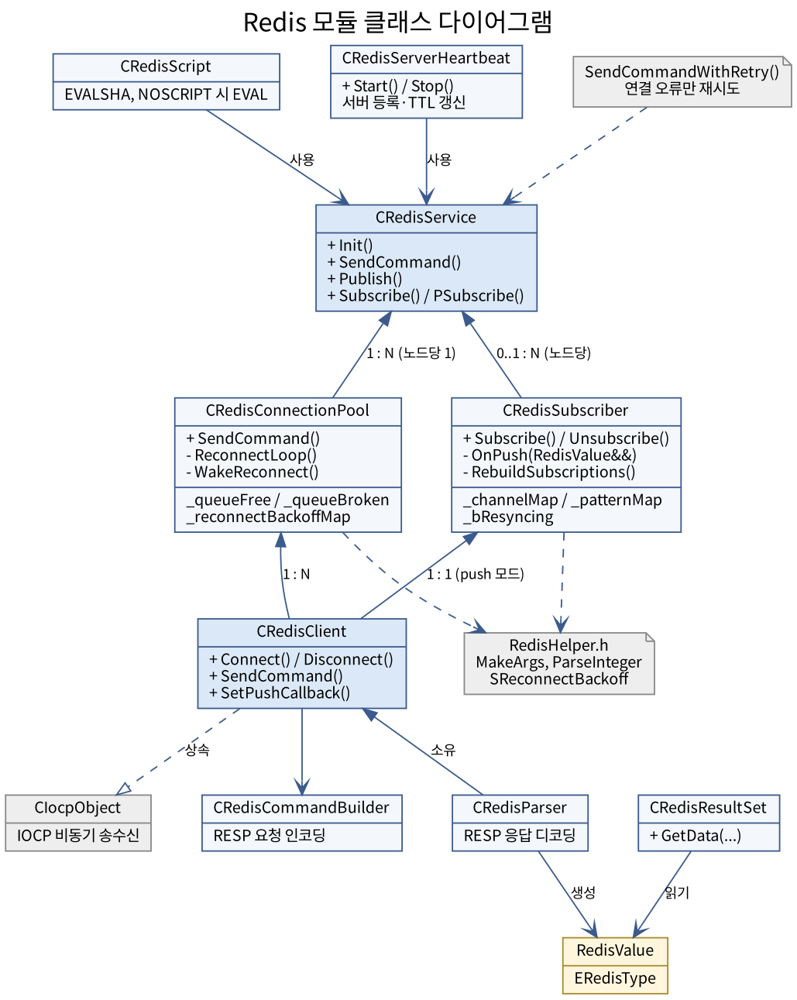

# Redis 모듈 설명

IOCP 기반 서버 프레임워크 위에서 동작하는 비동기 Redis 클라이언트 모듈이다.
소켓 하나당 커맨드 하나씩 순차 처리하는 `CRedisClient`를 여러 개 묶어 `CRedisConnectionPool`이 관리하고,
그 위에 `CRedisService`가 노드별 풀 라우팅과 스레드 안전한 콜백 이관(JobQueue)을 얹은 최상위 파사드로
노출된다. RESP(REdis Serialization Protocol) 인코딩/디코딩은 `CRedisCommandBuilder`(요청)와
`CRedisParser`(응답)가 전담하고, 파싱된 응답은 `CRedisResultSet`을 통해 타입 안전하게 꺼내 쓴다.
`CRedisServerHeartbeat`는 이 스택 위에서 서버 자신의 생존 여부를 Redis에 등록/갱신하는 디스커버리용
보조 클래스다. Lua 스크립트는 `CRedisScript`(EVALSHA + NOSCRIPT 폴백)로, 연결 오류에 한한 재시도는
`SendCommandWithRetry()`로 공용화했다.

접속 직후의 인증(`AUTH`, ACL 사용자 선택)과 논리 DB 고정(`SELECT`), 호스트 이름(DNS) 해석, 끊긴 커넥션에 대한 지수 백오프 재연결, 여러 Redis
노드에 대한 라우팅(`CRedisService`가 노드 ID별로 풀을 따로 관리)까지 지원한다. Pub/Sub은 요청-응답
풀과 분리된 구독 전용 연결(`CRedisSubscriber`)이 담당하며, 발행(`PUBLISH`)은 일반 풀로 나간다.

```
CRedisService (파사드, 노드별 풀 라우팅, 스레드 이관)
    └─ CRedisConnectionPool × N (노드 하나당 하나, 커넥션 대여/반납, 격리 큐 + 지수 백오프 재연결)
            └─ CRedisClient × N (소켓 1개당 1개, IOCP 비동기 송수신, 접속 시 SELECT로 DB 고정)
                    ├─ CRedisCommandBuilder (요청 인코딩)
                    └─ CRedisParser (응답 디코딩)
    └─ CRedisSubscriber × 노드당 최대 1개 (구독 전용 연결, 자동 재연결·재구독, 메시지를 JobQueue로 이관)
            └─ CRedisClient (push 수신 모드)

CRedisResultSet          — RedisValue → 타입별 순차 추출 유틸 (에러 응답은 IsError()로 구분)
CRedisScript             — Lua 스크립트를 EVALSHA로 실행 (NOSCRIPT이면 EVAL로 한 번 폴백)
SendCommandWithRetry()   — 연결 오류(IsRedisConnectionError)에 한해 지연 재시도
CRedisServerHeartbeat     — CRedisService를 이용한 서버 등록/TTL 갱신 (스크립트 하나로 원자적)
```



> 아래 멤버 함수 표는 `함수 | 함수 설명 | 파라미터명 | 파라미터 설명` 4열이다.
> 파라미터가 여러 개인 함수는 파라미터 하나당 한 행을 차지하며, 이 경우 함수/함수 설명 칸은
> 그 함수의 첫 행에만 표기하고 이어지는 행은 비워 같은 함수임을 나타낸다.

---

## 0-1. RedisDefine.h — 열거형·상수·에러 문자열

Redis 모듈의 열거형과 조정 가능한 상수를 한 곳에 모은 헤더다(`Network/IOCP/IocpCommon.h`의 `Iocp` 네임스페이스와 같은 방식).

- **열거형(전역)**: `ERedisType`(RESP 타입), `ERedisParseResult`(파서 결과), `ERedisDisconnectReason`(연결 종료 사유)
- **`Redis` 네임스페이스 상수**
  - 파서: `kMaxPendingBufferSize`(16MB), `kMaxArrayElements`(4096), `kMaxParseDepth`(64)
  - 클라이언트: `kRecvBufferSize`(16KB), `kScratchRetainLimit`, `kMaxCommandSize`(512MB, 명령 하나의 인코딩 크기 상한), `kKeepAliveIdleMs`(30000)/`kKeepAliveIntervalMs`(10000), `kConnectTimeoutMs`(3000), `kMaxActiveResolvers`(4)
  - 풀: `kDefaultReconnectIntervalSec`(3), `kMaxPendingCommands`(2000), `kPendingTimeoutMs`(5000), `kPoolCommandTimeoutMs`(10000), `kMaxConnectWorkers`(16), `kReconnectRecheckMs`(100)
  - 재연결 백오프(풀·구독 공용): `kReconnectBackoffBaseMs`/`MaxMs`/`MaxShift`/`JitterMs`
  - 구독 연결: `kSubscriberReconnectIntervalSec`(1), `kSubscriberPingIntervalMs`(5000), `kSubscriberCommandTimeoutMs`(5000)
- **에러 문자열(`kErr...`)**: 클라이언트와 풀이 직접 만드는 에러 응답. `IsRedisConnectionError()`는 `kErrConnectionClosed`/`kErrSendFailed`/`kErrRecvRegistrationFailed`/`kErrProtocolError`로 시작하는 에러를 연결 문제로 본다. `kErrCommandTooLarge`는 명령 자체의 문제(크기 한도 초과)라 연결 오류가 아니며 재시도 대상이 아니다.

## 0-2. RedisHelper.h — 공용 헬퍼

모듈 안팎에서 반복되던 작은 함수를 `Redis` 네임스페이스에 모았다(header-only).

| 함수 | 설명 |
|---|---|
| `RedisValue MakeError(const char*)` | 클라이언트/풀/재시도/스크립트가 직접 만드는 `ERedisType::Error` 응답. 서버가 돌려준 에러와 구분되며 `IsRedisConnectionError()`가 접두어로 판별한다 |
| `CVector<std::string> MakeArgs({...})` | 명령 인자를 한 줄로 만든다. 예: `MakeArgs({ "SADD", strKey, strMember })`. 인자 개수가 가변이면(`HMGET` 등) 기존처럼 벡터에 `push_back` |
| `CVector<std::string> MakeArgs(args...)` | 가변 인자 버전. 인자를 완벽 전달해 문자열을 한 번만 만든다 — 본문이 큰 인자는 `std::move`로 넘겨 복사를 없앤다. 예: `MakeArgs("RPUSH", strKey, std::move(strBody))` |
| `bool ParseInteger(std::string_view, T& out)` | 문자열 전체가 10진 정수이고 `T` 범위 안일 때만 변환(`std::from_chars`, 예외 없음). 공백·`+`·뒤따르는 문자·범위 초과·부호 없는 형식의 음수는 실패하며 `out`을 건드리지 않는다. 파서의 길이 헤더와 `CRedisResultSet`이 공유한다 |
| `struct SReconnectBackoff` | 재연결 실패 횟수와 다음 재시도 시각(`ptime::MonotonicNowMillis` 기준 ms)을 묶은 지수 백오프 상태. `ShouldSkip(nowMs)` / `OnFail(nowMs, jitterMs)` / `Reset()`. 풀(클라이언트별 맵)과 구독 연결이 함께 쓴다. 재연결 스레드 하나만 만지므로 스레드 안전하지 않다 |
| `int64 ComputeReconnectBackoffMs(nFailCount, nJitterMs = 0)` | 재연결 지수 백오프. 1차 실패=500ms, 이후 두 배씩 상한(30초)까지. 지터를 더한 뒤에도 상한을 넘지 않는다. 풀(지터 있음)과 구독 연결(지터 없음)이 함께 쓴다 |

## 0. RedisProtocol.h — 공통 타입

RESP 데이터를 표현하는 최상위 타입들. 별도 클래스는 아니지만 이후 모든 클래스가 이 타입을 주고받는다.

### ERedisType (enum class)
RESP 응답의 5가지 기본 타입.

| 값 | RESP 접두 | 의미 |
|---|---|---|
| `Unknown` | - | 초기값 |
| `SimpleString` | `+` | 단순 문자열 (예: "OK") |
| `Error` | `-` | 에러 메시지 |
| `Integer` | `:` | 정수 |
| `BulkString` | `$` | 길이 지정 문자열(바이너리 세이프) |
| `Array` | `*` | 하위 `RedisValue`들의 배열 |

### struct RedisValue
Redis 응답 하나를 표현하는 재귀적 구조체.

**멤버 변수**

| 이름 | 타입 | 설명 |
|---|---|---|
| `eType` | `ERedisType` | RESP 타입 |
| `i64Val` | `int64` | Integer 값 또는 BulkString/Array의 길이(-1이면 Null) |
| `strVal` | `std::string` | SimpleString/Error/BulkString의 문자열 데이터 |
| `arrayVal` | `CVector<RedisValue>` | Array 타입일 때의 하위 요소 목록 |

**멤버 함수**

| 함수 | 함수 설명 | 파라미터명 | 파라미터 설명 |
|---|---|---|---|
| `bool IsNull() const` | BulkString 또는 Array 타입이면서 `i64Val == -1`인 경우(Null Bulk String / Null Array)를 판별 | 없음 | - |

### using RedisCallback
`std::function<void(const RedisValue&)>` — 모든 계층(Client/Pool/Service)이 공통으로 사용하는 응답 콜백 시그니처.

### IsRedisConnectionError(const RedisValue&)
응답이 "연결 문제로 `CRedisClient`가 직접 만든 에러"인지 판별한다(`ERR connection closed…`, `ERR send failed`, `ERR recv registration failed`, `ERR protocol error`로 시작). Redis 서버가 돌려준 에러(`WRONGTYPE`, `NOSCRIPT`, `OOM` 등)와 `ERR command already in flight` 같은 호출 규약 위반은 해당하지 않는다. 재시도처럼 연결 문제에만 의미 있는 처리의 판별 기준이다.

### using RedisPushCallback
`std::function<void(RedisValue&&)>` — 구독 모드 연결이 서버로부터 받은 push 메시지(`["message", channel, payload]` 또는 `["pmessage", pattern, channel, payload]` 배열)를 전달받는 콜백 시그니처. rvalue로 넘겨 콜백이 채널/본문 문자열을 복사 없이 move할 수 있다.

---

## 1. CRedisParser

**역할**: 소켓에서 수신된 바이트 스트림을 누적하며, RESP 규격에 따라 완전한 값(`RedisValue`) 단위로 잘라낸다.
미완성 패킷(TCP 스트림이 메시지 중간에서 끊긴 경우) 재조립 책임을 전담하는 유일한 컴포넌트다.

**사용 패턴**: 수신 바이트를 `Feed()`로 넣고, `TryParse()`를 반복 호출해 그 시점까지 완성된 값을 모두 꺼낸다.
`TryParse()`는 `ERedisParseResult`(`Success` / `NeedMoreData` / `ProtocolError`)를 돌려준다. 데이터가 부족하면
`NeedMoreData`이며 버퍼를 그대로 보존하므로 다음 `Feed()` 이후 다시 호출하면 이어서 파싱한다. `ProtocolError`는 스트림이
RESP로 해석되지 않는다는 뜻이라 호출부(`CRedisClient`)가 연결을 끊는다.

**재파싱 비용 억제**: 파싱은 상태를 갖지 않아 `NeedMoreData` 뒤에는 처음부터 다시 파싱한다. 큰 Bulk String이 여러 조각으로
도착할 때 조각마다 처음부터 문자열을 복사하지 않도록, 값이 완성되는 데 필요한 최소 누적 바이트 수(`_nMinBytesNeeded`)를 기억해
그에 못 미치면 파싱을 건너뛴다. 배열은 남은 데이터로 가능한 개수까지만 `reserve`한다(원소는 최소 4바이트).

**안전성**: 누적 버퍼는 `kMaxPendingBufferSize`(16MB)를 넘지 못하고(`Feed()`가 `false`), Bulk String 길이는 같은 값 이하여야 하며,
Array 원소 수는 `kMaxArrayElements`(4096), 중첩 깊이는 `kMaxParseDepth`(64) 이하여야 한다. 정수 필드는 문자열 전체가 정확히
정수인지 엄격하게 검사하고(`123abc` 거부), Bulk String 데이터 뒤에는 반드시 `\r\n`이 와야 한다. 상한을 먼저 검사해 길이 산술의
정수 오버플로나 과도한 할당을 막는다.

### 멤버 변수

| 이름 | 타입 | 설명 |
|---|---|---|
| `_pendingBuffer` | `std::string` | 아직 소비되지 않은(=완성되지 않은) 누적 바이트. 미완성 패킷 보관의 유일한 소유자 |
| `_nMinBytesNeeded` | `size_t` | 직전 `NeedMoreData`에서 알아낸, 그 값을 완성하는 데 필요한 최소 누적 바이트 수. 이 값 미만이면 재파싱을 건너뜀 |

### 멤버 함수

| 함수 | 함수 설명 | 파라미터명 | 파라미터 설명 |
|---|---|---|---|
| `CRedisParser()` | 생성자. `Reset()` 호출 | 없음 | - |
| `~CRedisParser()` | 소멸자 | 없음 | - |
| `void Reset()` | `_pendingBuffer`와 `_nMinBytesNeeded`를 비워 파서 상태를 초기화(연결 종료/재연결 시 사용) | 없음 | - |
| `bool Feed(const char* pBuffer, const int32 nBytes)` | 수신된 원시 바이트를 `_pendingBuffer`에 append. 누적 크기가 `kMaxPendingBufferSize`를 넘기면 append하지 않고 `false` | `pBuffer` | 수신 데이터 버퍼 포인터. `nullptr`이면 아무 동작도 하지 않음 |
| | | `nBytes` | 수신된 바이트 크기. `0` 이하면 아무 동작도 하지 않음 |
| `ERedisParseResult TryParse(RedisValue& outValue)` | `_pendingBuffer` 맨 앞에서 완전한 RESP 값 하나를 임시 객체에 파싱하고, 성공했을 때만 `outValue`로 옮기며 소비한 만큼 버퍼를 앞으로 당긴다(`erase`). 실패 시 `outValue`는 건드리지 않고 버퍼를 보존 | `outValue` | (출력) 파싱 성공 시 결과를 담을 참조 |
| `ERedisParseResult ParseValue(...)` (private) | 접두 문자(`+ - : $ *`)를 보고 재귀적으로 값을 해석. 실패 시 `nOffset`을 호출 전 위치로 되돌림. 길이·개수 상한과 CRLF를 검증하고, 큰 Bulk String이 미완성이면 필요 바이트 수를 `_nMinBytesNeeded`에 기록. 정수 헤더는 `Redis::ParseInteger`로 엄격하게 변환하고(전체가 정수가 아니면 `ProtocolError`), 예외는 파싱 실패(`ProtocolError`)로 변환 | `pBuffer` | 파싱 대상 버퍼 포인터(`_pendingBuffer.data()`) |
| | | `nSize` | `pBuffer`의 전체 바이트 크기 |
| | | `nOffset` | (입출력) 읽기 시작 오프셋. 성공 시 소비한 만큼 전진, 실패 시 호출 전 값으로 복원 |
| | | `outValue` | (출력) 파싱 결과. Array 타입이면 재귀 호출로 하위 요소가 채워짐 |
| | | `nDepth` | 현재 중첩 깊이 |
| `ERedisParseResult ReadLine(...)` (private) | `\r\n` 기준으로 한 줄을 읽는다. 개행을 찾지 못하면 `NeedMoreData` | `pBuffer` | 읽을 버퍼 포인터 |
| | | `nSize` | `pBuffer`의 전체 바이트 크기 |
| | | `nOffset` | (입출력) 읽기 시작 오프셋. 성공 시 개행 다음 위치로 이동 |
| | | `strLine` | (출력) 개행 전까지 읽은 한 줄 문자열 |

---

## 2. CRedisCommandBuilder

**역할**: `CVector<std::string>` 형태의 명령어 인자 목록을 RESP Array 포맷(`*N\r\n$L\r\n...`)으로 인코딩하는 정적 유틸리티.
모든 메서드가 `static`이며 인스턴스를 만들 필요가 없다.

**두 가지 경로**
- `Build()`: `std::string` 결과가 필요한 곳(로깅/디버깅 등)에 쓰는 간편 버전. 내부적으로 `CalcEncodedSize()` + `Encode()`로 만들어 인코딩 규칙이 한 곳에만 있다.
- `CalcEncodedSize()` + `Encode()`: 송신 버퍼에 결과를 직접 써넣어 중간 `std::string` 사본을 만들지 않는 경로. 실제 전송 경로(`CRedisClient::SendCommand`)는 이 버전을 사용한다.

### 멤버 변수
없음 (상태를 갖지 않는 순수 정적 유틸리티 클래스).

### 멤버 함수

| 함수 | 함수 설명 | 파라미터명 | 파라미터 설명 |
|---|---|---|---|
| `static std::string Build(const CVector<std::string>& vecArgs)` | `CalcEncodedSize()` + `Encode()`로 RESP 문자열을 만들어 반환(크기 한도를 넘으면 빈 문자열) | `vecArgs` | Redis 명령어 및 인자 목록(예: `{"SET","Key","Value"}`) |
| `static uint32 CalcEncodedSize(const CVector<std::string>& vecArgs)` | `Encode()`가 필요로 하는 정확한 바이트 크기를 미리 계산. `uint64`로 누적하며 `Redis::kMaxCommandSize`를 넘으면 0을 반환한다(정상 명령은 최소 4바이트). 클라이언트는 0이면 `kErrCommandTooLarge`로 콜백을 호출하고 전송하지 않는다 | `vecArgs` | Redis 명령어 및 인자 목록 |
| `static void Encode(const CVector<std::string>& vecArgs, char* pDest)` | `pDest`에 RESP 포맷을 직접 기록. 헤더는 `WriteHeader()`로, 데이터는 `memcpy`로 기록 | `vecArgs` | Redis 명령어 및 인자 목록 |
| | | `pDest` | (출력) 기록 대상 버퍼. `CalcEncodedSize(vecArgs)` 이상의 여유 공간 필요 |
| `static uint32 HeaderLen(char cPrefix, size_t nValue)` (private) | `"<cPrefix><nValue>\r\n"` 한 줄이 차지할 바이트 수 계산(`_snprintf_s` 이용) | `cPrefix` | RESP 접두 문자(`*` 또는 `$`) |
| | | `nValue` | 헤더에 들어갈 개수/길이 값 |
| `static size_t WriteHeader(char* pDest, char cPrefix, size_t nValue)` (private) | 위 헤더 문자열을 `pDest`에 실제로 기록하고 기록한 바이트 수 반환 | `pDest` | (출력) 기록 대상 위치 |
| | | `cPrefix` | RESP 접두 문자(`*` 또는 `$`) |
| | | `nValue` | 헤더에 들어갈 개수/길이 값 |

---

## 3. CRedisClient

**역할**: `CIocpObject`를 상속받는, 소켓 1개에 대응하는 비동기 Redis 연결 단위. 연결/인증/해제, 명령 전송, 응답 수신 및
콜백 디스패치를 담당한다. `std::enable_shared_from_this`를 상속해 IOCP 콜백에서 자기 자신의 생존을 보장한다.

**한 연결에 미완료 명령은 하나**: 이 클래스는 파이프라이닝을 하지 않는다. `SendCommand()`는 응답 콜백을 단일
필드(`_pendingCallback`)에 두고, 이미 미완료 명령이 있으면 `ERR command already in flight` 에러를 콜백으로 돌려준다.
`CRedisConnectionPool`은 커넥션을 대여한 뒤 응답이 올 때까지 다시 대여하지 않는 방식으로 이 계약을 지킨다.
직전 명령의 송신 완료 통지가 아직 처리되기 전에 응답이 먼저 와서 커넥션이 재대여되는 경우를 위해, 다음 명령의
송신 버퍼는 `_nextSendBuffers`에 보관했다가 송신 완료 처리에서 이어서 보낸다(`_sendEvent`는 통지를 소비한 뒤에만 재사용).

**콜백 계약**: `SendCommand()`의 `fnCallback`은 반환값과 무관하게 **정확히 한 번** 호출된다 — 정상 응답, 연결 끊김
(`Disconnect()`가 대기 콜백을 에러 값으로 완료), 전송 실패 모두 마찬가지다. `_commandLock` 하나가 "소켓 확인 → 콜백 등록
→ 송신 상태 설정"(`SendCommand`)과 "콜백 회수"(`Disconnect`)를 같은 임계구역으로 묶어 콜백이 0회 또는 2회 호출되는
경합을 막는다. 전송 등록에 실패하면 콜백을 `std::move`로 되찾아 에러로 한 번 호출한다(복사 없음).

**`Disconnect()` 동시 호출**: `_recvEvent`와 `_sendEvent` 완료가 서로 다른 IOCP 워커에서 거의 동시에
`numOfBytes==0`으로 도착할 수 있으므로 `Disconnect()`는 여러 스레드에서 동시에 불려도 안전하다. `_socket`을
`std::atomic<SOCKET>`으로 두고 `exchange()`로 회수해 소켓 close·콜백 드레인·파서 리셋을 이긴 호출 하나만 수행한다.
대기 콜백에 넘기는 에러 문자열은 `ERedisDisconnectReason`(Generic/ConnectionClosedRecv/ConnectionClosedSend/SendFailed/ProtocolError/RecvRegistrationFailed/CommandTimeout)에서 만든다.

**수신 버퍼**: 수신 링 버퍼는 16KB다. 한 번의 `WSARecv`가 받는 최대 바이트이므로, 작으면 큰 응답(대화 기록 등)이 수십~수백 번의
완료 통지와 파서 호출로 쪼개진다.

**응답 지연 감지**: 명령을 등록한 시각을 기록해 `GetPendingCommandAgeMs()`로 경과 시간을 알려 준다. 서버가 응답 없이 멈추거나 경로가
반열림 상태가 되면 콜백이 오지 않는데, 풀이 이 값으로 감지해 `Disconnect(CommandTimeout)`로 끊는다.

**접속**: `Connect()`는 호스트를 해석(IP 문자열은 `AI_NUMERICHOST`로 DNS 없이 즉시, DNS 이름은 도우미 스레드에서 `getaddrinfo()`를 돌려 제한 시간까지만 대기, IPv6 가능)해 주소를 순서대로
시도한다. 이름 해석 시간도 접속 제한 시간(`nConnectTimeoutMs`)에 포함되어, DNS가 응답하지 않아도 그 시간을 넘겨 호출 스레드를 막지 않는다. 시간 초과된 해석 스레드는 getaddrinfo가 돌아올 때까지 남으므로, 동시에 살아 있는 해석 스레드는 프로세스 전체에서 4개로 제한한다(넘으면 그 시도는 즉시 실패). 연결 성공 → IOCP 등록 → 최초 수신 등록 → `AUTH`(자격이 있을 때) → `SELECT`(`nDbIndex > 0`일 때) 순이며,
하나라도 실패하면 `Disconnect()` 후 `false`다. 재연결도 같은 인자로 `Connect()`를 다시 부르므로 재연결된 커넥션도 항상
인증되고 같은 DB를 본다. 인증 정보는 로그에 남기지 않는다. `TCP_NODELAY`를 켜고(큰 명령이 여러 세그먼트로 나뉘거나 부분 전송을 이어 보낼 때 Nagle이 마지막 조각을 붙잡는 지연을 막는다), TCP keepalive(30초/10초)를 켜서 조용히 끊긴 연결을 감지한다. 둘 다 공용 `CSocketUtils`(`SetNoDelay`, `SetKeepAlive`)로 설정하며 실패해도 연결은 계속 쓴다.

**재연결 안전성(`_pendingIoCount`)**: 소켓을 닫아도 그 소켓에 걸려 있던 WSARecv/WSASend 완료 통지가 IOCP 큐에 남아
있을 수 있다. 이 상태에서 재연결이 `_recvEvent`/`_sendEvent`(OVERLAPPED)를 재사용하면 낡은 완료 통지가 새 연결의 것으로
오인된다. 게시 직전에 +1, 완료 처리 시 -1 하는 `_pendingIoCount`가 0일 때만(`HasNoOutstandingIo()`) 재연결한다.

### 멤버 변수

| 이름 | 타입 | 설명 |
|---|---|---|
| `_socket` | `std::atomic<SOCKET>` | 소켓 핸들. 미연결 시 `INVALID_SOCKET`. 동시 `Disconnect()` 시 정확히 한 번만 close되도록 atomic exchange로 관리 |
| `_iocpCore` | `CIocpCoreRef` | IOCP 코어 참조 |
| `_recvBuffer` | `CRingBuffer` | 수신 링 버퍼 |
| `_pendingIoCount` | `std::atomic<int32>` | 걸려 있는 WSARecv+WSASend 수. 0이어야 재연결 가능 |
| `_recvEvent` / `_sendEvent` | `RecvEvent` / `SendEvent` | Overlapped 이벤트 |
| `_commandLock` | `std::mutex` | `_pendingCallback`/송신 상태 동기화 |
| `_nCommandStartMs` | `std::atomic<int64>` | `_pendingCallback`을 등록한 시각(steady 기준 ms, 없으면 0) |
| `_pendingCallback` | `RedisCallback` | 응답을 기다리는 콜백(한 시점에 최대 1개) |
| `_pendingSendBuffers` / `_sendOffset` / `_sendTotalSize` | `CVector<CSendBufferRef>` / `uint32` / `uint32` | 현재 전송 중인 명령의 송신 버퍼와 진행 상태(부분 전송 이어 보내기) |
| `_nextSendBuffers` / `_nextSendTotalSize` | `CVector<CSendBufferRef>` / `uint32` | 직전 명령의 송신 완료 통지 전에 들어온 다음 명령의 송신 버퍼 |
| `_recvLock` | `std::mutex` | `_parser` 접근(`ProcessRecv`)과 리셋(`Disconnect`) 직렬화 |
| `_parser` | `CRedisParser` | RESP 파서 |
| `_fnPushCallback` | `RedisPushCallback` | 구독 모드의 push 콜백. 비어 있으면 일반 모드 |

### 멤버 함수

| 함수 | 함수 설명 | 파라미터명 | 파라미터 설명 |
|---|---|---|---|
| `CRedisClient(CIocpCoreRef iocpCore)` | 생성자. 소켓을 `INVALID_SOCKET`으로 초기화 | `iocpCore` | IOCP 코어 참조 객체 |
| `~CRedisClient()` | 소멸자. `Disconnect()` 호출 | 없음 | - |
| `HANDLE GetHandle() override` | IOCP 바인딩용 소켓 핸들 반환 | 없음 | - |
| `CIocpObjectRef GetIocpObjectPtr() override` | Aliasing Constructor로 `CIocpObjectRef`를 만들어 반환 | 없음 | - |
| `void Dispatch(CIocpEvent* iocpEvent, int32 numOfBytes = 0) override` | IOCP 완료 통지 처리. 수신 완료면 `numOfBytes==0`일 때 `Disconnect()`, 아니면 `ProcessRecv()`. 송신 완료면 `_sendOffset`을 누적해 남았으면 `DoSend()`로 이어 보내고, 다 보냈으면 `_nextSendBuffers`를 승격해 이어서 전송 | `iocpEvent` | 완료된 이벤트(`&_recvEvent`/`&_sendEvent`와 비교) |
| | | `numOfBytes` | 이번 완료로 송수신된 바이트 수(`0`이면 끊김) |
| `bool Connect(const std::string& strIP, const uint16 nPort, const int32 nDbIndex = 0, const int32 nConnectTimeoutMs = 3000, const std::string& strUserId = "", const std::string& strPassword = "")` | 위 "접속" 절차를 수행. `connect()`는 동기 호출이므로 소켓을 일시 논블로킹으로 전환해 `select()`로 주소별 타임아웃을 걸고 복원 | `strIP` | 서버 주소. IP 문자열 또는 DNS 이름 |
| | | `nPort` | 서버 포트 |
| | | `nDbIndex` | 접속 직후 `SELECT`로 고정할 논리 DB. `0`이면 생략 |
| | | `nConnectTimeoutMs` | connect, `AUTH`, `SELECT` 각 단계의 최대 대기(ms). 기본 3000 |
| | | `strUserId` | ACL 사용자(Redis 6+). 비어 있고 비밀번호만 있으면 `AUTH <password>` |
| | | `strPassword` | 비밀번호. 비어 있으면 인증 생략 |
| `bool Disconnect(ERedisDisconnectReason reason = Generic)` | 소켓을 원자적으로 회수한 단 하나의 호출이 close·콜백 드레인·파서 리셋을 수행. 대기 콜백은 `reason`에서 만든 에러 값으로 한 번 완료(덕분에 풀의 래핑 콜백이 커넥션을 반납) | `reason` | 대기 콜백에 전달할 끊김 사유 |
| `bool IsConnected() const` | `_socket`이 `INVALID_SOCKET`이 아닌지 | 없음 | - |
| `int64 GetPendingCommandAgeMs() const` | 응답을 기다리는 명령을 보낸 뒤 지난 시간(ms). 대기 중인 명령이 없으면 0 | 없음 | - |
| `bool HasNoOutstandingIo() const` | 걸려 있는 비동기 I/O 완료 통지를 모두 받았는지(`_pendingIoCount == 0`). 재연결 가능 조건 | 없음 | - |
| `bool SendCommand(const CVector<std::string>& vecArgs, RedisCallback fnCallback)` | `CRedisCommandBuilder`로 송신 버퍼에 RESP를 직접 인코딩하고 콜백을 등록한 뒤 전송 시작. 콜백은 반환값과 무관하게 정확히 한 번 호출된다. 미완료 명령이 있으면 `ERR command already in flight` | `vecArgs` | 명령어와 인자 |
| | | `fnCallback` | 응답(또는 에러) 완료 시 호출될 콜백 |
| `void SetPushCallback(RedisPushCallback fnPushCallback)` | 구독 모드용 push 콜백 지정. 지정하면 `["message", ...]`/`["pmessage", ...]` 배열은 명령 콜백을 소비하지 않고 이 콜백으로만 간다. `Connect()` 전에 한 번만 호출 | `fnPushCallback` | push 메시지 콜백(IOCP 워커에서 수신 순서대로) |
| `bool RegisterRecv()` (private) | `WSARecv`를 IOCP에 등록 | 없음 | - |
| `void ProcessRecv(DWORD dwBytesTransferred)` (private) | 수신 바이트를 `_parser`에 넘기고 완성된 값마다 `OnReceiptResponse()` 호출, 마지막에 `RegisterRecv()` 재등록(실패 시 `Disconnect()`) | `dwBytesTransferred` | 수신된 바이트 수 |
| `void OnReceiptResponse(const RedisValue& value)` (private) | push 콜백이 있고 `message`/`pmessage` 배열이면 push 콜백으로, 그 외에는 `_pendingCallback`을 꺼내 호출 | `value` | 파싱된 응답 |
| `bool DoSend()` (private) | `_sendOffset`부터 나머지를 `WSASend`(Scatter-Gather)로 등록. 호출자는 `_commandLock`을 쥐고 있어야 함 | 없음 | - |
| `bool Authenticate(...)` / `bool SelectDb(...)` (private) | `AUTH`/`SELECT`를 `SendCommandAndWait()`로 보내 성공(`OK`)을 확인 | `strUserId`, `strPassword` / `nDbIndex` | 인증 정보 / 논리 DB |
| `bool SendCommandAndWait(const CVector<std::string>& vecArgs, const int32 nTimeoutMs)` (private) | 비동기 `SendCommand()`를 `condition_variable`로 기다려 동기 호출처럼 동작시킴. 응답이 에러가 아니고 타임아웃 안에 오면 `true`. IOCP 완료는 별도 워커에서 오므로 이 대기가 스스로를 막지 않는다 | `vecArgs`, `nTimeoutMs` | 명령 / 최대 대기 |

---

## 4. CRedisConnectionPool

**역할**: 여러 개의 `CRedisClient`를 생성/분배/회수하는 커넥션 풀. `std::enable_shared_from_this`를 상속해
콜백 래핑 시 자기 자신을 약한 참조로 캡처한다. 하나의 풀은 서버 1대(`strIP`/`nPort`)에 대응하며,
여러 노드에 대한 라우팅은 상위의 `CRedisService`가 풀을 노드마다 하나씩 두는 방식으로 처리한다.

**격리 큐 + 백그라운드 재연결(지수 백오프)**: 커넥션 반납 시 연결 상태를 확인해, 살아있으면 Free 큐로,
끊어져 있으면 격리 큐(`_queueBroken`)로 보낸다. 전용 재연결 스레드가 일정 주기(`_nReconnectIntervalSec`)로 — 그리고 커넥션이
격리 큐로 들어오는 즉시(`WakeReconnect()`로 깨워) — 격리 큐를 훑어 재연결을 시도하고, 성공한 커넥션만 다시 Free 큐로 돌려보낸다 — 죽은 커넥션이 Free 큐에
섞여 매 요청을 실패시키는 것을 막기 위함이다. 재연결 시도는 클라이언트별로 지수 백오프(+지터)를 적용한다
(500ms에서 시작해 최대 30초까지) — 연속으로 실패할수록 다음 시도까지의 대기 시간이 늘어나, 서버가 오래
죽어있는 동안 스윕 주기마다 무의미하게 계속 두드리는 것을 막는다. 재연결 시도 자체(블로킹 `Connect()`)는
항상 `_lock` 밖에서 수행해, 대량 재연결이 진행 중이거나 풀을 채우는 도중에도 다른 스레드의
`PopConnection()`/`PushConnection()`/`SendCommand()`가 막히지 않게 한다. 한 스윕에서 접속할 커넥션들은
`Init()`과 같은 방식으로(`ConnectClientsParallel`, 최대 `kMaxConnectWorkers`개) 동시에 맺는다 — 서버가 응답하지 않을 때
순차 시도라면 (끊긴 수 × 접속 제한)만큼 스윕이 길어져 대기 큐 만료 점검이 멈추기 때문이다. 끊긴 직후에는 이전 연결의
I/O 완료 통지가 아직 남아 있을 수 있어(`HasNoOutstandingIo()`가 false) 그 커넥션은 백오프를 늘리지 않고 건너뛰며,
이때는 `kReconnectRecheckMs`(100ms) 뒤에 다시 점검한다.

**대기 큐와 포화 처리**: 모든 커넥션이 사용 중이면 `SendCommand()`는 실패하지 않고 요청을 대기 큐(`_queuePending`)에
넣은 뒤 `true`를 돌려주고, 커넥션이 반납되는 즉시 선입선출로 꺼내 태운다("Free에서 꺼내기 OR 대기 큐에 넣기"가 하나의
`_lock` 구간이라 반납과 접수가 엇갈려 요청이 방치되지 않는다). 대기 큐는 상한(`kMaxPendingCommands = 2000`)을 넘으면
`false`(콜백 미호출)로 거부한다. 대기 중인 요청이 5초(`kPendingTimeoutMs`)를 넘기면 재연결 스레드가(대기 시간을 가장 오래된 요청의 남은 만료 시간에 맞춰 줄여 두므로 점검 주기에 밀리지 않고) 
`ERR connection closed (pending timeout)`으로 완료시킨다 — Redis가 오래 죽어 있어도 호출부가 결과를 기다리는 시간에
상한이 생기고, 복구 뒤에 한참 지난 요청이 뒤늦게 실행되지 않는다. 이 문자열은 `IsRedisConnectionError()`가 연결 오류로
분류하므로 `SendCommandWithRetry`가 재시도한다. 사용 중인 커넥션의 명령이 10초(`kPoolCommandTimeoutMs`)를 넘도록 응답이 없으면
재연결 스레드가 그 커넥션을 `Disconnect(CommandTimeout)`로 끊어 `ERR connection closed (command timeout)`으로 완료시키고,
커넥션은 격리 큐를 거쳐 재연결된다 — 멈춘 서버나 반열림 연결 때문에 호출부와 커넥션이 영원히 묶이지 않는다. `Clear()` 때 대기 중이던 요청도 `ERR connection closed (pool cleared)`로
완료되어, `true`를 반환한 요청의 콜백은 항상 호출된다. 포화 상태에서는 거부가 초당 수천 건일 수 있어 로그는 약 1초에 한 줄로 합쳐 남긴다
(`_nLastRejectLogMs`, `_nRejectedSinceLog`로 그 사이 거부 건수 표기).

**재진입 안전성**: `Init()`은 이미 초기화된 풀에 다시 호출해도 안전하다 — 맨 앞에서 항상 `Clear()`를 먼저
호출해 기존 재연결 스레드/커넥션을 완전히 정리한 뒤 처음부터 다시 채운다. 이 선행 정리가 없으면, 이미
실행 중인 `_reconnectThread` 위에 새 `std::thread`를 그대로 대입하려다 `std::terminate()`로 죽는다
(joinable한 `std::thread`에 대한 이동 대입은 표준상 종료를 유발하기 때문).

### 멤버 변수

| 이름 | 타입 | 설명 |
|---|---|---|
| `_iocpCore` | `CIocpCoreRef` | IOCP 코어 참조 |
| `_strIP` | `std::string` | 연결 대상 IP |
| `_nPort` | `uint16` | 연결 대상 포트 |
| `_nDbIndex` | `int32` | 각 커넥션이 접속 직후 `SELECT`로 고정할 논리 DB 인덱스(0이면 생략). 재연결된 커넥션에도 동일하게 적용 |
| `_strUserId` / `_strPassword` | `std::string` | 접속 직후 `AUTH`에 쓸 자격(비면 생략). 재연결된 커넥션에도 동일하게 적용. 로그에 남기지 않는다 |
| `_queuePending` | `CQueue<TPendingCommand>` | 풀이 바닥났을 때 대기 중인 요청(명령 인자 + 콜백 + 대기 시작 시각) |
| `_generation` | `std::atomic<uint64>` | `Clear()`마다 증가. 옛 세대 커넥션의 뒤늦은 콜백이 새 풀 상태를 건드리지 못하게 막는 가드 |
| `_nLastRejectLogMs` / `_nRejectedSinceLog` | `std::atomic<int64>` | 대기 큐 포화 로그 합치기(로그 폭주 방지) |
| `_lock` | `std::mutex` | `_vecAllClients`/`_queueFree`/`_queueBroken` 공용 동기화 락 |
| `_vecAllClients` | `CVector<CRedisClientRef>` | 풀이 생성한 전체 클라이언트 목록(생존 관리 목적) |
| `_queueFree` | `CQueue<CRedisClientRef>` | 대여 가능한(연결된) 클라이언트 큐 |
| `_queueBroken` | `CQueue<CRedisClientRef>` | 연결이 끊겨 재연결을 기다리는 격리 큐 |
| `_bInitialized` | `std::atomic<bool>` | 풀 초기화 여부 |
| `_nReconnectIntervalSec` | `int32` | 재연결 스레드가 격리 큐를 훑는 주기(초). 기본 3 |
| `_reconnectThread` | `std::thread` | 재연결 전용 백그라운드 스레드 |
| `_reconnectLock` | `std::mutex` | `_reconnectCv` 대기/신호 전달 전용 뮤텍스(재연결 시도 자체는 이 락 밖에서 수행) |
| `_reconnectCv` | `std::condition_variable` | 재연결 주기 대기 및 즉시 종료 신호 수신용 |
| `_stopping` | `std::atomic<bool>` | 재연결 스레드 정지 요청 플래그 |
| `_reconnectBackoffMap` | `std::unordered_map<CRedisClient*, Redis::SReconnectBackoff>` | 클라이언트별 재연결 지수 백오프 상태(실패 횟수/다음 재시도 시각, 구조체는 RedisHelper.h). 재연결 스레드만 접근하므로 별도 락 불필요 |
| `_bReconnectWake` | `bool` | 커넥션이 격리 큐로 들어와 즉시 점검이 필요함. `_reconnectLock`으로 보호 |


### 멤버 함수

| 함수 | 함수 설명 | 파라미터명 | 파라미터 설명 |
|---|---|---|---|
| `CRedisConnectionPool(CIocpCoreRef iocpCore)` | 생성자 | `iocpCore` | IOCP 코어 참조 객체 |
| `~CRedisConnectionPool()` | 소멸자. `Clear()` 호출 | 없음 | - |
| `bool Init(const std::string& strIP, const uint16 nPort, const int32 nDbIndex, const int32 nPoolSize, const int32 nReconnectIntervalSec = 3, const std::string& strUserId = "", const std::string& strPassword = "")` | 맨 앞에서 항상 `Clear()`를 먼저 호출해 재진입에 안전하게 만든 뒤, `strIP`/`_nPort`/`_nDbIndex`/`_nReconnectIntervalSec`를 짧게 락으로 감싸 반영하고, `nPoolSize`개의 클라이언트를 락 밖에서 최대 `kMaxConnectWorkers`개 워커로 동시에 `Connect()`(블로킹, `ConnectClientsParallel`)한다. 연결된 것은 `_queueFree`, 실패한 것은 `_queueBroken`에 넣어 재연결 스레드가 이어서 붙이며(부분 실패는 로그만 남기고 계속), 하나도 연결하지 못했을 때만 `Clear()` 후 `false`. 이후 초기화 완료 표시와 재연결 스레드 시작 | `strIP` | 연결 대상 서버 IP |
| | | `nPort` | 연결 대상 서버 포트 |
| | | `nDbIndex` | 각 커넥션이 접속 직후 `SELECT`로 고정할 논리 DB 인덱스 |
| | | `nPoolSize` | 생성할 커넥션 개수 |
| | | `nReconnectIntervalSec` | 재연결 시도 주기(초). `0` 이하면 기본값 3으로 보정 |
| | | `strUserId` | ACL 사용자(비면 `AUTH <password>`) |
| | | `strPassword` | 비밀번호(비면 인증 생략) |
| `void Clear()` | 재연결 스레드를 먼저 정지·조인(락을 쥔 채 조인을 기다리는 데드락 방지를 위해 락 밖에서 호출)한 뒤, 두 큐와 `_reconnectBackoffMap`을 비우고 모든 클라이언트를 `Disconnect()`, 전체 목록/초기화 플래그 정리 | 없음 | - |
| `void PushConnection(CRedisClientRef pClient, uint64 generation)` (private) | 반납된 커넥션의 `generation`이 현재 세대와 같을 때만 처리. 대기 큐에 요청이 있으면 그 커넥션에 바로 태워 보내고, 없으면 `IsConnected()`에 따라 Free 큐 또는 격리 큐로 분배 | `pClient` | 반납할 클라이언트 |
| | | `generation` | 명령을 보낼 때의 세대 번호 |
| `void DispatchOnClient(CRedisClientRef pClient, const CVector<std::string>& vecArgs, RedisCallback fnCallback)` (private) | 커넥션 하나에 명령을 실어 보낸다. 콜백을 원본 실행 후 `weak_ptr`로 캡처한 풀을 잠가 `PushConnection()`으로 반납하도록 래핑. 즉시 전송 경로와 대기 큐 소진 경로가 공유 | `pClient` | 사용할 커넥션 |
| | | `vecArgs`, `fnCallback` | 명령과 응답 콜백 |
| `bool SendCommand(const CVector<std::string>& vecArgs, RedisCallback fnCallback)` | Free 커넥션이 있으면 `DispatchOnClient()`로 즉시 전송, 없으면 대기 큐에 넣는다(위 "대기 큐와 포화 처리"). 풀 미초기화/대기 큐 포화면 `false`이며 이때 콜백은 호출되지 않는다 | `vecArgs` | Redis 명령어 및 인자 목록 |
| | | `fnCallback` | 응답 처리 콜백 함수 |
| `void DisconnectStalledClients()` (private) | 재연결 스레드가 점검 주기마다 호출. `_lock` 안에서는 `GetPendingCommandAgeMs()`(원자적 읽기)가 10초 이상인 커넥션만 골라내고(전체 목록을 복사하지 않음), 락 밖에서 `Disconnect(CommandTimeout)` | 없음 | - |
| `void ExpirePendingCommands()` (private) | 재연결 스레드가 점검 주기마다 호출. 대기 큐 앞쪽(도착 순)에서 5초를 넘긴 요청을 꺼내 락 밖에서 `ERR connection closed (pending timeout)`으로 완료 | 없음 | - |
| `void StartReconnectLoop()` (private) | `_stopping`을 `false`로 리셋하고 `ReconnectLoop()` 스레드 시작 | 없음 | - |
| `void StopReconnectLoop()` (private) | `_stopping`을 `true`로 CAS(중복 호출 안전) 후 `_reconnectLock`을 한 번 잡았다 놓고(조건 검사와 대기 사이의 알림 유실 방지) `notify_all()`로 깨우고 스레드 조인 |
| `void WakeReconnect()` (private) | `_bReconnectWake`를 세우고 재연결 스레드를 깨운다. 커넥션이 격리 큐로 들어가는 곳(`PushConnection()`, `SendCommand()`가 죽은 커넥션을 발견한 곳)에서 `_lock`을 쥔 채 호출해도 안전하다(`_lock` → `_reconnectLock` 순서로만 잡는다) | 없음 | - |
| `void CheckLiveness(const CRedisClientRef& pClient)` (private) | 연결이 살아 있어 보일 때 호출. 진행 중 명령이 5초를 넘기면 `Disconnect()`, 유휴이고 마지막 PING 후 5초가 지났으면 `PING`을 큐에 넣고 `PumpCommands()` | `pClient` | 점검할 연결 |
| `void ReconnectLoop()` (private) | `_reconnectLock`으로 감싼 `wait_for`로 주기 대기(정지 신호나 `_bReconnectWake`, 또는 건너뛴 커넥션 재점검 시 100ms에 깨어남). 대기 큐에 요청이 있으면 대기 시간을 가장 오래된 요청의 남은 만료 시간(최소 100ms)으로 줄여, 점검 주기 때문에 `kPendingTimeoutMs`가 늦게 적용되지 않게 한다. 대기 시간을 계산할 때 `_lock`은 `_reconnectLock`을 잡기 전에 잡고 놓는다. 깨어나면 대기 큐 만료·정체 커넥션 점검 후 격리 큐를 스냅샷해 분류한다 — 백오프 대기 중이거나 이전 I/O 통지가 남은 클라이언트는 건너뛰고, 나머지는 `ConnectClientsParallel`로 동시에 `Connect()`. 성공하면 백오프 상태를 지우고 `PushConnection()`(대기 요청이 있으면 즉시 전송), 실패하면 `SReconnectBackoff::OnFail()`로 지수 백오프(+지터) 후 격리 큐로 되돌림. 종료 요청이 들어오면 아직 시작하지 않은 접속은 하지 않고 격리 큐로 되돌림. 접속에 시간이 걸렸을 수 있어 끝난 뒤 대기 큐 만료를 한 번 더 점검 | 없음 | - |

---

## 5. CRedisResultSet

**역할**: `RedisValue` 응답 객체를 문자열 목록으로 평탄화한 뒤, 순차 커서(cursor) 방식으로 원하는 기본 타입으로
하나씩 꺼내주는 유틸리티. Boost 없이 표준 라이브러리(`std::from_chars` 기반 `Redis::ParseInteger`)만으로 변환한다.

### 멤버 변수

| 이름 | 타입 | 설명 |
|---|---|---|
| `_readCursor` | `UINT` | 순차 데이터 읽기 커서 위치 |
| `_vecResultSplit` | `CVector<std::string>` | 문자열로 분할·보관된 결과 목록 |
| `_bError` | `bool` | 원본 응답이 `ERedisType::Error`였는지 |

### 멤버 함수

| 함수 | 함수 설명 | 파라미터명 | 파라미터 설명 |
|---|---|---|---|
| `explicit CRedisResultSet(const RedisValue& value)` | `value`가 Null이면 빈 상태로 둠. SimpleString/BulkString은 그대로, Integer는 `to_string`, Array는 각 원소를 (Null→빈 문자열, Integer→`to_string`, 그 외→원문) 규칙으로 적재. Error는 데이터 없이 `_bError`만 표시 | `value` | 파싱 완료된 Redis 응답 객체(`CRedisParser`의 결과) |
| `~CRedisResultSet() = default` | 소멸자 | 없음 | - |
| `bool GetData(INT8& Dest)` | 커서 위치 문자열을 `INT8`로 변환(`Redis::ParseInteger`)해 꺼내고 커서 1 전진. 문자열 전체가 정수가 아니거나 범위 초과(부호 없는 형식의 음수 포함)면 `false`, `Dest`는 0, 커서는 그대로(같은 필드를 다른 타입으로 다시 읽을 수 있음) | `Dest` | (출력) 추출한 값을 받을 변수 참조 |
| `bool GetData(UINT8& Dest)` | 커서 위치 문자열을 `UINT8`로 변환(`Redis::ParseInteger`)해 꺼내고 커서 1 전진. 문자열 전체가 정수가 아니거나 범위 초과(부호 없는 형식의 음수 포함)면 `false`, `Dest`는 0, 커서는 그대로(같은 필드를 다른 타입으로 다시 읽을 수 있음) | `Dest` | (출력) 추출한 값을 받을 변수 참조 |
| `bool GetData(INT16& Dest)` | 커서 위치 문자열을 `INT16`으로 변환(`Redis::ParseInteger`)해 꺼내고 커서 1 전진. 문자열 전체가 정수가 아니거나 범위 초과(부호 없는 형식의 음수 포함)면 `false`, `Dest`는 0, 커서는 그대로(같은 필드를 다른 타입으로 다시 읽을 수 있음) | `Dest` | (출력) 추출한 값을 받을 변수 참조 |
| `bool GetData(INT32& Dest)` | 커서 위치 문자열을 `INT32`로 변환(`Redis::ParseInteger`)해 꺼내고 커서 1 전진. 문자열 전체가 정수가 아니거나 범위 초과(부호 없는 형식의 음수 포함)면 `false`, `Dest`는 0, 커서는 그대로(같은 필드를 다른 타입으로 다시 읽을 수 있음) | `Dest` | (출력) 추출한 값을 받을 변수 참조 |
| `bool GetData(UINT32& Dest)` | 커서 위치 문자열을 `UINT32`로 변환(`Redis::ParseInteger`)해 꺼내고 커서 1 전진. 문자열 전체가 정수가 아니거나 범위 초과(부호 없는 형식의 음수 포함)면 `false`, `Dest`는 0, 커서는 그대로(같은 필드를 다른 타입으로 다시 읽을 수 있음) | `Dest` | (출력) 추출한 값을 받을 변수 참조 |
| `bool GetData(INT64& Dest)` | 커서 위치 문자열을 `INT64`로 변환(`Redis::ParseInteger`)해 꺼내고 커서 1 전진. 문자열 전체가 정수가 아니거나 범위 초과(부호 없는 형식의 음수 포함)면 `false`, `Dest`는 0, 커서는 그대로(같은 필드를 다른 타입으로 다시 읽을 수 있음) | `Dest` | (출력) 추출한 값을 받을 변수 참조 |
| `bool GetData(UINT64& Dest)` | 커서 위치 문자열을 `UINT64`로 변환(`Redis::ParseInteger`)해 꺼내고 커서 1 전진. 문자열 전체가 정수가 아니거나 범위 초과(부호 없는 형식의 음수 포함)면 `false`, `Dest`는 0, 커서는 그대로(같은 필드를 다른 타입으로 다시 읽을 수 있음) | `Dest` | (출력) 추출한 값을 받을 변수 참조 |
| `bool GetData(std::string& Dest)` | 커서 위치 문자열을 이동(`std::move`)으로 꺼내고 커서 전진. 한 번 읽은 필드는 다시 읽히지 않으므로 복사하지 않는다 | `Dest` | (출력) 추출한 문자열을 받을 변수 참조 |
| `bool GetData(TCHAR* Dest, int nSize)` | `Dest`를 0으로 채운 뒤 커서 위치 문자열을 (UNICODE 빌드면 `MultiByteToWideChar`, 아니면 `strncpy_s`로) 복사. 범위 초과나 변환 불가 시 버퍼는 비운 채, 커서를 옮기지 않고 `false` | `Dest` | (출력) 문자열을 저장할 TCHAR 버퍼 포인터. `nullptr`이면 즉시 `false` |
| | | `nSize` | `Dest` 버퍼의 TCHAR 요소 개수. `0` 이하면 즉시 `false` |
| `INT32 GetRankInfoRetCount() const` | (Member, Score) 쌍 랭킹류 응답의 튜플 개수(`size/2`) 반환. 정상 응답은 항상 짝수 요소이므로 홀수면 `ASSERT_CRASH`로 개발 빌드에서 즉시 노출 | 없음 | - |
| `bool IsError() const` | 원본 응답이 에러였는지. 에러는 `IsEmpty()==true`가 되어 정상적인 빈 결과와 겉으로 같으므로, 둘을 가려야 하면 `IsEmpty()`보다 먼저 확인한다. 연결 오류만 가리려면 `IsRedisConnectionError()` | 없음 | - |
| `bool IsEmpty() const` | `_vecResultSplit`이 비었는지 여부 | 없음 | - |
| `size_t GetSize() const` | `_vecResultSplit.size()` 반환 | 없음 | - |

---

## 6. CRedisService

**역할**: 외부 모듈에 노출되는 최상위 파사드. Redis 노드 하나당 `CRedisConnectionPool`을 하나씩 두고,
`CRedisNode::_nID`를 키로 `CClusterSpinUnorderedMap`(`_poolMap`)에서 관리한다. IOCP 수신 스레드에서 받은
응답 콜백을 지정된 `CJobQueue`로 이관해 **로직/메인 스레드에서 별도 동기화 없이 안전하게** 결과를 받을 수
있게 한다.

`_poolMap`은 클러스터별 `PRWLock`으로 조회/삽입/전체삭제를 내부적으로 자동 락 처리하므로(`bInnerLock=true`),
`CRedisService`가 별도의 뮤텍스를 두지 않는다. 노드가 하나뿐인 목록으로 초기화한 경우에도 동일하게 그
하나의 풀만 맵에 들어가며, `SendCommand()`는 노드를 지정하지 않아도 항상 첫 번째로 등록된 노드(`_nDefaultNodeId`)로
동작한다.

**재초기화 시 원자성 관련 주의**: `Init()`은 각 노드에 대한 풀을 먼저 전부 만들어본 뒤(하나라도 연결 실패하면
로컬 벡터가 스코프를 벗어나며 그때까지 만든 풀들이 자동 정리되고 즉시 실패 반환) 전부 성공한 경우에만
`_poolMap`에 반영한다. 다만 `_poolMap.ClearObjectMap()`과 각 노드의 `InsertObject()`는 클러스터 단위로 순차
수행되는 별개의 락 구간이라, 이 반영 과정 자체는 원자적이지 않다(트래픽이 흐르는 도중 재초기화를 호출하면
아주 짧은 순간 맵이 비어있거나 일부만 채워진 상태로 보일 수 있음). 보통 트래픽이 시작되기 전 한 번만
호출하는 용도이므로 문제되지 않는다.

### 멤버 변수

| 이름 | 타입 | 설명 |
|---|---|---|
| `_iocpCore` | `CIocpCoreRef` | 노드별 풀을 만들 때 넘겨줄 IOCP 코어 참조 |
| `_jobQueue` | `CJobQueueRef` | 콜백을 이관할 대상 스레드의 작업 큐 |
| `_poolMap` | `CClusterSpinUnorderedMap<int16, CRedisConnectionPoolRef, 4>` | 노드 ID → 커넥션 풀. 클러스터 4개로 락 경합을 분산하며, 조회/삽입/전체삭제가 내부 자동 락(`bInnerLock=true`)으로 스레드 세이프 |
| `_nDefaultNodeId` | `std::atomic<int16>` | `SendCommand()`를 노드 지정 없이 호출했을 때 쓰이는 기본 노드 ID |
| `_subscriberLock` | `std::mutex` | `_redisNodeVec`/`_subscriberMap` 보호 |
| `_redisNodeVec` | `CVector<CRedisNode>` | `Init()`에 넘겨받은 노드 목록. 구독 연결을 만들 때 호스트/포트를 여기서 찾는다 |
| `_subscriberMap` | `std::unordered_map<int16, CRedisSubscriberRef>` | 노드 ID → 구독 전용 연결. 노드별 첫 `Subscribe()` 호출 때 만들어진다 |

### 멤버 함수

| 함수 | 함수 설명 | 파라미터명 | 파라미터 설명 |
|---|---|---|---|
| `CRedisService(CIocpCoreRef iocpCore, CJobQueueRef pJobQueue)` | 생성자. 풀은 아직 만들지 않고 `_iocpCore`만 보관해뒀다가 `Init()` 시점에 필요한 만큼 생성 | `iocpCore` | IOCP 코어 참조 객체 |
| | | `pJobQueue` | 결과를 전달받을 메인/대상 스레드의 작업 큐 |
| `~CRedisService()` | 소멸자. `ShutdownSubscribers()`로 구독 연결을 먼저 닫고, `_poolMap`이 소멸되며 각 풀의 소멸자가 순서대로 정리 | 없음 | - |
| `int16 GetDefaultNodeId() const` | `SendCommand()`를 노드 없이 호출했을 때 쓰이는 기본 노드 ID(`redisNodeVec[0]`). `CRedisScript::Run()`의 기본 노드 오버로드가 사용 | 없음 | - |
| `bool Init(CVector<CRedisNode> redisNodeVec, const int32 nPoolSize)` | `redisNodeVec`의 각 노드마다 별도의 `CRedisConnectionPool`을 만들어 연결까지 마친 뒤(전부 성공해야 함. 노드의 호스트·사용자·비밀번호(`_tszDBHost`/`_tszDBUserId`/`_tszDBPasswd`)와 DB 인덱스를 풀에 그대로 넘겨 접속 시 `AUTH`/`SELECT`에 쓴다), `_poolMap`을 `ClearObjectMap()`으로 비우고 `CRedisNode::_nID`를 키로 `InsertObject()`. 같은 `_nID`가 중복되면 `InsertObject()`가 실패해 로그만 남기고 건너뜀. 첫 번째 노드(`redisNodeVec[0]`)는 기본 노드로 등록됨 | `redisNodeVec` | 서버 설정에서 읽어온 Redis 노드 목록(비어있으면 실패). 서버 1대만 쓰려면 노드 하나짜리 목록을 넘기면 됨 |
| | | `nPoolSize` | 노드별로 생성할 커넥션 풀 개수(모든 노드에 동일하게 적용) |
| `bool SendCommand(const CVector<std::string>& vecArgs, RedisCallback fnMainThreadCallback)` | 기본 노드(`_nDefaultNodeId`)로 3-파라미터 `SendCommand()`를 위임 호출 | `vecArgs` | Redis 명령어 인자 목록 |
| | | `fnMainThreadCallback` | 대상 스레드에서 안전하게 실행될 콜백 함수 |
| `bool SendCommand(const int16 nNodeId, const CVector<std::string>& vecArgs, RedisCallback fnMainThreadCallback)` | `FindPool(nNodeId)`로 해당 노드의 풀을 찾아 명령을 전송. 못 찾으면 `false`. IOCP 스레드에서 실행될 내부 콜백을 만들어 풀의 `SendCommand()`에 전달하며, 내부 콜백은 `_jobQueue`를 `weak_ptr`로 잠가 `DoAsync()`로 대상 스레드 큐에 콜백 실행을 예약한다. 사용자 콜백과 응답(`RedisValue`) 모두 복사 없이 이동으로 넘긴다 — 클라이언트/풀 내부 경로는 `RedisResponseHandler`(`void(RedisValue&&)`)이고, 서비스가 이를 큐 작업에 move해 사용자 콜백에는 `const RedisValue&`로 전달한다 | `nNodeId` | `Init()`으로 등록된 `CRedisNode::_nID` |
| | | `vecArgs` | Redis 명령어 인자 목록 |
| | | `fnMainThreadCallback` | 대상 스레드에서 안전하게 실행될 콜백 함수 |
| `bool Publish([const int16 nNodeId,] const std::string& strChannel, const std::string& strMessage, RedisCallback fnMainThreadCallback = nullptr)` | `PUBLISH` 명령을 일반 풀(`SendCommand()`)로 전송. 노드를 생략하면 기본 노드. 응답은 메시지를 받은 구독자 수(Integer). 빈 채널이면 `false` | `nNodeId` | (선택) 대상 노드 ID |
| | | `strChannel` | 발행할 채널 이름 |
| | | `strMessage` | 메시지 본문 |
| | | `fnMainThreadCallback` | (선택) 응답 콜백 |
| `bool Subscribe([const int16 nNodeId,] const std::string& strChannel, RedisMessageCallback fnCallback)` | 노드의 구독 연결(`FindSubscriber(nNodeId, true)`)으로 채널을 구독. 연결이 없으면 `_redisNodeVec`의 노드 정보로 만든다. 콜백은 `_jobQueue`를 처리하는 스레드에서 호출됨 | `nNodeId` | (선택) 구독할 노드 ID. 생략하면 기본 노드 |
| | | `strChannel` | 구독할 채널 이름 |
| | | `fnCallback` | 메시지마다 호출될 콜백 `(channel, payload)` |
| `bool Unsubscribe([const int16 nNodeId,] const std::string& strChannel)` | 채널 구독을 해제. 구독 연결이 없거나 등록되지 않은 채널이면 `false` | `nNodeId` | (선택) 노드 ID |
| | | `strChannel` | 해제할 채널 이름 |
| `bool PSubscribe(...)` / `bool PUnsubscribe(...)` | `Subscribe()`/`Unsubscribe()`와 같은 형태로 글롭 패턴(예: `"Chat:*"`)을 구독/해제. 콜백의 channel에는 패턴이 아니라 실제 발행 채널이 온다 | `strPattern` | 구독/해제할 패턴 |
| `void ShutdownSubscribers()` | 모든 노드의 구독 연결을 닫고 구독 목록을 비움. `Init()` 재호출 시에도 먼저 실행된다 | 없음 | - |
| `CRedisSubscriberRef FindSubscriber(const int16 nNodeId, const bool bCreate)` (private) | 노드의 구독 연결을 반환. `bCreate`이고 없으면 생성(접속은 락 밖에서 수행하고, 동시에 두 스레드가 만들면 먼저 맵에 넣은 쪽을 쓰고 나머지는 닫음) | `nNodeId` | 노드 ID |
| | | `bCreate` | 없을 때 만들지 여부 |
| `CRedisConnectionPoolRef FindPool(const int16 nNodeId)` (private) | `_poolMap.FindObject(nNodeId, pPool)`로 노드 ID에 해당하는 풀을 찾아 반환. `[[nodiscard]]` 반환값을 확인해 못 찾으면 `nullptr` | `nNodeId` | 찾을 노드 ID |

**참고**: `Init()`/구독 연결 생성은 `CRedisNode`의 TCHAR 고정 버퍼(`_tszDBHost` 등)를 `std::string`으로 바꿔 풀·구독 연결에 넘긴다. 이 변환은 공용 `TCharToString(const TCHAR*)`(`Util/CommonUtil.h`, nullptr이면 빈 문자열)를 쓴다.

---

## 7. CRedisServerHeartbeat

**역할**: 서버 프로세스가 시작될 때 자신의 실행 정보를 Redis Hash로 등록하고, 주기적으로 같은 정보를 다시 쓰며 TTL을
갱신해 "살아있음"을 알리는 디스커버리용 클래스. TTL이 heartbeat 주기보다 충분히 길게 설정되어, 프로세스가 비정상
종료되면 heartbeat가 끊기고 TTL 만료로 키가 자동 소멸한다(별도 정리 배치 불필요). 정상 종료 시에는 `Stop()`이 `DEL`로
키를 즉시 지워 TTL 만료를 기다리지 않는다.

등록 키 형식: `"{serverName}:{serverGroupId}:{serverChannelId}"` (Redis Hash, 필드: `serverName`, `serverGroupId`,
`serverChannelId`, `port`, `pid`, `sessionCount`, `startedAt`, `updatedAt`).

**원자성**: 등록(`HSET`)과 TTL(`EXPIRE`)은 `CRedisScript` 하나(`KEYS[1]`=키, `ARGV[1]`=TTL, `ARGV[2..]`=필드/값 쌍)에서
함께 실행된다. 최초 등록과 매 주기 갱신이 같은 스크립트·같은 필드 집합을 쓰므로, 키가 TTL 만료나 Redis 재시작으로
사라졌다가도 다음 틱이 완전한 등록 정보로 되살린다. 둘 사이에 실패나 연결 끊김이 끼어 TTL 없는 키가 남을 수 없다.

**스레드 모델**: 전용 스레드 하나가 `condition_variable::wait_for`로 heartbeat 주기만큼 대기 후 깨어나 스크립트를
게시한다. 응답을 기다려 후속 명령을 거는 콜백이 없어(`PublishRegistration()`은 fire-and-forget) 객체가 먼저 소멸해도
건드릴 멤버가 없다. `sessionCount` 제공자는 heartbeat 스레드에서 호출된다.

### 멤버 변수

| 이름 | 타입 | 설명 |
|---|---|---|
| `_redisService` | `CRedisService*` | 명령 전송에 사용할 Redis 서비스(비소유). `nullptr`이면 `Start()`가 실패 |
| `_serverName` / `_serverGroupId` / `_serverChannelId` | `std::string` | 키와 필드로 쓰이는 서버 이름, 그룹, 채널(인스턴스) 식별자 |
| `_port` | `uint16` | 클라이언트/내부 연동이 접속할 포트(등록 정보용) |
| `_ttlSec` | `int32` | 살아있음으로 간주할 TTL(초). 기본 15 |
| `_heartbeatIntervalSec` | `int32` | heartbeat 주기(초). 기본 5, `_ttlSec`보다 반드시 작아야 함 |
| `_startedAtMs` | `int64` | `Start()` 시각(epoch ms). 매 갱신에 같은 값으로 기록 |
| `_sessionCountProvider` | `SessionCountProvider` | 현재 세션 수를 돌려주는 콜백. 없으면 `sessionCount`는 0 |
| `_thread` / `_lock` / `_cv` / `_stopping` | | heartbeat 스레드, 대기 전용 뮤텍스·조건 변수, 정지 플래그 |

### 멤버 함수

| 함수 | 함수 설명 | 파라미터명 | 파라미터 설명 |
|---|---|---|---|
| `CRedisServerHeartbeat(CRedisService* redisService, std::string serverName, std::string serverGroupId, std::string serverChannelId, uint16 port)` | 생성자. 각 필드를 이동 저장 | `redisService` | 명령 전송에 사용할 서비스 |
| | | `serverName` | 서버 이름(예: `"ChatServer"`) |
| | | `serverGroupId` | 서버 그룹 식별자 |
| | | `serverChannelId` | 서버 채널(인스턴스) 식별자 |
| | | `port` | 등록 정보용 포트 |
| `~CRedisServerHeartbeat()` | 소멸자. 실행 중이면 `Stop()` | 없음 | - |
| `void SetSessionCountProvider(SessionCountProvider provider)` | `sessionCount` 필드에 쓸 세션 수 제공자 등록. `Start()` 전에 등록해야 최초 등록부터 반영 | `provider` | 세션 수 반환 콜백 |
| `bool Start(int32 ttlSec = 15, int32 heartbeatIntervalSec = 5)` | 이미 실행 중이거나 `heartbeatIntervalSec<=0` 또는 `ttlSec<=heartbeatIntervalSec`이면 `ASSERT_CRASH` 후 `false`. 유효하면 저장 후 `RegisterInitial()` 호출, 스레드 시작 | `ttlSec` | TTL(초) |
| | | `heartbeatIntervalSec` | 갱신 주기(초). `ttlSec`보다 작아야 함 |
| `void Stop()` | 대기 뮤텍스를 한 번 거쳐 스레드를 깨우고(알림 유실 방지) join한 뒤 등록 키를 `DEL`(응답을 기다리지 않음 — 서비스를 곧바로 해제하면 전송 전에 끊길 수 있고 그때는 TTL이 정리). `Start()`가 성공한 적이 없으면(`_bStarted`) `DEL`을 보내지 않는다. 중복 호출 안전 | 없음 | - |
| `void RegisterInitial()` / `void SendHeartbeat()` (private) | 둘 다 `PublishRegistration()` 호출 | 없음 | - |
| `void PublishRegistration()` (private) | `BuildRegistrationArgv()`로 만든 ARGV로 등록 스크립트를 `Run()` | 없음 | - |
| `void BuildRegistrationArgv(CVector<std::string>& argv, int64 nowMs) const` (private) | `ARGV[1]`=TTL, 이어서 전체 필드/값 쌍을 채움 | `argv` | (출력) 스크립트 ARGV |
| | | `nowMs` | `updatedAt`에 쓸 현재 시각(epoch ms) |
| `void HeartbeatLoop()` (private) | `_cv.wait_for`로 주기 대기(`Stop()` 시 즉시 깨어남). 타임아웃으로 깨어난 경우에만 `SendHeartbeat()` | 없음 | - |
| `std::string BuildKey() const` (private) | `{serverName}:{serverGroupId}:{serverChannelId}` 반환 | 없음 | - |

---

## 8. CRedisSubscriber

Redis Pub/Sub 구독 전용 연결을 관리한다. 구독 상태의 연결은 서버가 메시지를 자발적으로 밀어 보내므로 "요청 하나에
응답 하나"인 풀의 연결과 섞어 쓸 수 없다. 그래서 노드마다 구독 전용 `CRedisClient`(push 수신 모드)를 하나 소유하고,
구독 목록·재연결·재구독·메시지 이관을 이 클래스가 맡는다. `std::make_shared`로 만들어야 한다(내부 콜백이
`weak_ptr(shared_from_this)`를 쓴다).

핵심 동작:
- **push 수신 모드**: `CRedisClient::SetPushCallback()`을 지정한 연결은 `["message", ...]`/`["pmessage", ...]` 배열을
  명령 응답 콜백이 아니라 push 콜백으로만 보낸다. SUBSCRIBE 확인·에러 응답은 기존대로 미완료 명령의 콜백을 완료시킨다.
- **명령 직렬화**: 한 시점에 미완료 명령은 하나뿐이라는 `CRedisClient` 계약에 따라, 구독/해제 명령은 내부 큐에 쌓였다가
  앞 명령의 확인 응답 뒤에 하나씩 전송된다. 명령 하나에 채널 하나만 담아 확인 응답이 명령과 1:1로 대응한다.
  전송 실패 시 콜백이 동기로 호출되므로 `_bPumping`으로 재진입을 막아 재귀 대신 루프로 큐를 소진한다.
- **재연결·재구독**: 재연결 스레드가 주기적으로 연결 상태를 보고, 끊겨 있으면 지수 백오프(500ms~30s)로 다시 접속한다.
  접속에 성공하면 연결 에폭을 올리고(이전 연결의 지연 응답 무시) 등록된 모든 채널·패턴을 다시 구독한다.
  `Init()`의 첫 접속이 실패해도 `true`를 반환하고 같은 경로로 계속 시도하므로, 서버 기동 순서와 무관하게 `Subscribe()`를 미리 등록해 둘 수 있다.
- **생존 점검(PING)**: 중간 장비가 RST 없이 연결을 버리면 수신 쪽은 끊긴 것을 알 수 없다. 재연결 스레드가 연결이 유휴(진행 중 명령·대기 큐 없음)일 때
  5초마다 `PING`을 같은 명령 큐로 보내고, 진행 중인 명령(PING 포함)이 5초 안에 응답하지 않으면 연결을 끊어 재연결 경로로 넘긴다.
  구독 모드에서 `PING`의 응답(`["pong", ""]`)은 `message`/`pmessage`가 아니므로 명령 콜백을 완료시킨다.
- **인증**: `Init()`에 받은 사용자·비밀번호는 최초 접속과 모든 재연결의 `Connect()`에 그대로 쓰인다.
- **메시지 이관**: 수신한 메시지는 구독 목록에서 콜백을 찾아 `CJobQueue::DoAsync()`로 넘긴다. 같은 연결의 메시지는 수신 순서대로 쌓인다.
- **한계**: 단절 중에 발행된 메시지는 받을 수 없다. 유실되면 안 되는 데이터는 Pub/Sub을 "알림"으로만 쓰고 원본은 DB·Redis 자료구조에서 다시 읽는다.

### using RedisMessageCallback
`std::function<void(const std::string& strChannel, const std::string& strPayload)>` — 구독한 채널에 메시지가 도착했을 때의 콜백. 패턴 구독에서도 `strChannel`은 실제 발행 채널이다.

### 멤버 변수

| 이름 | 타입 | 설명 |
|---|---|---|
| `_iocpCore` | `CIocpCoreRef` | 구독 연결을 등록할 IOCP 코어 |
| `_jobQueue` | `CJobQueueRef` | 메시지 콜백을 이관할 작업 큐 |
| `_lock` | `std::mutex` | 아래 상태 전체 보호. 클라이언트 호출은 락 밖에서 한다 |
| `_pClient` | `CRedisClientRef` | 구독 전용 연결 |
| `_bInitialized` | `bool` | `Init()` 성공 후 `true`, `Shutdown()` 시작 시 `false` |
| `_nEpoch` | `uint64` | 연결(재연결)마다 증가. 이전 연결의 지연된 확인 응답을 무시하는 데 쓴다 |
| `_channelMap` / `_patternMap` | `unordered_map<string, RedisMessageCallbackPtr>` | 구독 중인 채널/패턴 → 콜백(`shared_ptr<const RedisMessageCallback>`이라 메시지마다 `std::function`을 복사하지 않고 참조만 공유). 재구독의 원본 |
| `_cmdQueue` | `deque<CVector<string>>` | 전송 대기 중인 구독 명령 |
| `_bCmdInFlight` | `bool` | 확인 응답을 기다리는 명령이 있는지 |
| `_bPumping` | `bool` | `PumpCommands()`가 실행 중인지(재진입 방지) |
| `_sendLock` | `std::mutex` | `PumpCommands()`의 "게이트 확인 → 명령 꺼내기 → `SendCommand()` 호출" 구간 직렬화. 재연결 스레드는 `_bResyncing`을 켠 뒤 이 락을 한 번 거쳐, 게이트를 이미 통과해 전송 중인 명령이 끝난 뒤에 `Connect()`를 시작한다 |
| `_bResyncing` | `bool` | 재연결 스레드가 `Connect()`를 시작해서 `RebuildSubscriptions()`가 끝날 때까지 `true`. 이 동안 `PumpCommands()`는 명령을 보내지 않는다 — 접속 직후의 AUTH 응답 대기나 재구독 명령과 같은 연결에 명령이 겹치면 "미완료 명령 하나" 계약 위반으로 구독 명령이 유실되기 때문(쌓인 명령은 재구독이 대신한다) |
| `_nCmdSentMs` / `_nLastPingMs` | `int64` | 진행 중 명령의 전송 시각(무응답 감지) / 마지막 PING 예약 시각 (`ptime::MonotonicNowMillis` 기준 ms) |
| `_strUserId` / `_strPassword` | `std::string` | 접속·재접속의 `AUTH` 자격 |
| `_strIP` / `_nPort` / `_nReconnectIntervalSec` | `std::string` / `uint16` / `int32` | 접속 대상과 재연결 점검 주기 |
| `_reconnectThread` / `_reconnectLock` / `_reconnectCv` / `_stopping` | | 재연결 스레드와 정지 신호 |

### 멤버 함수

| 함수 | 함수 설명 | 파라미터명 | 파라미터 설명 |
|---|---|---|---|
| `CRedisSubscriber(CIocpCoreRef iocpCore, CJobQueueRef pJobQueue)` | 생성자 | `iocpCore` | IOCP 코어 |
| | | `pJobQueue` | 메시지 콜백을 실행할 작업 큐 |
| `~CRedisSubscriber()` | 소멸자. `Shutdown()` 호출 | 없음 | - |
| `bool Init(const std::string& strIP, const uint16 nPort, const int32 nReconnectIntervalSec = Redis::kSubscriberReconnectIntervalSec, const std::string& strUserId = "", const std::string& strPassword = "")` | push 콜백을 건 `CRedisClient`를 만들어 접속을 시도하고 재연결 스레드 시작. 이미 초기화됨/잘못된 인자면 `false`. 첫 접속이 실패해도 `true`(이후 백오프로 계속 시도, 접속 여부는 `IsConnected()`). Pub/Sub은 논리 DB와 무관해 DB 인덱스는 받지 않는다 | `strIP` | Redis 서버 주소 |
| | | `nPort` | Redis 서버 포트 |
| | | `nReconnectIntervalSec` | 연결 상태·생존 점검 주기(초). 0 이하면 `Redis::kSubscriberReconnectIntervalSec`(1) |
| | | `strUserId` | ACL 사용자(비면 `AUTH <password>`) |
| | | `strPassword` | 비밀번호(비면 인증 생략) |
| `void Shutdown()` | `_bInitialized`를 내려 새 구독을 막고 재연결 스레드를 깨워(대기 뮤텍스를 한 번 거친 뒤 알림) join한 뒤 연결을 끊고 구독 목록을 비움. 이후 `Init()`으로 다시 시작 가능 | 없음 | - |
| `bool Subscribe(const std::string& strChannel, RedisMessageCallback fnCallback)` | 구독 목록에 기록하고 `SUBSCRIBE`를 큐에 넣는다. 같은 채널을 다시 구독하면 콜백이 교체된다. 연결이 끊긴 중에도 `true`이며 재연결 후 서버에 반영된다("등록됨"이지 "서버가 확인함"이 아님). 초기화 전/빈 채널/null 콜백이면 `false` | `strChannel` | 구독할 채널 |
| | | `fnCallback` | 메시지 콜백 |
| `bool Unsubscribe(const std::string& strChannel)` | 목록에서 제거하고 `UNSUBSCRIBE`를 큐에 넣는다. 등록돼 있지 않으면 `false` | `strChannel` | 해제할 채널 |
| `bool PSubscribe(...)` / `bool PUnsubscribe(...)` | 패턴 구독/해제(`PSUBSCRIBE`/`PUNSUBSCRIBE`). 규칙은 위와 같다 | `strPattern` | 패턴 |
| `bool IsConnected() const` | 초기화됐고 연결이 살아 있는지 | 없음 | - |
| `void OnPush(RedisValue&& value)` (private) | IOCP 스레드에서 호출. `message`/`pmessage`를 구독 목록에서 찾아(콜백은 `shared_ptr` 복사만) 채널/본문을 move해 콜백을 `DoAsync()`로 이관. 형식 불일치·해제된 구독은 버림 | `value` | push 배열 |
| `void OnCommandReply(const uint64 nEpoch, const RedisValue& value)` (private) | 명령 응답 처리. 에폭이 다르면 무시. `_bCmdInFlight`를 내리고 연결이 살아 있는 상태의 에러는 로그, 다음 명령 전송 | `nEpoch` | 명령을 보낸 시점의 에폭 |
| | | `value` | 확인 응답 또는 에러 |
| `void PumpCommands()` (private) | 큐에서 명령을 하나씩 꺼내 전송. `_bPumping`으로 한 스레드만 실행. `_bResyncing` 동안은 보내지 않는다 | 없음 | - |
| `void RebuildSubscriptions()` (private) | 재연결 성공 후 에폭 증가, `_bResyncing` 해제, 대기 큐를 비우고 `_channelMap`/`_patternMap` 전체를 다시 구독 | 없음 | - |
| `void ReconnectLoop()` (private) | 점검 주기마다 연결 상태 확인. 연결돼 있으면 `CheckLiveness()`. 끊겨 있고 백오프(`SReconnectBackoff`) 시각이 지났고 `HasNoOutstandingIo()`이면 `_bResyncing`을 켜고 `_sendLock`을 한 번 거쳐(전송 중인 명령이 끝나길 기다림) 자격을 넣어 `Connect()` 후 `RebuildSubscriptions()`. 실패하면 `_bResyncing`을 끄고 지수 백오프 | 없음 | - |

사용 예(서버 로직 스레드에서 처리되는 콜백):
```cpp
redisService.Subscribe("Chat:1:2", [](const std::string& channel, const std::string& payload) {
    // 생성자에 넘긴 JobQueue를 처리하는 스레드에서 호출된다.
});
redisService.Publish("Chat:1:2", "hello");   // 일반 풀로 PUBLISH
```

---

## 9. CRedisScript

Lua 스크립트를 `EVALSHA`로 실행하는 공용 헬퍼. `EVAL`은 호출마다 스크립트 본문 전체를 보내고 Redis도 그때마다 본문의 SHA1을
계산한다. 이 클래스는 본문의 SHA1을 생성 시점에 한 번 계산해 두고 `EVALSHA <sha>`로 보낸다. Redis가 캐시를 갖고 있지 않으면
(첫 실행, 재시작, `SCRIPT FLUSH`) 서버가 `NOSCRIPT` 에러를 돌려주고, 이때만 같은 인자로 `EVAL`을 한 번 보내 스크립트를 적재한다.
이후 호출은 다시 `EVALSHA`로 나간다. SHA는 본문만으로 정해지므로 `SCRIPT LOAD`를 먼저 보내거나 SHA를 보관·동기화할 필요가 없다.

- `NOSCRIPT`가 아닌 에러(연결 오류 포함)는 그대로 콜백에 전달된다. 재시도가 필요하면 호출부가 `SendCommandWithRetry()`처럼 처리한다.
- 생성 후 불변이라 여러 스레드에서 동시에 `Run()`해도 안전하다. `static const CRedisScript`로 두면 프로세스당 한 번만 계산된다.
- 콜백은 `CRedisService`와 같이 생성자에 넘긴 JobQueue의 스레드에서 호출된다.
- Redis Cluster에서는 스크립트가 쓰는 모든 키를 `vecKeys`로 선언해야 한다. `ARGV`로 키를 넘기는 스크립트는 단일 노드에서만 동작한다.
- SHA1은 외부 라이브러리 없이 구현했다(보안 용도 아님, Redis 스크립트 식별자와 같은 값).

```cpp
static const CRedisScript kConsume("local v=redis.call('GET',KEYS[1]) if v then redis.call('DEL',KEYS[1]) end return v");
kConsume.Run(redisService, { "UploadToken:abc" }, {}, [](const RedisValue& res) { /* ... */ });
```

### 멤버 변수

| 이름 | 타입 | 설명 |
|---|---|---|
| `_pBody` | `std::shared_ptr<const std::string>` | `EVAL` 폴백용 본문. 콜백이 공유해 스크립트 객체보다 오래 살아도 안전 |
| `_strSha` | `std::string` | 본문의 SHA1(소문자 16진 40자) |

### 멤버 함수

| 함수 | 함수 설명 | 파라미터명 | 파라미터 설명 |
|---|---|---|---|
| `explicit CRedisScript(std::string strBody)` | 본문을 보관하고 SHA1을 계산 | `strBody` | Lua 스크립트 본문 |
| `const std::string& GetBody() const` / `GetSha() const` | 본문 / SHA1 반환 | 없음 | - |
| `bool Run(CRedisService& redisService, const CVector<std::string>& vecKeys, const CVector<std::string>& vecArgv, RedisCallback fnCallback = nullptr) const` | 기본 노드에서 실행. 노드 지정 오버로드로 위임 | `redisService` | 명령을 보낼 서비스 |
| | | `vecKeys` | `KEYS` 배열 |
| | | `vecArgv` | `ARGV` 배열 |
| | | `fnCallback` | 결과 콜백(생략 가능) |
| `bool Run(CRedisService& redisService, const int16 nNodeId, ...) const` | 지정한 노드에서 `EVALSHA`로 보내고, 응답이 `NOSCRIPT`이면 인자 벡터의 첫 두 칸(명령, SHA)만 `EVAL`/본문으로 바꿔 한 번 다시 보낸다. 반환값이 `false`면(풀 없음/대기 큐 포화) 콜백은 호출되지 않는다. 폴백 전송이 거부되면 콜백을 에러(`SendCommand rejected`)로 한 번 호출한다 | `nNodeId` | 대상 노드 ID |
| `static std::string ComputeSha1Hex(const std::string& strData)` | SHA-1(RFC 3174)을 소문자 16진 문자열로 계산(테스트·진단용 공개) | `strData` | 입력 바이트열 |

---

## 10. SendCommandWithRetry (RedisRetry.h)

`void SendCommandWithRetry(CRedisService* pRedisService, CJobQueueRef pJobQueue, RedisScheduleDelayedFn fnScheduleDelayed, const CVector<std::string>& vecArgs, int32 nMaxRetry, int32 nRetryDelayMs, RedisCallback fnOnResult)`

Redis 명령을 보내고, 응답이 **연결 오류**(`IsRedisConnectionError`)이면 지정한 횟수만큼 지연을 두고 재시도한다. 커넥션 풀은 끊어진
커넥션을 백그라운드에서 재연결하지만, 끊기는 순간 그 커넥션에 이미 올라타 있던 요청은 재연결을 기다리지 않고 에러로 끝난다.
호출부가 이를 빈 결과로 오인하지 않도록 이 함수가 흡수한다.

- **재시도 대상**: 연결 오류만. `WRONGTYPE`/`NOSCRIPT`/`OOM` 같은 서버 에러와 정상적인 빈 결과는 재시도하지 않는다(같은 결과이거나 이미 반영된 명령이 중복될 수 있음).
- **멱등성**: 서버가 이미 처리한 뒤 응답만 유실된 경우에도 재시도되므로 `INCR`/`LPUSH` 같은 비멱등 명령에는 쓰지 않는다.
- **지연**: `jobQueue->DoTimer()`는 `CJobTimer::Distribute()`를 주기적으로 돌리는 루프가 있어야 하므로 쓰지 않는다. 호출자가 넘기는 `fnScheduleDelayed`(별도 지연 큐/유지보수 스레드)에 예약하고, 기한이 되면 `pJobQueue->DoAsync()`로 되돌아와 재시도한다. 이들이 없거나 `nRetryDelayMs <= 0`이면 지연 없이 즉시 재시도한다.
- **최종 결과**: 재시도를 다 써도 연결 오류면 마지막 에러 값이 `fnOnResult`로 전달된다. 큐 적재 실패(풀 없음/대기 큐 포화)도 에러 값(`SendCommand rejected`)으로 전달된다.

| 파라미터 | 설명 |
|---|---|
| `pRedisService` | 명령을 보낼 서비스(기본 노드) |
| `pJobQueue` | 재시도를 원래 문맥으로 되돌릴 큐(지연 재시도에만 사용) |
| `fnScheduleDelayed` | `(delayMs, task)` 지연 실행 예약 함수 |
| `vecArgs` | 명령어와 인자 |
| `nMaxRetry` | 최대 재시도 횟수(0이면 한 번만 시도) |
| `nRetryDelayMs` | 재시도 사이 지연(ms) |
| `fnOnResult` | 최종 결과 콜백 |

