# 프로세스와 스레드 상세 정리

2026-10-17 · @성준

## 1. 개념

프로세스는 자원 할당의 단위이고, 스레드는 그 자원을 사용해 CPU에서 실행되는 스케줄링의 단위입니다.

| 구분 | 정의 | 위치 |
|---|---|---|
| 프로그램 | 저장 장치에 있는 실행 파일 (정적, 코드 덩어리) | 디스크 |
| 프로세스 | 메모리에 적재되어 OS로부터 자원을 할당받아 실행 중인 프로그램 | 메모리 |
| 스레드 | 프로세스 내부의 실행 흐름 단위 | 프로세스 내부 |


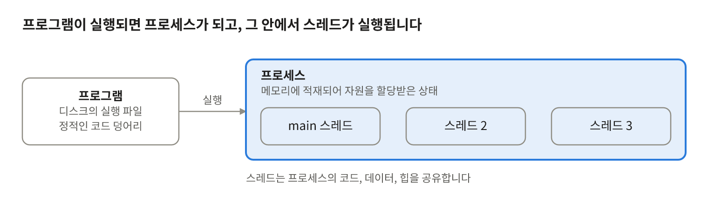

프로세스는 OS가 자원을 할당한 작업의 단위이고, 스레드는 그 자원을 공유하며 실행되는 흐름입니다.

- 프로세스는 최소 1개의 스레드(main)를 가지며, 추가 스레드는 코드에서 명시적으로 생성합니다.
- 한 프로그램이 여러 프로세스로 구성될 수 있습니다 (브라우저의 탭, GPU, 네트워크 프로세스 분리 등).

### (1) 프로세스 (Process)

실행 중인 프로그램의 인스턴스로, OS가 자원을 할당하는 기본 단위입니다.

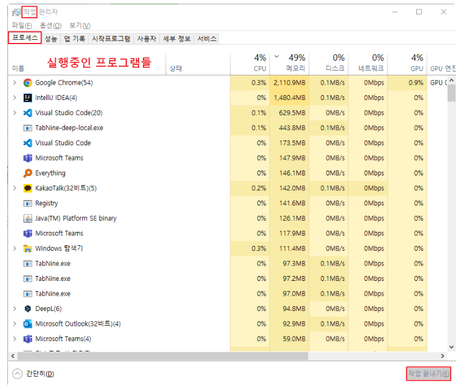

**프로세스가 가지는 것**

| 영역 | 내용 |
|---|---|
| 가상 주소 공간 | 코드, 데이터, 힙, 스택(주 스레드), 매핑된 파일/DLL |
| 핸들/FD 테이블 | 파일, 소켓, 이벤트, IOCP 핸들 등 커널 오브젝트 참조 |
| 보안 컨텍스트 | 토큰, 권한, 사용자 SID |
| 스레드 | 최소 1개 이상 |
| 커널 자료구조 | Windows: EPROCESS / Linux: task_struct(+mm_struct) |

**핵심 특성**

- 주소 공간 격리: 한 프로세스의 포인터는 다른 프로세스에서 의미가 없습니다. 한 프로세스가 크래시해도 다른 프로세스는 영향받지 않습니다.
- 무거운 생성 비용: 주소 공간(페이지 테이블), 핸들 테이블 등을 새로 구성해야 합니다. (Windows CreateProcess, Linux fork+exec)
- IPC 필요: 데이터를 공유하려면 파이프, 공유 메모리, 소켓, 메시지 큐 등 명시적 수단이 필요합니다.

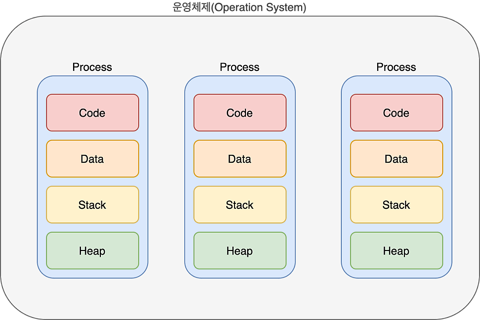

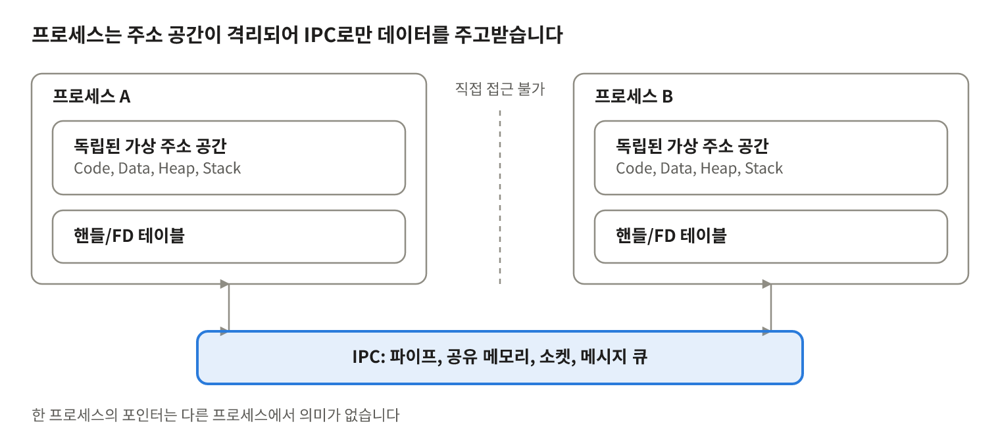

프로세스끼리는 포인터조차 공유하지 못하므로, 필요한 데이터는 OS가 제공하는 IPC로 주고받습니다.

### (2) 스레드 (Thread)

프로세스 내부의 실행 흐름 단위로, OS 스케줄러가 CPU 시간을 배분하는 기본 단위입니다.


**스레드가 등장한 이유**

- 프로세스 하나로는 다운로드와 UI 처리 같은 다중 작업을 동시에 수행하기 어렵습니다.
- 같은 작업을 프로세스 여러 개로 띄우면 주소 공간, 핸들 테이블 등 자원이 중복됩니다.
- 스레드는 자원을 공유하면서 실행 흐름만 분리해 이 비용을 줄입니다.

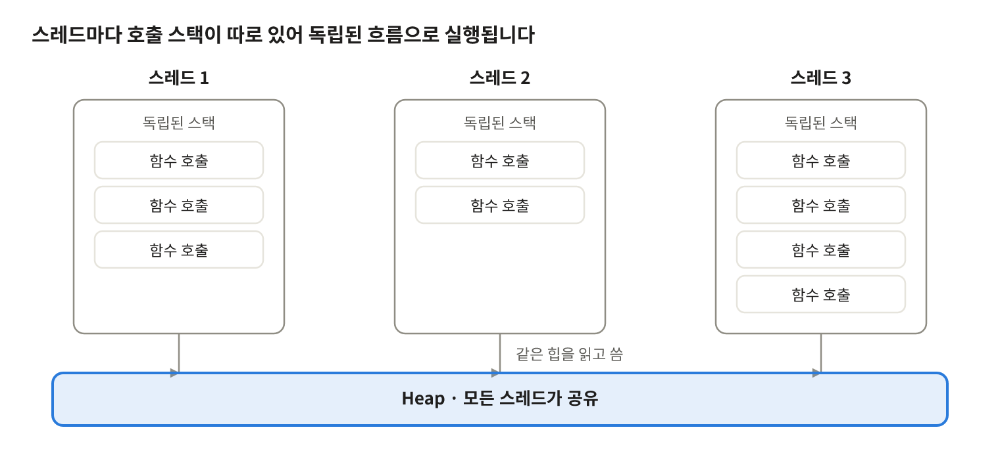

스택이 따로 있으므로 스레드는 서로 다른 깊이의 함수 호출을 독립적으로 진행하고, 힙은 함께 사용합니다.

**스레드마다 독립적인 것**

- 레지스터 집합 (PC/RIP, SP/RSP 포함)
- 스택 (기본 Windows 1MB, Linux 8MB 수준)
- TLS(Thread Local Storage)
- 스레드 ID, 우선순위, 스케줄링 상태
- 예외 처리 체인 (Windows SEH), errno/GetLastError 값

**같은 프로세스의 스레드끼리 공유하는 것**

- 코드, 전역/정적 데이터, 힙
- 핸들/FD 테이블 (소켓 하나를 모든 스레드가 접근 가능)
- 주소 공간 전체

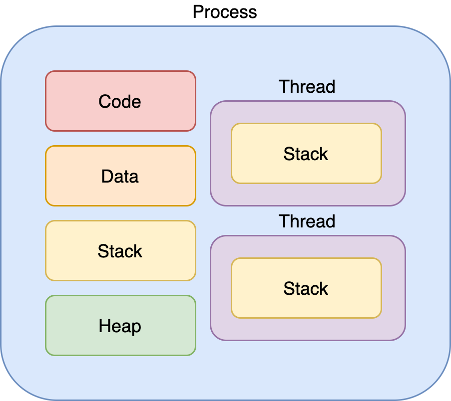

**핵심 특성**

- 생성/전환 비용이 낮음: 주소 공간 전환이 없습니다 (TLB flush 불필요).
- 데이터 공유가 쉬운 대신 동기화 책임이 개발자에게 있음: 레이스 컨디션, 데드락, 메모리 가시성 문제가 발생합니다.
- 한 스레드의 치명적 오류(access violation 등)는 프로세스 전체를 종료시킵니다.

### (3) 비교

| 항목 | 프로세스 | 스레드 |
|---|---|---|
| 자원 소유 | 독립 주소 공간 | 프로세스 자원 공유 |
| 생성 비용 | 큼 | 작음 |
| 컨텍스트 스위칭 | 비쌈 (주소 공간 전환, TLB 영향) | 상대적으로 쌈 |
| 통신 | IPC 필요 | 메모리 직접 공유 |
| 장애 격리 | 강함 | 없음 (프로세스 전체 영향) |
| 동기화 이슈 | 적음 | 많음 |

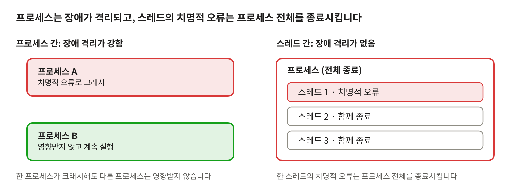

격리가 강한 프로세스와 달리 스레드는 장애 격리가 없어, 공유 상태 보호와 오류 처리를 더 신중하게 설계해야 합니다.

## 2. 프로세스 메모리 구조

프로세스는 Code, Data, Stack, Heap 영역으로 구성된 독립된 가상 주소 공간을 가집니다.

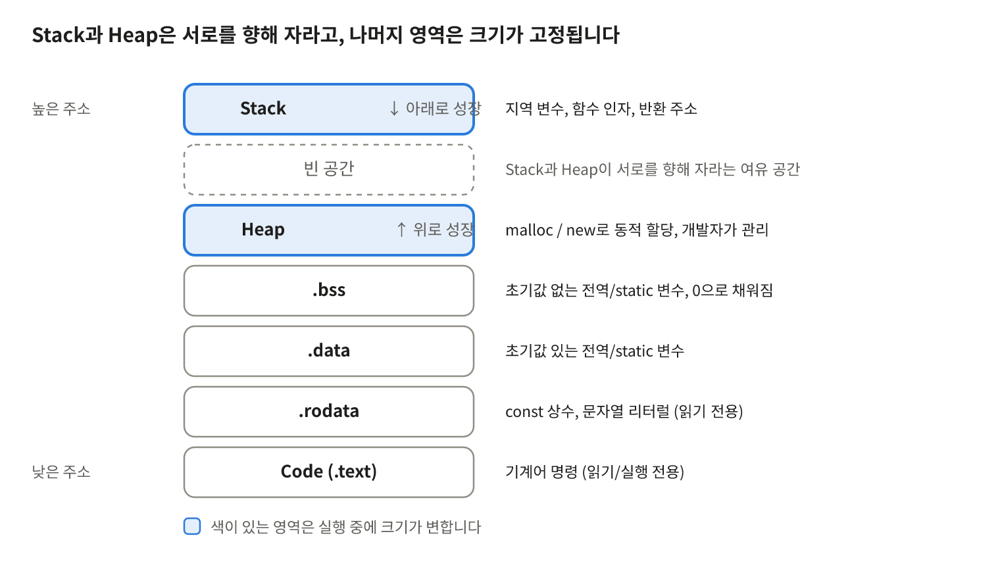

Stack은 함수 호출과 함께 늘었다 줄고, Heap은 동적 할당에 따라 늘어납니다.

| 영역 | 내용 | 특징 |
|---|---|---|
| Code (.text) | 기계어 명령 | 크기 고정, 읽기/실행 전용 (쓰기 시 access violation) |
| .data | 초기값이 있는 전역/static 변수 | 크기 고정 |
| .bss | 초기값이 없는 전역/static 변수 | 파일에는 크기만 기록, 로드 시 0으로 채움 |
| .rodata | const 상수, 문자열 리터럴 | 읽기 전용 |
| Stack | 지역 변수, 함수 인자, 반환 주소, 저장된 레지스터 | 호출 시 할당, 반환 시 해제. 초과하면 stack overflow |
| Heap | 동적 할당 객체 (malloc/new) | 개발자가 관리. 단편화와 누수 가능 |

- Code와 Data는 로드 시점에 크기가 결정되는 정적 영역입니다. Stack과 Heap은 실행 중 늘고 줄어드는 동적 영역입니다.
- 위 주소는 가상 주소입니다. 프로세스마다 독립된 페이지 테이블을 가지므로, 같은 주소값도 프로세스마다 다른 물리 메모리를 가리킵니다. 이것이 프로세스 격리의 기반입니다.
- 주소 공간에는 이 영역들 외에 DLL/공유 라이브러리와 파일 매핑 영역(mmap), 커널 공간도 포함됩니다.

## 3. 스레드의 자원 모델

같은 프로세스의 스레드는 Code, Data, Heap과 핸들 테이블을 공유하고, 스택과 레지스터만 독립으로 가집니다.

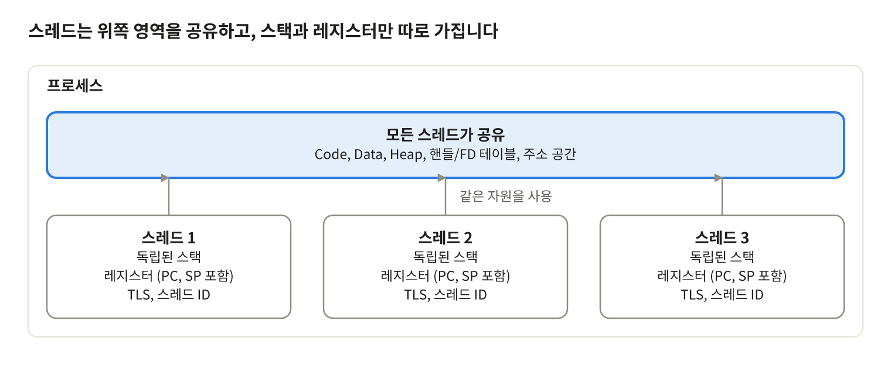

스레드마다 스택이 따로 있어 독립된 함수 호출 흐름을 가질 수 있습니다.

| 구분 | 항목 |
|---|---|
| 스레드별 독립 | 스택, 레지스터 집합(PC/RIP, SP/RSP, 범용 레지스터, 플래그), TLS, 스레드 ID, 우선순위, 스케줄링 상태, 예외 처리 체인, errno / GetLastError 값 |
| 프로세스 내 공유 | Code, Data(.data/.bss/.rodata), Heap, 핸들/FD 테이블(열린 파일, 소켓 등), 가상 주소 공간 전체, 보안 컨텍스트 |

독립된 스택이 있으면 독립적인 함수 호출 체인을 가질 수 있고, 이것이 곧 독립된 실행 흐름의 본질입니다.

**주의할 점**

- 다른 스레드의 스택도 같은 주소 공간에 있으므로 포인터를 알면 접근할 수 있습니다. 스택이 독립이라는 것은 논리적으로 분리되어 있다는 뜻이지 접근이 차단된다는 뜻이 아닙니다. 지역 변수의 주소를 다른 스레드에 넘기는 코드가 위험한 이유입니다.
- 한 스레드가 크래시하면(access violation, 미처리 예외) 프로세스 전체가 종료됩니다.

## 4. 프로세스 간 통신 (IPC)

프로세스는 주소 공간이 격리되어 있으므로 데이터를 주고받으려면 OS가 제공하는 명시적 수단이 필요합니다.

| 방식 | 특징 | Windows | Linux |
|---|---|---|---|
| 파이프 | 단방향 바이트 스트림, 부모-자식 간 | Anonymous Pipe | pipe() |
| 이름 있는 파이프 | 무관한 프로세스 간 통신 | Named Pipe | FIFO |
| 공유 메모리 | 가장 빠름(복사 없음), 동기화는 직접 구현 | File Mapping | shm_open / mmap |
| 메시지 큐 | 메시지 단위 전달 | Mailslot 등 | POSIX / SysV MQ |
| 소켓 | 로컬과 원격 모두 가능, 범용적 | Winsock | Unix Domain Socket 등 |
| 시그널 / 이벤트 | 알림 용도 | Event, Named Mutex | signal |

- 공유 메모리는 복사 비용이 없는 대신 동기화를 직접 구현해야 하며, 사실상 스레드와 같은 동기화 문제를 안게 됩니다.
- 소켓 기반 IPC는 단일 머신에서 다중 머신으로 확장하기 쉽습니다.
- 프로세스 간 전환과 통신은 스레드보다 비용이 크기 때문에, 현대 OS는 멀티 프로세싱을 지원하되 멀티 스레딩을 기본으로 합니다.

## 5. CPU의 작업 방식

CPU는 메모리에 있는 명령어를 하나씩 가져와 해석하고 실행하는 장치입니다. 프로세스와 스레드는 이 명령어의 흐름이고, OS는 그 흐름을 CPU 코어에 번갈아 배정합니다.

**명령어 사이클 (Fetch → Decode → Execute → Write-back)**

| 단계 | 동작 | 관련 요소 |
|---|---|---|
| Fetch | PC(프로그램 카운터)가 가리키는 주소의 명령어를 캐시/메모리에서 가져오고, PC를 다음 명령어로 증가 | PC, 명령어 레지스터, 명령어 캐시 |
| Decode | 제어 장치가 opcode와 피연산자를 해석하고 필요한 회로를 선택 | 제어 장치 |
| Execute | ALU 연산, 메모리 읽기/쓰기, 분기(PC 변경)를 수행 | ALU, 주소 생성 유닛 |
| Write-back | 결과를 레지스터나 메모리에 기록 | 레지스터, 데이터 캐시 |

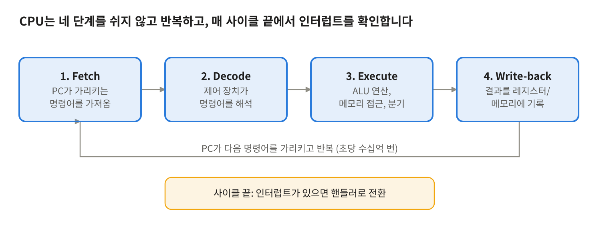

이 사이클이 클럭에 맞춰 초당 수십억 번 반복됩니다. 한 논리 코어는 한 시점에 하나의 명령어 흐름(스레드)만 실행합니다.

**CPU 안의 주요 구성 요소**

- 레지스터: 가장 빠른 저장 공간입니다. PC(다음 명령어 주소), SP(스택 꼭대기), 범용 레지스터, 플래그 레지스터가 있습니다. 스레드의 CPU 컨텍스트는 이 레지스터들의 값입니다.
- ALU: 정수 연산과 논리 연산을 수행합니다.
- 제어 장치: 명령어를 해석해 CPU 내부 동작을 지시합니다.
- 캐시 (L1/L2/L3): 느린 메모리와의 속도 차이를 줄입니다. 보통 L1, L2는 코어별이고 L3는 코어들이 공유합니다.
- MMU / TLB: 가상 주소를 물리 주소로 변환하고, 최근 변환 결과를 TLB에 캐싱합니다. 프로세스마다 주소 공간이 다르므로 프로세스 전환 시 TLB 영향을 받습니다.

**메모리 계층과 접근 시간 (대략적인 값)**

| 계층 | 접근 시간 | 특징 |
|---|---|---|
| 레지스터 | 1 cycle 이하 | 코어 내부, 용량 최소 |
| L1 캐시 | 약 1ns | 코어별, 수십 KB |
| L2 캐시 | 약 3~5ns | 코어별 또는 코어 쌍별, 수백 KB~수 MB |
| L3 캐시 | 약 10~20ns | 코어 공유, 수십 MB |
| 메인 메모리(DRAM) | 약 60~100ns | GB 단위, CPU 입장에서는 매우 느림 |

**CPU 성능을 높이는 기법**

- 파이프라인: 명령어 여러 개를 단계별로 겹쳐 실행해 처리량을 높입니다. 분기 예측이 틀리면 파이프라인을 비우고 다시 채워야 합니다.
- 슈퍼스칼라 / 비순차 실행: 한 사이클에 여러 명령어를 발행하고, 의존성이 없는 명령어를 앞당겨 실행합니다.
- 분기 예측: 조건 분기의 결과를 미리 추측해 파이프라인이 멈추지 않게 합니다.
- 캐시와 지역성: 최근 접근한 데이터(시간 지역성)와 인접한 데이터(공간 지역성)가 다시 쓰일 가능성이 높다는 점을 이용합니다.
- SMT (Hyper-Threading): 물리 코어 하나가 스레드 2개의 상태를 유지하며, 한쪽이 메모리를 기다리는 동안 다른 쪽이 실행 자원을 씁니다.

**CPU 모드와 인터럽트**

- 사용자 모드: 일반 프로그램이 실행되는 제한된 권한 모드입니다. 하드웨어와 다른 프로세스의 메모리에 직접 접근할 수 없습니다.
- 커널 모드: OS 커널이 실행되는 특권 모드입니다. 시스템 콜, 인터럽트, 예외가 발생하면 커널 모드로 전환됩니다.
- CPU는 명령어 사이클이 끝날 때마다 처리할 인터럽트가 있는지 확인하고, 있으면 현재 상태를 저장한 뒤 핸들러를 실행하고 복귀합니다.

| 구분 | 발생 원인 | 예 |
|---|---|---|
| 하드웨어 인터럽트 | 외부 장치의 비동기 신호 | 타이머, 키보드, 디스크/네트워크 I/O 완료 |
| 예외 (Exception) | 명령어 실행 중 발생한 오류나 특수 상황 | 0으로 나누기, 페이지 폴트, 잘못된 메모리 접근 |
| 시스템 콜 (트랩) | 프로그램이 커널 서비스를 의도적으로 요청 | 파일 읽기, 스레드 생성, 메모리 할당 |

**프로세스·스레드와의 연결**

- OS는 타이머 인터럽트로 CPU 제어권을 되찾고, 스케줄러가 다음 실행할 스레드를 정합니다. 선점형 스케줄링과 컨텍스트 스위칭이 이 구조 위에서 동작합니다.
- 컨텍스트 스위칭은 PC, SP, 레지스터 값을 TCB/PCB에 저장하고 다른 스레드의 값으로 바꿔 넣는 작업입니다.
- 전환 비용에는 레지스터 저장/복원뿐 아니라 캐시, TLB, 분기 예측기 상태를 잃는 간접 비용이 포함됩니다.

## 6. 동시 실행의 원리

실제 시스템은 병렬성과 동시성의 혼합입니다. 논리 코어 수만큼은 병렬로, 그 이상의 스레드는 타임슬라이스 단위로 번갈아 실행합니다.

**물리 코어와 논리 코어**

- 물리 코어: 명령을 fetch, decode, execute하는 실제 실행 유닛
- 논리 코어 (SMT / Hyper-Threading): 물리 코어 하나가 스레드 2개의 상태(레지스터 등)를 유지하며 실행 자원을 공유해 번갈아 사용
- 4코어 8스레드는 OS가 논리 코어 8개를 인식한다는 뜻입니다. 8개가 물리 코어 8개만큼의 성능을 내지는 않습니다.
- 하드웨어 스레드(논리 코어)와 소프트웨어 스레드(OS 스레드)는 다른 개념입니다.

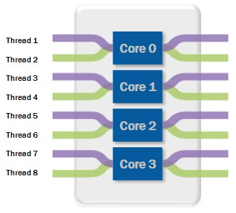

**병렬성과 동시성**

|  | 병렬성 (Parallelism) | 동시성 (Concurrency) |
|---|---|---|
| 의미 | 실제로 동시에 실행 | 번갈아 실행하며 동시에 진행되는 것처럼 보임 |
| 필요 조건 | 멀티 코어 | 싱글 코어로도 가능 |
| 목적 | 처리량(throughput) 향상 | 응답성 향상, I/O 대기 중 자원 활용 |


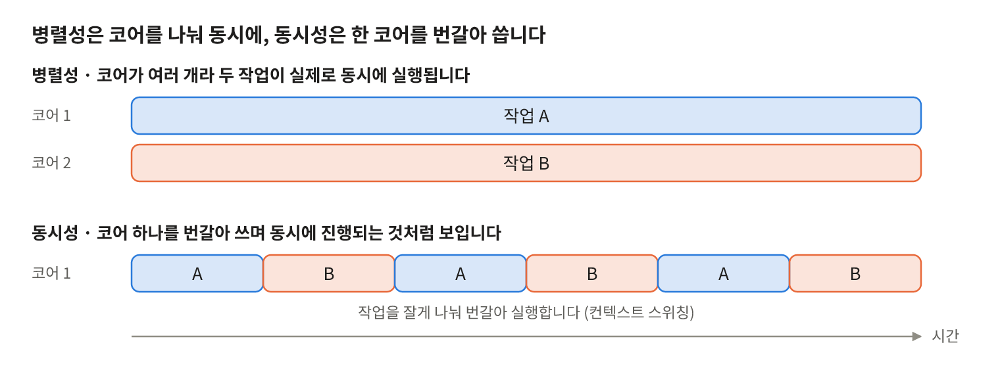

코어 수보다 작업이 많으면 작업을 잘게 나눠 번갈아 실행하며, 이 전환이 컨텍스트 스위칭입니다.

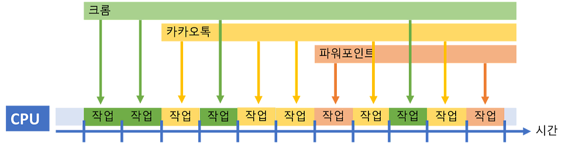

**동시성이 필요한 이유**

1. 하드웨어 한계: 클럭 상승은 발열과 전력 문제로 막혔고, 코어 수도 수백 개의 프로세스를 따라갈 수 없습니다.
2. 응답성: 긴 작업이 코어를 독점하면 짧은 작업이 오래 대기합니다. 작업을 잘게 나눠 번갈아 실행하면 대화형 작업의 반응이 빨라집니다.
3. I/O 대기 활용: 디스크나 네트워크를 기다리는 스레드는 CPU가 필요 없으므로, 그동안 다른 스레드를 실행해 CPU를 놀리지 않습니다. 실질적으로 가장 큰 이유입니다.

## 7. 스케줄링

스케줄러는 Ready 상태의 스레드 중 다음에 CPU를 줄 대상을 고르며, 현대 범용 OS는 모두 선점형이고 스레드 단위로 스케줄링합니다.

**방식**

- 비선점형: 실행 중인 작업이 스스로 양보하거나 끝날 때까지 CPU를 유지
- 선점형: 타임슬라이스 만료나 더 높은 우선순위 작업 도착 시 CPU를 강제로 회수

**주요 알고리즘**

| 알고리즘 | 동작 | 장점 | 단점 |
|---|---|---|---|
| FCFS | 도착 순 | 단순 | Convoy effect (긴 작업 뒤에서 짧은 작업이 대기) |
| SJF / SRTF | 실행 시간이 짧은 순 (SRTF는 선점형) | 평균 대기시간 최소 | 실행 시간 예측 필요, 긴 작업 기아 |
| Priority | 우선순위 순 | 중요 작업 우선 | 기아 발생, aging으로 완화 |
| Round Robin | 동일한 time quantum씩 순환 | 공평, 응답성 좋음 | quantum이 작으면 스위칭 오버헤드, 크면 FCFS화 |
| Multilevel Queue | 큐를 성격별로 분리 (시스템, 대화형, 배치) | 작업 유형별 정책 적용 | 큐 간 이동 불가 |
| MLFQ | 큐 간 이동 허용 (CPU를 오래 쓰면 강등) | 짧은 작업과 대화형 작업을 자동으로 우대 | 파라미터 튜닝이 복잡 |

**평가 지표:** CPU 이용률, 처리량(throughput), 반환시간(turnaround), 대기시간(waiting), 응답시간(response)

**실제 OS**

- Windows: 우선순위 기반 선점형, 레벨 0~31 (16~31은 실시간 클래스). 같은 우선순위끼리는 RR이며, I/O 완료나 포그라운드 전환 시 동적 우선순위 부스트가 있습니다.
- Linux: 일반 작업은 공정성 기반 스케줄러를 사용합니다 (CFS, 6.6 이후 EEVDF로 대체). 실시간 작업은 SCHED_FIFO / SCHED_RR입니다.
- 두 OS 모두 프로세스가 아니라 스레드가 스케줄링 대상입니다. 프로세스는 자원 컨테이너입니다.

## 8. 상태 모델

프로세스와 스레드는 New, Ready, Running, Waiting, Terminated의 5가지 상태를 오가며, 상태 전이는 스케줄러와 이벤트 완료가 일으킵니다.

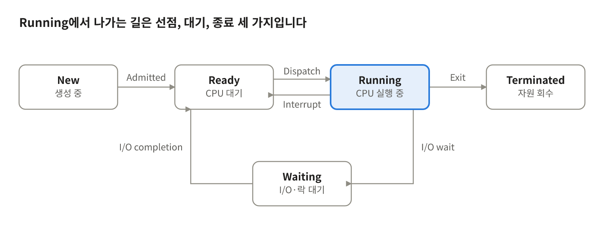

Ready와 Running 사이의 전환은 스케줄러가, Waiting에서 Ready로의 전환은 I/O나 이벤트 완료(인터럽트)가 일으킵니다.

| 전이 | 의미 |
|---|---|
| Admitted (New → Ready) | 생성을 승인받아 실행 준비 완료 |
| Dispatch (Ready → Running) | 스케줄러가 준비 상태의 작업 하나를 선택해 CPU 할당 |
| Interrupt (Running → Ready) | 타임슬라이스 만료나 더 높은 우선순위 작업 등장으로 선점 |
| I/O wait (Running → Waiting) | I/O, 락, 이벤트를 기다리며 CPU를 반납 |
| I/O completion (Waiting → Ready) | 대기하던 이벤트가 끝나 다시 스케줄 대상이 됨 |
| Exit (Running → Terminated) | 실행을 마치고 종료 |

- 대기 중에는 CPU를 소비하지 않습니다. 반면 스핀락의 busy-wait는 Running 상태에서 CPU를 소모합니다.
- Java 스레드 상태는 NEW, RUNNABLE, BLOCKED / WAITING / TIMED_WAITING, TERMINATED입니다. Java 런타임 모델이며, OS 일반 모델의 Ready와 Running이 RUNNABLE로 합쳐진 형태입니다.

## 9. PCB와 TCB

PCB는 프로세스 단위, TCB는 스레드 단위로 OS가 유지하는 커널 자료구조이며, 컨텍스트 스위칭 때 상태를 저장하고 복원하는 저장소 역할을 합니다. 프로세스 하나에 PCB는 1개, TCB는 N개입니다.

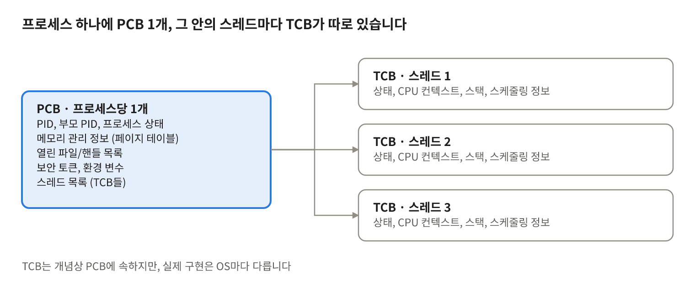

PCB는 프로세스 전체의 정보를, TCB는 스레드별 실행 상태를 보관합니다.

**PCB (Process Control Block)**

| 항목 | 내용 |
|---|---|
| PID / PPID | 프로세스 식별자 / 부모 프로세스 |
| 상태 | New, Ready, Running, Waiting, Terminated |
| 메모리 관리 정보 | 페이지 테이블 포인터(CR3), 메모리 제한, 세그먼트 정보 |
| 자원 정보 | 열린 파일/핸들 목록, 보안 토큰, 환경 변수 |
| 스레드 목록 | 이 프로세스에 속한 TCB들 |
| 계정 정보 | CPU 사용 시간, 우선순위 등 |

**TCB (Thread Control Block)**

| 항목 | 내용 |
|---|---|
| TID / 소속 PID | 스레드 식별자, 소속 프로세스 |
| 상태 | Ready, Running, Waiting 등 |
| CPU 컨텍스트 | PC, SP, 범용 레지스터, 플래그 (스위칭 시 저장/복원 대상) |
| 스택 정보 | 사용자/커널 스택 포인터와 범위 |
| 스케줄링 정보 | 우선순위, 타임슬라이스 잔량, 어피니티 |
| 대기 정보 | 어떤 락/이벤트를 기다리는지 (뮤텍스, 세마포어 관련 정보 포함) |
| TLS 포인터 | 스레드별 저장소 |

**OS별 구현**

- Windows: EPROCESS / ETHREAD (+ KPROCESS / KTHREAD)로 분리된 별개 객체
- Linux: 스레드도 task_struct이며 mm_struct 등을 공유하는 방식
- 개념상 TCB가 PCB에 속하지만, 실제 구현은 OS마다 다릅니다.

## 10. 컨텍스트 스위칭

컨텍스트 스위칭은 실행 중인 작업의 CPU 상태를 저장하고 다음 작업의 상태를 복원하는 과정이며, 직접 비용보다 캐시와 TLB 오염 같은 간접 비용이 큽니다.

**발생 시점**

- 비자발적: 타임슬라이스 만료, 더 높은 우선순위 스레드가 Ready가 됨
- 자발적: I/O, 락, 이벤트 대기(block), Sleep / yield, 종료
- 인터럽트나 시스템 콜로 커널에 진입한 뒤 스케줄러가 호출되면서 일어납니다.

**절차 (P1에서 P2로)**

1. 인터럽트 또는 시스템 콜로 커널 모드에 진입합니다.
2. P1의 CPU 컨텍스트(레지스터, PC, SP)를 PCB1 / TCB1에 저장합니다.
3. 스케줄러가 다음 실행 대상 P2를 선택합니다.
4. 다른 프로세스라면 주소 공간을 전환합니다 (CR3 교체, TLB 영향).
5. P2의 컨텍스트를 복원합니다.
6. 사용자 모드로 복귀해 P2를 중단된 지점부터 재개합니다.

이 과정에서 CPU는 유용한 작업을 하지 못하며, 이 간극이 스위칭 오버헤드입니다.

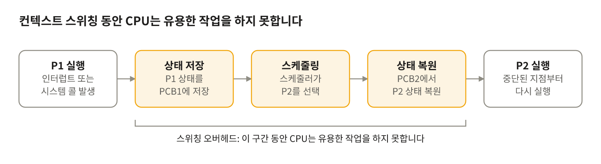

저장과 복원, 스케줄링이 끝날 때까지 CPU는 어느 쪽 작업도 진행하지 못합니다.

**비용**

| 구분 | 내용 |
|---|---|
| 직접 비용 | 모드 전환, 레지스터 저장/복원, 스케줄러 실행 (보통 수 µs 이하) |
| 간접 비용 | 새 작업 집합으로 인한 캐시 오염과 미스 증가, 분기 예측기 상태 손실, TLB 미스. 직접 비용보다 큰 경우가 많음 |

**프로세스 간 vs 같은 프로세스 내 스레드 간**

| 항목 | 같은 프로세스 내 스레드 | 다른 프로세스 간 |
|---|---|---|
| 주소 공간 전환 | 없음 (CR3 유지) | 필요 (CR3 교체) |
| TLB | 유지 | 무효화 (PCID/ASID가 있으면 부분 완화) |
| 저장/복원 대상 | 레지스터, 스택 포인터 | 위 항목 + 메모리 관리 컨텍스트 |
| 캐시 지역성 | 코드와 힙 데이터를 공유하므로 유지될 가능성이 높음 | 작업 집합이 완전히 바뀜 |
| 상대 비용 | 낮음 | 높음 |

- 물리 태그 캐시는 스위칭 때 플러시되지 않습니다. 정확히는 캐시가 초기화되는 것이 아니라, 새 프로세스의 데이터가 채워지면서 이전 데이터가 밀려납니다.
- 스레드 전환이라도 다른 코어로 옮겨 가면 해당 코어의 캐시가 비어 있어 비용이 발생합니다. 그래서 프로세서 어피니티와 이상적 프로세서(ideal processor) 개념이 있습니다.

**스레드를 많이 쓸수록 빨라지지 않는 이유**

- 스위칭 오버헤드와 캐시/TLB 오염
- 스레드가 늘수록 락 경합으로 대기 시간이 증가
- 코어 수를 넘는 CPU 바운드 스레드는 병렬성이 늘지 않고 스위칭만 늘어남
- 스레드마다 스택 메모리를 소비

## 11. 멀티 프로세스 vs 멀티 스레드

멀티 스레드는 가볍고 통신이 빠른 대신 동기화 부담과 장애 전파를 안고, 멀티 프로세스는 격리가 강한 대신 생성과 통신 비용이 큽니다.

| 항목 | 멀티 프로세스 | 멀티 스레드 |
|---|---|---|
| 메모리 | 프로세스마다 독립 (사용량 큼) | 공유 (사용량 작음) |
| 생성 비용 | 큼 | 작음 |
| 컨텍스트 스위칭 | 비쌈 | 상대적으로 쌈 |
| 통신 | IPC 필요 (복잡, 상대적으로 느림) | 메모리 직접 공유 (빠르고 단순) |
| 동기화 | 공유 자원이 없으면 불필요 | 필수 (race, deadlock 위험) |
| 장애 격리 | 강함 (한 프로세스가 죽어도 다른 프로세스는 생존) | 약함 (한 스레드 크래시 = 프로세스 전체 종료) |
| 디버깅 | 상대적으로 쉬움 | 재현하기 어려운 타이밍 버그 |
| 보안 경계 | 프로세스 경계 활용 가능 | 같은 권한, 같은 주소 공간 |

**선택 기준**

- 프로세스 분리가 유리한 경우: 장애 격리, 보안 경계, 플러그인/샌드박스, 주기적 재시작이 필요한 경우, 수평 확장(채널/월드 단위)
- 스레드가 유리한 경우: 대량의 공유 상태를 낮은 지연으로 접근해야 할 때, 짧은 작업을 빈번히 병렬 처리할 때
- 실무에서는 혼합이 일반적입니다. 프로세스는 격리 단위로 쓰고, 프로세스 내부는 스레드 풀과 비동기 I/O로 구성합니다.

## 12. 스레드 동기화

스레드는 Heap과 전역 데이터를 공유하므로, 공유 자원에 접근하는 모든 구간은 동기화 책임이 개발자에게 있습니다.

**문제**

| 문제 | 설명 |
|---|---|
| Race condition | 실행 순서에 따라 결과가 달라짐. counter++는 load, add, store 3단계라 비원자적 |
| Data race | 동기화 없이 같은 메모리를 동시에 접근하고 하나 이상이 쓰기인 경우. C++에서는 정의되지 않은 동작 |
| 가시성 / 재정렬 | 컴파일러와 CPU의 재정렬, 코어별 캐시와 스토어 버퍼 때문에 다른 스레드에 쓰기 순서가 다르게 보임 |
| 임계 영역 | 공유 자원에 접근하는 코드 구간. 상호 배제가 필요 |

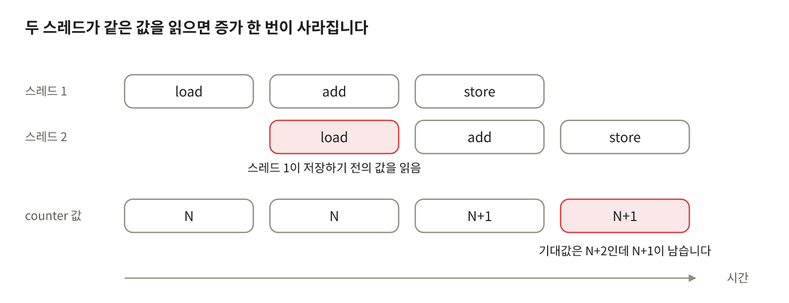

counter++는 load, add, store 3단계라서, 두 스레드가 겹치면 한 번의 증가가 덮어써집니다.

**도구**

| 수단 | 특징 |
|---|---|
| Mutex | 임계 영역에 1개 스레드만 진입. 소유권 개념이 있고(잠근 스레드가 해제), 획득 실패 시 대기 상태로 전환 |
| Critical Section (Windows) | 프로세스 내부 전용 경량 mutex. spin 후 대기 |
| Semaphore | 카운터로 동시 진입 수를 제한 (자원 풀, 생산자-소비자). 소유권 없음 |
| SpinLock | busy-wait. 매우 짧은 임계 영역, 커널, 비선점 환경에 적합 |
| RW Lock (SRWLock) | 읽기 다중 / 쓰기 단독 |
| Condition Variable | 조건 대기와 통지. 반드시 predicate 루프와 함께 사용 (spurious wakeup 대응) |
| Atomic / Lock-free | CAS 기반. 메모리 오더링(relaxed, acquire, release, seq_cst) 이해 필수 |

**데드락**

- 4가지 필요조건: 상호 배제, 점유 대기, 비선점, 순환 대기
- 락 획득 순서를 전역적으로 고정하면 순환 대기를 제거할 수 있습니다.
- 한 번에 모든 락을 획득합니다 (std::scoped_lock, std::lock).
- 타임아웃이 있는 try-lock을 사용합니다.
- 락 범위를 최소화하고, 락 안에서 외부 콜백이나 I/O를 호출하지 않습니다.

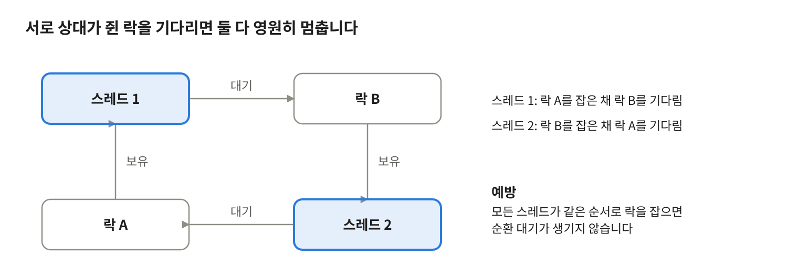

락 획득 순서를 고정하면 이 순환 대기가 생기지 않아 데드락을 예방할 수 있습니다.

**기타 위험**

- Starvation (기아), Livelock
- Priority inversion: 낮은 우선순위 스레드가 락을 쥐고 있어 높은 우선순위 스레드가 대기
- False sharing: 서로 다른 스레드가 쓰는 변수가 같은 캐시 라인(보통 64B)에 있으면 캐시 라인이 코어 사이를 왕복하며 성능이 급락합니다. alignas(64)로 분리합니다.

## 13. 스레드 수 결정

스레드 수는 작업 유형별 시작점에서 출발해 반드시 측정으로 조정합니다.

| 작업 유형 | 시작점 | 이유 |
|---|---|---|
| CPU 바운드 | 코어 수 N (또는 N+1) | 코어를 초과하면 스위칭만 증가 |
| I/O 바운드 | N × (1 + 대기시간 / 연산시간) | 대기 중 다른 스레드가 CPU를 사용 |
| 비동기 I/O (IOCP, epoll) | 워커 수 ≈ 코어 수 | 대기를 커널에 위임하므로 스레드가 블로킹되지 않음 |

- 연결당 스레드 모델은 연결 수가 늘면 스택 메모리(스레드당 1MB 안팎)와 스위칭 비용으로 한계에 부딪힙니다.
- Amdahl의 법칙: 직렬 구간의 비율이 s이면 이론적 최대 가속은 1/s를 넘지 못합니다. 코어를 늘려도 직렬 구간(락으로 보호되는 구간 등)이 병목이 됩니다.

```latex
S(N) = \frac{1}{s + \frac{1 - s}{N}}
```

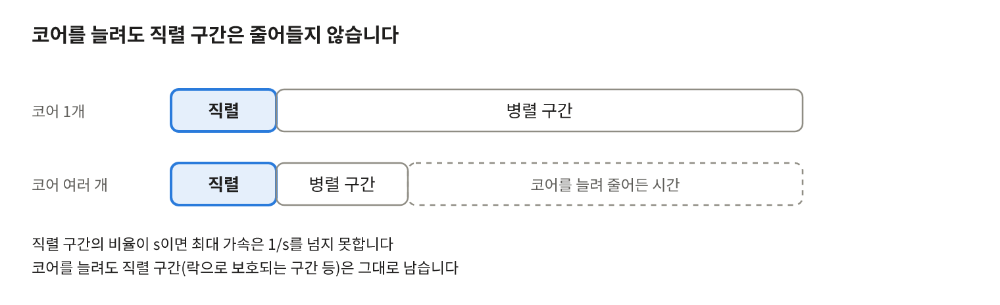

줄어드는 시간은 병렬 구간뿐이라, 직렬 구간이 최대 가속의 한계가 됩니다.

## 14. OS별 구현

Windows는 프로세스와 스레드를 별개 객체로 다루고, Linux는 둘 다 clone() 플래그 조합으로 만든 task로 다룹니다.

| 항목 | Windows | Linux |
|---|---|---|
| 프로세스 생성 | CreateProcess (새 이미지를 처음부터 로드) | fork (COW 복제) + exec |
| 스레드 생성 | CreateThread / _beginthreadex | pthread_create → clone() |
| 내부 구조 | EPROCESS / ETHREAD | task_struct (스레드도 task, TGID로 그룹화) |
| 스택 기본 크기 | 1MB (링커 설정) | 8MB (ulimit -s) |
| 경량 실행 단위 | Fiber, 스레드 풀 | (라이브러리 수준 코루틴) |
| 비동기 I/O | IOCP, RIO | epoll, io_uring |
| 스레드 이름 | SetThreadDescription | pthread_setname_np |

- Linux의 fork는 Copy-On-Write로 페이지를 공유하다가 쓰기 시점에 복사하므로, 호출 자체의 비용은 페이지 테이블 복제 정도입니다.
- Linux에서는 프로세스와 스레드 모두 clone()의 플래그 조합(CLONE_VM, CLONE_FILES, CLONE_SIGHAND 등)으로 만들어지며, 차이는 공유 범위뿐입니다.

## 15. 스레드 모델

Windows와 Linux를 포함한 주요 OS는 1:1 모델을 쓰며, 서버에서는 스레드 풀과 비동기 I/O를 조합해 스레드 수를 코어 수 근처로 묶는 것이 일반적입니다.

| 모델 | 설명 | 예 |
|---|---|---|
| 1:1 (커널 스레드) | 사용자 스레드 1개 = 커널 스레드 1개. 커널이 직접 스케줄링하므로 멀티코어를 활용하고, 한 스레드의 블로킹이 다른 스레드를 막지 않음 | Windows, Linux pthread, Java |
| N:1 (사용자 스레드) | 라이브러리가 스케줄링하고 커널은 1개로 인식. 전환이 가볍지만 멀티코어를 못 쓰고, 한 스레드가 블로킹되면 전체가 멈춤 | 초기 green thread |
| M:N | 사용자 태스크 M개를 커널 스레드 N개에 다중화. 가볍고 멀티코어도 활용하지만 런타임이 복잡 | Go goroutine, Fiber / 코루틴 계열 |

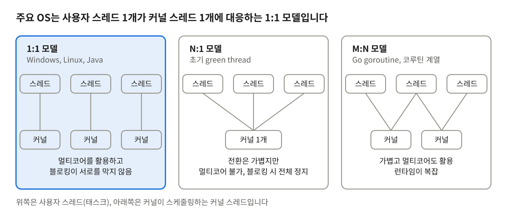

1:1 모델은 커널이 스레드를 직접 스케줄링해 멀티코어를 활용하고, N:1과 M:N은 런타임이 스케줄링을 일부 맡습니다.

**서버에서의 선택**

- 연결당 스레드 모델은 연결 수가 늘면 스택 메모리와 컨텍스트 스위칭 비용으로 한계에 부딪힙니다.
- 일반적인 구성은 스레드 풀 + 비동기 I/O(IOCP, epoll, io_uring)입니다. 대기를 커널에 위임하므로 워커 스레드가 블로킹되지 않고, 스레드 수를 코어 수 근처로 유지할 수 있습니다.
- IOCP는 완료 포트에 동시에 실행되는 스레드 수(concurrency)를 코어 수 기준으로 제한해, 활성 스레드가 코어 수를 넘지 않도록 조절합니다.

**게임 서버의 혼합 구조**

- 프로세스 = 월드 / 존 / 채널 단위 (장애 격리, 수평 확장, 메모리 초기화 단위)
- 프로세스 내부 = IOCP 워커 스레드(I/O 완료 처리) + 로직 스레드(게임 상태 갱신)
- 세션 테이블 같은 대량의 공유 상태는 프로세스 내부 스레드끼리 메모리로 직접 공유합니다.

## 16. 메모리 관점

스택은 스레드마다 고정 크기로 따로 있고, 힙은 프로세스가 공유하므로 힙 할당 경합과 캐시 라인 공유가 멀티 스레드 성능의 주된 병목이 됩니다.

| 대상 | 특징 | 대응 |
|---|---|---|
| 스택 | 스레드별 고정 크기 (Windows 기본 1MB, Linux 8MB 수준). 깊은 재귀나 큰 지역 배열은 stack overflow를 유발 | 큰 버퍼는 힙이나 풀에 두고, 재귀 깊이를 제한 |
| 힙 | 프로세스 공유. 다중 스레드가 할당할 때 락 경합이 생김 | 스레드별 캐시를 쓰는 할당자(tcmalloc, jemalloc, mimalloc, Windows LFH)나 커스텀 오브젝트 풀 |
| TLS | 스레드별 저장소. thread_local, __declspec(thread), TlsAlloc | 락 없이 스레드별 상태(할당 캐시, 임시 버퍼 등)를 유지 |
| False sharing | 서로 다른 스레드가 쓰는 변수가 같은 캐시 라인(통상 64B)에 있으면 캐시 라인이 코어 사이를 왕복하며 성능이 급락 | alignas(64) 패딩으로 분리 |

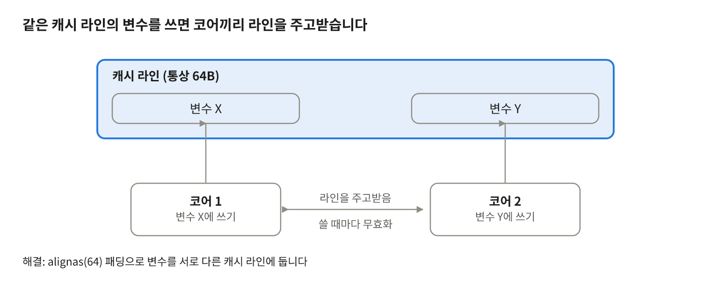

변수는 서로 다르지만 캐시 라인은 하나라서, 쓰기마다 라인이 코어 사이를 왔복합니다.

- 스택 크기는 스레드 수와 곱해져 메모리 사용량을 결정합니다. 스레드를 수천 개 만드는 설계가 어려운 이유입니다.
- 락 없이 공유 상태를 읽는 구조라도 같은 캐시 라인에 쓰기가 몰리면 사실상 직렬화됩니다. 락을 제거해도 성능이 오르지 않는 흔한 원인입니다.
- 공유 객체의 수명은 참조 카운트(shared_ptr, 침입형 RC)로 관리하되, 카운트 연산(atomic)도 캐시 라인 경합을 일으킨다는 점을 알고 있어야 합니다.

## 17. 실무 체크포인트

서버에서 스레드를 다룰 때는 스레드 수를 측정으로 정하고, 락 경합 지점을 한 곳으로 모으며, 종료와 진단 경로를 처음부터 설계합니다.

**(1) 스레드 수:** 워커 스레드 수는 CPU 바운드 ≈ 코어 수, I/O 바운드 ≈ 코어 수 × α에서 시작해 측정으로 조정합니다.

**(2) 임계 영역:** 임계 영역은 최소화하고, 락 안에서 I/O, 메모리 할당, 외부 콜백 호출을 피합니다.

**(3) 큐 기반 설계:** 생산자/소비자, 더블 버퍼, 락프리 큐처럼 큐 기반으로 설계해 락 경합 지점을 한 곳으로 모읍니다.

**(4) 종료 처리:** 스레드 종료는 협조적 종료(종료 플래그 + 대기 중인 스레드 깨우기)로 처리합니다. TerminateThread는 락을 쥔 채 스레드를 죽여 데드락과 누수를 유발하므로 사용하지 않습니다.

**(5) 진단 준비:** 스레드 이름을 지정하고(SetThreadDescription) 미니덤프를 준비해 크래시와 행(hang) 분석이 가능하게 합니다.

**(6) 객체 수명:** 공유 객체의 수명은 참조 카운트로 관리하되, 카운트 연산 자체의 캐시 라인 경합도 인지합니다.

**(7) 동기화 선택:** 임계 영역이 짧고 경합이 낮으면 스핀락이나 SRWLock, 길거나 대기가 필요하면 mutex나 condition variable을 씁니다. Condition variable은 항상 predicate 루프와 함께 사용합니다.

**(8) 락 순서:** 여러 락을 잡아야 하면 획득 순서를 전역적으로 고정하고, 가능하면 한 번에 획득합니다.

## 18. 정리

**(1) 프로세스와 스레드의 차이는?** 프로세스는 독립된 주소 공간과 자원을 가진 할당 단위이고, 스레드는 그 안에서 Code, Data, Heap을 공유하며 스택과 레지스터만 독립으로 가지는 실행 단위입니다.

**(2) 멀티 스레드가 멀티 프로세스보다 가벼운 이유는?** 생성 시 주소 공간 구성이 필요 없고, 스위칭 시 주소 공간 전환(TLB 영향)이 없으며, 통신이 메모리 공유로 이루어지기 때문입니다.

**(3) 멀티 스레드의 단점은?** 동기화 문제(race, deadlock), 디버깅 난이도, 한 스레드의 오류가 프로세스 전체에 영향을 주는 점입니다.

**(4) 컨텍스트 스위칭이란?** 실행 중인 작업의 CPU 상태를 저장하고 다음 작업의 상태를 복원하는 과정입니다. 직접 비용보다 캐시와 TLB 오염 같은 간접 비용이 큽니다.

**(5) 병렬성과 동시성의 차이는?** 병렬성은 여러 코어에서 실제로 동시에 실행하는 것이고, 동시성은 번갈아 실행해 동시에 진행되는 것처럼 보이게 하는 것입니다.

**(6) 스레드가 많을수록 빠른가?** 아닙니다. 코어 수를 넘는 CPU 바운드 스레드는 스위칭과 락 경합만 늘립니다.
